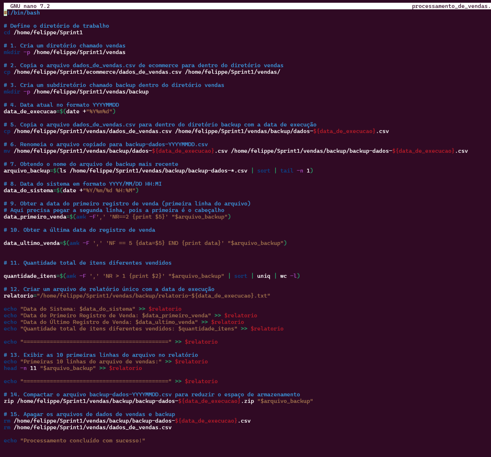
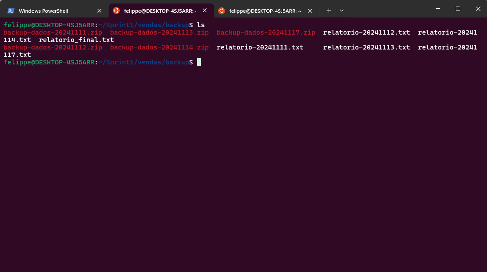
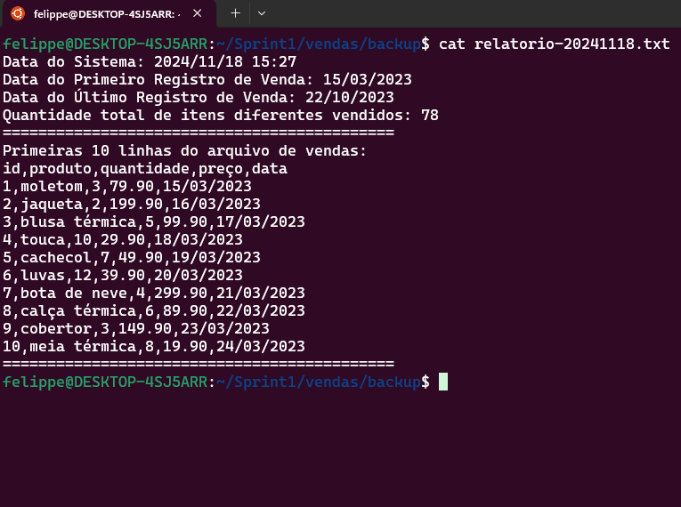
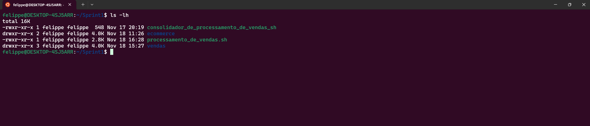
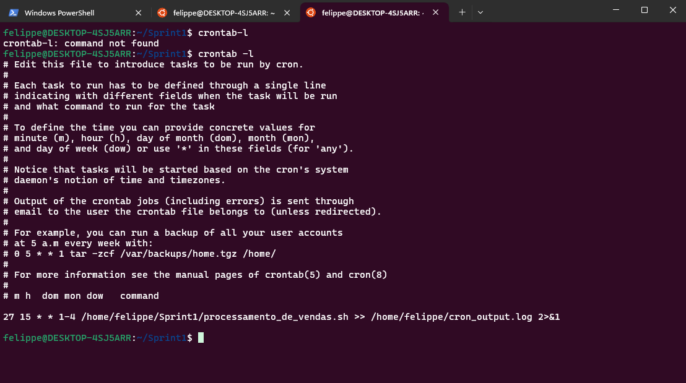
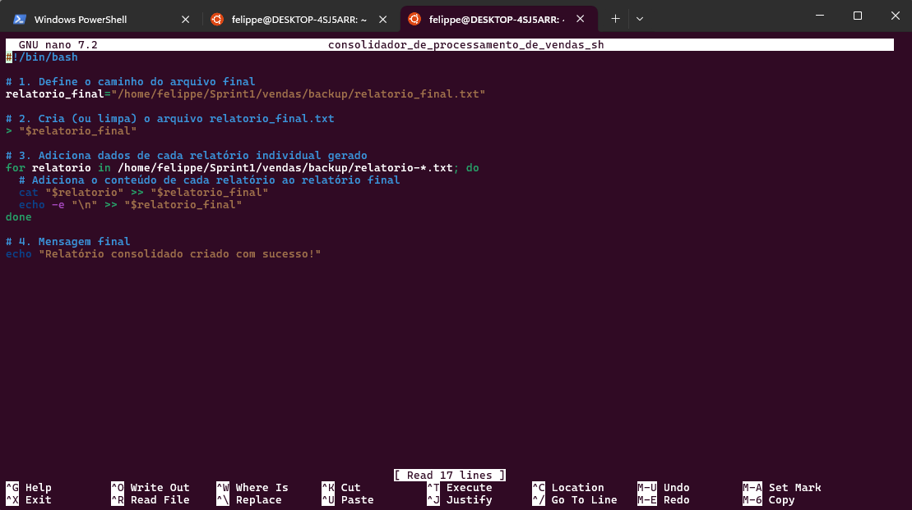
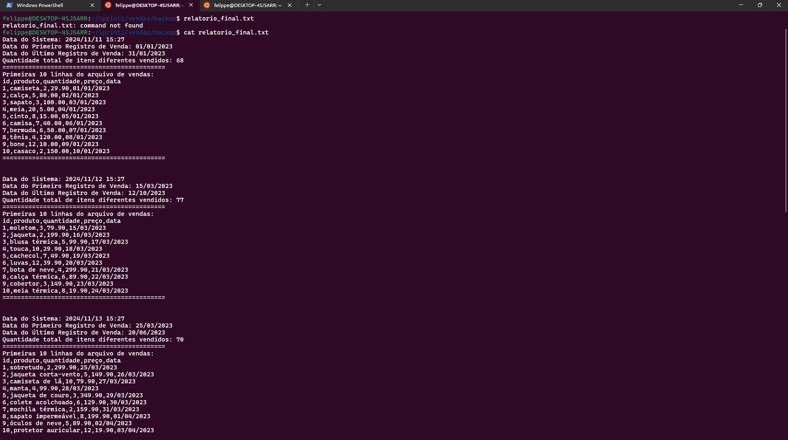

# Desafio
Neste desafio, foi necessário criar um script em Bash para automatizar o processamento de dados de vendas. O objetivo era realizar uma série de etapas, como criar diretórios, copiar arquivos, gerar backups com datas, extrair dados do arquivo CSV de vendas e gerar relatórios com informações como a data de execução, primeiras e últimas vendas, e a quantidade de itens diferentes vendidos. Também foi necessário compactar arquivos para economizar espaço e, por fim, excluir arquivos temporários.

Além disso, o desafio incluiu a configuração do agendamento automatizado do script usando o cron, uma ferramenta do Linux, para garantir que o script fosse executado diariamente em horários específicos.

Por fim, o desafio envolveu a criação de um script adicional para consolidar todos os relatórios gerados em um único arquivo de relatório final, centralizando as informações de todos os processos realizados.


# Índice

- [Desafio](#desafio)
- [Índice](#índice)
  - [Criar um arquivo executável](#criar-um-arquivo-executável)
    - [Especificar o interpretador (bash)](#especificar-o-interpretador-bash)
    - [Definir o diretório de trabalho](#definir-o-diretório-de-trabalho)
    - [Criação de diretórios e cópia de arquivos](#criação-de-diretórios-e-cópia-de-arquivos)
      - [1. Criar diretório vendas](#1-criar-diretório-vendas)
      - [2. Copiar arquivo de vendas](#2-copiar-arquivo-de-vendas)
      - [3. Criar subdiretório backup](#3-criar-subdiretório-backup)
    - [Operações com data](#operações-com-data)
      - [4. Obter data atual](#4-obter-data-atual)
      - [5. Copiar arquivo para backup com data de execução](#5-copiar-arquivo-para-backup-com-data-de-execução)
      - [6. Renomear arquivo copiado](#6-renomear-arquivo-copiado)
      - [7. Obter nome do arquivo de backup mais recente](#7-obter-nome-do-arquivo-de-backup-mais-recente)
      - [8. Obter data do sistema](#8-obter-data-do-sistema)
    - [Extração de dados e relatório](#extração-de-dados-e-relatório)
      - [9. Obter data do primeiro registro de venda](#9-obter-data-do-primeiro-registro-de-venda)
      - [10. Obter última data de registro de venda](#10-obter-última-data-de-registro-de-venda)
      - [11. Contar itens diferentes vendidos](#11-contar-itens-diferentes-vendidos)
      - [12. Criar relatório único](#12-criar-relatório-único)
      - [13. Exibir primeiras 10 linhas no relatório](#13-exibir-primeiras-10-linhas-no-relatório)
    - [Operações de backup e limpeza](#operações-de-backup-e-limpeza)
      - [14. Compactar arquivo de backup](#14-compactar-arquivo-de-backup)
      - [15. Apagar arquivos temporários](#15-apagar-arquivos-temporários)
      - [16. Mensagem final](#16-mensagem-final)
  - [Resultados do Script](#resultados-do-script)
  - [Concedendo permissões](#concedendo-permissões)
      - [1. Usando o chmod](#1-usando-o-chmod)
  - [Agendamento com cron](#agendamento-com-cron)
    - [1. Instalar o cron](#1-instalar-o-cron)
    - [2. Editar o arquivo crontab](#2-editar-o-arquivo-crontab)
    - [3. Adicionar agendamento no crontab](#3-adicionar-agendamento-no-crontab)
  - [Consolidação de relatórios](#consolidação-de-relatórios)
    - [1. Criar arquivo final consolidado](#1-criar-arquivo-final-consolidado)
    - [2. Adicionar relatórios individuais ao arquivo final](#2-adicionar-relatórios-individuais-ao-arquivo-final)
    - [3. Mensagem final](#3-mensagem-final)

## Criar um arquivo executável
 
Na primeira parte do desafio, foi necessário criar um arquivo executável chamado processamento_de_vendas.sh. Para isso, foi ultilizado o editor de texto *nano* para escrever o script que seria responsável pelas próximas etapas do processamento. O uso do nano é simples e eficiente, permitindo editar e salvar o arquivo de forma rápida.


### Especificar o interpretador (bash)
```bash
#!/bin/bash
```

### Definir o diretório de trabalho
```bash
cd /home/felippe/Sprint1
```

### Criação de diretórios e cópia de arquivos

#### 1. Criar diretório vendas
```bash
mkdir -p vendas
```

#### 2. Copiar arquivo de vendas
```bash
cp ecommerce/dados_de_vendas.csv vendas/
```

#### 3. Criar subdiretório backup
```bash
mkdir -p vendas/backup
```

### Operações com data

#### 4. Obter data atual
```bash
data_de_execucao=$(date +"%Y%m%d")
```

#### 5. Copiar arquivo para backup com data de execução
```bash
cp vendas/dados_de_vendas.csv vendas/backup/dados-${data_de_execucao}.csv
```

#### 6. Renomear arquivo copiado
```bash
mv vendas/backup/dados-${data_de_execucao}.csv vendas/backup/backup-dados-${data_de_execucao}.csv
```

#### 7. Obter nome do arquivo de backup mais recente
```bash
arquivo_backup=$(ls vendas/backup/backup-dados-*.csv | sort | tail -n 1)
```

#### 8. Obter data do sistema
```bash
data_do_sistema=$(date +"%Y/%m/%d %H:%M")
```

### Extração de dados e relatório

#### 9. Obter data do primeiro registro de venda
```bash
data_primeiro_venda=$(awk -F',' 'NR==2 {print $5}' "$arquivo_backup")
```

#### 10. Obter última data de registro de venda
```bash
data_ultimo_venda=$(awk -F ',' 'NF == 5 {data=$5} END {print data}' "$arquivo_backup")
```

#### 11. Contar itens diferentes vendidos
```bash
quantidade_itens=$(awk -F ',' 'NR > 1 {print $2}' "$arquivo_backup" | sort | uniq | wc -l)
```

#### 12. Criar relatório único
```bash
relatorio="/home/felippe/Sprint1/vendas/backup/relatorio-${data_de_execucao}.txt"
echo "Data do Sistema: $data_do_sistema" >> $relatorio
echo "Data do Primeiro Registro de Venda: $data_primeiro_venda" >> $relatorio
echo "Data do Último Registro de Venda: $data_ultimo_venda" >> $relatorio
echo "Quantidade total de itens diferentes vendidos: $quantidade_itens" >> $relatorio
echo "============================================" >> $relatorio
```

#### 13. Exibir primeiras 10 linhas no relatório
```bash
echo "Primeiras 10 linhas do arquivo de vendas:" >> $relatorio
head -n 11 "$arquivo_backup" >> $relatorio
echo "============================================" >> $relatorio
```

### Operações de backup e limpeza

#### 14. Compactar arquivo de backup
```bash
zip -j /home/felippe/Sprint1/vendas/backup/backup-dados-${data_de_execucao}.zip /home/felippe/Sprint1/vendas/backup/backup-dados-${data_de_execucao}.csv

```

#### 15. Apagar arquivos temporários
```bash
rm vendas/backup/backup-dados-${data_de_execucao}.csv
rm vendas/dados_de_vendas.csv
```

#### 16. Mensagem final
```bash
echo "Processamento concluído com sucesso!"
```




## Resultados do Script






## Concedendo permissões
Para poder deixar o processamento_de_vendas.sh executável o comando chmod no Linux é usado para alterar as permissões de acesso a arquivos e diretórios. Ele define quem pode ler, escrever ou executar um arquivo

  #### 1. Usando o chmod
  ```bash
  chmod +x processamento_de_vendas.sh
  ```




## Agendamento com cron
Nesta etapa, o cron é uma ferramenta do Linux utilizada para agendar a execução de comandos ou scripts em horários, datas e intervalos específicos. Ele permite configurar tarefas automatizadas e repetitivas no sistema, como backups, atualizações e relatórios. A sintaxe do cron é baseada em uma expressão de tempo composta por minutos, horas, dias, meses e dias da semana, permitindo flexibilidade na programação das tarefas. Uma explicação rápida de como funciona a sintaxe dele :  

```
* * * * * comando
│ │ │ │ │
│ │ │ │ └── Dia da semana (0 - 6) (Domingo a Sábado)
│ │ │ └──── Mês (1 - 12)
│ │ └────── Dia do mês (1 - 31)
│ └──────── Hora (0 - 23)
└────────── Minuto (0 - 59)
```

Usando no Desafio queria uma agendamento todos os dias de segunda a quinta as 15:27 logo o script ficou assim:

### 1. Instalar o cron
```bash
sudo apt install cron
```

### 2. Editar o arquivo crontab
```bash
crontab -e
```

### 3. Adicionar agendamento no crontab
```bash
27 15 * * 1-4 /home/felippe/Sprint1/processamento_de_vendas.sh >> /home/felippe/cron_output.log 2>&1
```



## Consolidação de relatórios

Criando um script chamado consolidador_de_processamento_de_vendas.sh que une todos os relatórios gerados e gere outro arquivo chamado relatorio_final.txt usando o editor de texto *nano*:

### 1. Criar arquivo final consolidado
```bash
relatorio_final="/home/felippe/Sprint1/vendas/backup/relatorio_final.txt"
> "$relatorio_final"
```

### 2. Adicionar relatórios individuais ao arquivo final
```bash
for relatorio in vendas/backup/relatorio-*.txt; do
  cat "$relatorio" >> "$relatorio_final"
  echo -e "
" >> "$relatorio_final"
done
```

### 3. Mensagem final
```bash
echo "Relatório consolidado criado com sucesso!"
```


