# Desafio

O objetivo deste desafio é aplicar as Formas Normais para normalizar uma base de dados e, em seguida, converter o modelo relacional em um modelo dimensional. A partir da base de dados Concessionária, o desafio consiste em primeiro criar um modelo relacional normalizado, utilizando as técnicas de normalização adequadas, e, em seguida, aplicar os conceitos de modelagem dimensional para transformar esse modelo em um modelo dimensional eficiente e otimizado para análise.

# Índice

- [Desafio](#desafio)
- [Índice](#índice)
  - [Links para as pastas](#links-para-as-pastas)
  - [Explicação sobre a Normalização e Criação das Tabelas](#explicação-sobre-a-normalização-e-criação-das-tabelas)
  - [Tabela Combustiveis](#tabela-combustiveis)
  - [Tabela Carros](#tabela-carros)
  - [Tabela Clientes](#tabela-clientes)
  - [Tabela Vendedores](#tabela-vendedores)
  - [Tabela Locacoes](#tabela-locacoes)
  - [Inserções de Dados](#inserções-de-dados)
  - [Modelo Relacional Relacionamentos](#modelo-relacional-relacionamentos)
- [Resultado das consultas Relacional](#resultado-das-consultas-relacional)
  - [Tabela Combustiveis](#tabela-combustiveis-1)
  - [Tabela Carros](#tabela-carros-1)
  - [Tabela Clientes](#tabela-clientes-1)
  - [Tabela Vendedores](#tabela-vendedores-1)
  - [Tabela Locacoes](#tabela-locacoes-1)
    - [Modelagem dimensional](#modelagem-dimensional)
  - [Tabela de Dimensão para Clientes](#tabela-de-dimensão-para-clientes)
  - [Tabela de Dimensão para Carros](#tabela-de-dimensão-para-carros)
  - [Tabela de Dimensão para Vendedores](#tabela-de-dimensão-para-vendedores)
  - [Tabela de Dimensão para Tempo](#tabela-de-dimensão-para-tempo)
  - [Tabela de Fatos para as Locações](#tabela-de-fatos-para-as-locações)
  - [Modelo Dimensional Relacionamentos](#modelo-dimensional-relacionamentos)
- [Resultado das consultas Dimensional](#resultado-das-consultas-dimensional)
  - [Tabela de Dimensão Clientes](#tabela-de-dimensão-clientes)
  - [Tabela de Dimensão Carros](#tabela-de-dimensão-carros)
  - [Tabela de Dimensão Vendedores](#tabela-de-dimensão-vendedores)
  - [Tabela de Dimensão Tempo](#tabela-de-dimensão-tempo)
  - [Tabela de Fatos Locações](#tabela-de-fatos-locações)
    

 ## Links para as pastas 
 - [Modelagem_Relacional](./Modelagem_Relacional) 
 - [Modelagem_Dimensional](./Modelagem_Dimensional) 

## Explicação sobre a Normalização e Criação das Tabelas 


Este processo de criação de tabelas e inserção de dados segue um modelo relacional e visa a normalização dos dados, promovendo a eficiência, a consistência e a integridade das informações. O objetivo é minimizar redundâncias e garantir que os dados sejam armazenados de forma otimizada, respeitando as dependências entre as entidades.

## Tabela Combustiveis
A tabela Combustiveis armazena os tipos de combustíveis disponíveis. Cada combustível é identificado por um ID único (idCombustivel) e um nome associado ao tipo de combustível (tipoCombustivel).

Objetivo: Centralizar e normalizar os tipos de combustíveis para uso em outros relacionamentos.

```sql
CREATE TABLE Combustiveis (
    idCombustivel INT PRIMARY KEY,         
    tipoCombustivel VARCHAR(50)            
);
```

## Tabela Carros

A tabela Carros armazena informações sobre os carros disponíveis para locação. Cada carro tem um ID único (idCarro) e está associado a um tipo de combustível, representado pela chave estrangeira (idCombustivel), que se relaciona com a tabela Combustiveis.

Objetivo: Relacionar carros com seus respectivos tipos de combustível, evitando duplicação de dados.


```sql
CREATE TABLE Carros (
    idCarro INT PRIMARY KEY,
    classiCarro VARCHAR(50),
    marcaCarro VARCHAR(50),
    modeloCarro VARCHAR(100),
    kmCarroatual DECIMAL(10, 2),
    anoCarro INT,
    idCombustivel INT,
    FOREIGN KEY (idCombustivel) REFERENCES Combustiveis(idCombustivel)
);
```

## Tabela Clientes 

A tabela Clientes armazena dados sobre os clientes, como nome, cidade, estado e país. Cada cliente tem um ID único (idCliente).
Objetivo: Organizar as informações dos clientes de forma eficiente e sem redundâncias.
```sql 
CREATE TABLE Clientes (
    idCliente INT PRIMARY KEY,             
    nomeCliente VARCHAR(100),              
    cidadeCliente VARCHAR(100),         
    estadoCliente VARCHAR(50),             
    paisCliente VARCHAR(50)               
);
```

## Tabela Vendedores 
A tabela Vendedores armazena os dados dos vendedores responsáveis pelas locações, incluindo informações como nome, sexo e estado. Cada vendedor é identificado por um ID único (idVendedor)
Objetivo: Armazenar informações sobre os vendedores, servindo de referência para as locações.

```sql
CREATE TABLE Vendedores (
    idVendedor INT PRIMARY KEY,
    nomeVendedor VARCHAR(100),
    sexoVendedor VARCHAR(10),
    estadoVendedor VARCHAR(50)
);
```


## Tabela Locacoes

A tabela Locacoes armazena informações sobre as locações feitas pelos clientes, como quilometragem, datas de locação e entrega, valor da diária, entre outros. Ela se relaciona com as tabelas Clientes, Carros, e Vendedores por meio de chaves estrangeiras.

Objetivo: Controlar as locações associando clientes, carros e vendedores, além de evitar duplicação de dados

``` sql
CREATE TABLE Locacoes (
    idLocacao INT PRIMARY KEY,             
    idCliente INT,                        
    idCarro INT,                           
    kmCarro DECIMAL(10, 2),              
    dataLocacao DATE,                     
    horaLocacao TIME,                    
    qtdDiaria INT,                         
    vlrDiaria DECIMAL(10, 2),           
    dataEntrega DATE,                     
    idVendedor INT,                        
    FOREIGN KEY (idCliente) REFERENCES Clientes(idCliente),     
    FOREIGN KEY (idCarro) REFERENCES Carros(idCarro),           
    FOREIGN KEY (idVendedor) REFERENCES Vendedores(idVendedor)  
);
```


## Inserções de Dados 

As inserções de dados nas tabelas Locacoes, Vendedores, Clientes, Carros, e Combustiveis são feitas a partir da tabela de origem tb_locacao. As inserções são feitas sem duplicidade utilizando a cláusula DISTINCT, o que garante que apenas dados exclusivos sejam inseridos

```sql
INSERT INTO Locacoes (
    idLocacao, 
    idCliente, 
    idCarro,
    kmCarro,
    dataLocacao, 
    horaLocacao, 
    qtdDiaria,
    vlrDiaria,
    dataEntrega,
    horaEntrega,
    idVendedor
)
SELECT 
    DISTINCT 
    idLocacao,               
    idCliente,               
    idCarro,
    kmCarro,
    dataLocacao,             
    horaLocacao,             
    qtdDiaria,               
    vlrDiaria,               
    dataEntrega,             
    horaEntrega,             
    idVendedor               
FROM 
    tb_locacao;  -- A origem dos dados é a tabela 'tb_locacao'

-- Inserção de Dados na tabela 'Vendedores', a partir da tabela 'tb_locacao', sem duplicidade.

INSERT INTO Vendedores (idVendedor, nomeVendedor, sexoVendedor, estadoVendedor)
SELECT DISTINCT idVendedor, nomeVendedor, sexoVendedor, estadoVendedor
FROM tb_locacao;  -- A origem dos dados é a tabela 'tb_locacao'


-- Inserção de Dados na tabela 'Clientes', a partir da tabela 'tb_locacao', sem duplicidade.


INSERT INTO Clientes (idCliente, nomeCliente, cidadeCliente, estadoCliente, paisCliente)
SELECT DISTINCT idCliente, nomeCliente, cidadeCliente, estadoCliente, paisCliente
FROM tb_locacao;  -- A origem dos dados é a tabela 'tb_locacao'


-- Inserção de Dados na tabela 'Carros', a partir da tabela 'tb_locacao', sem duplicidade.


INSERT OR REPLACE INTO Carros (idCarro, classiCarro, marcaCarro, modeloCarro,kmCarroatual, anoCarro, idCombustivel)
SELECT DISTINCT idCarro, classiCarro, marcaCarro, modeloCarro,kmCarro, anoCarro, idCombustivel
FROM tb_locacao;


-- Inserção de Dados na tabela 'Combustiveis', a partir da tabela 'tb_locacao', sem duplicidade.
INSERT INTO Combustiveis (idCombustivel, tipoCombustivel)
SELECT DISTINCT idCombustivel, tipoCombustivel
FROM tb_locacao;  -- A origem dos dados é a tabela 'tb_locacao'

```


## Modelo Relacional Relacionamentos


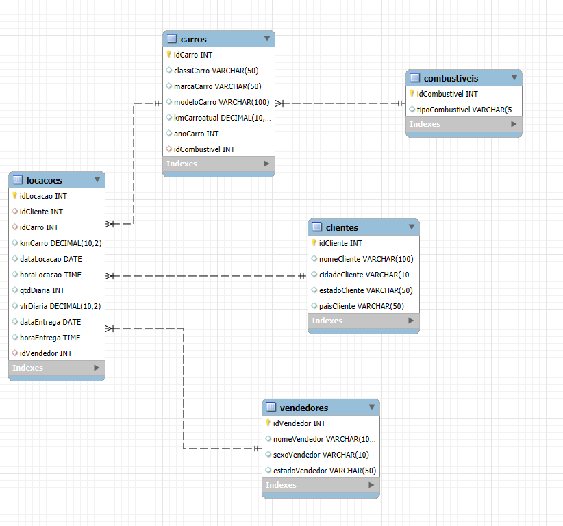


# Resultado das consultas Relacional

## Tabela Combustiveis
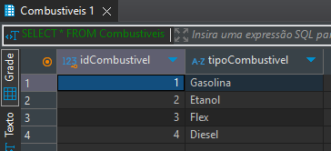
## Tabela Carros
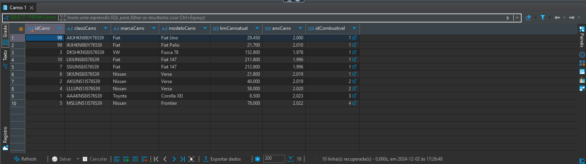
## Tabela Clientes 
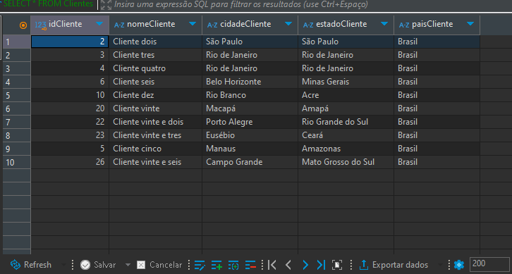
## Tabela Vendedores 
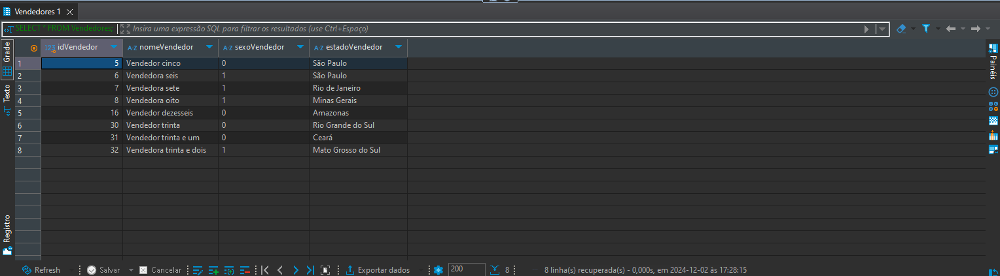
## Tabela Locacoes
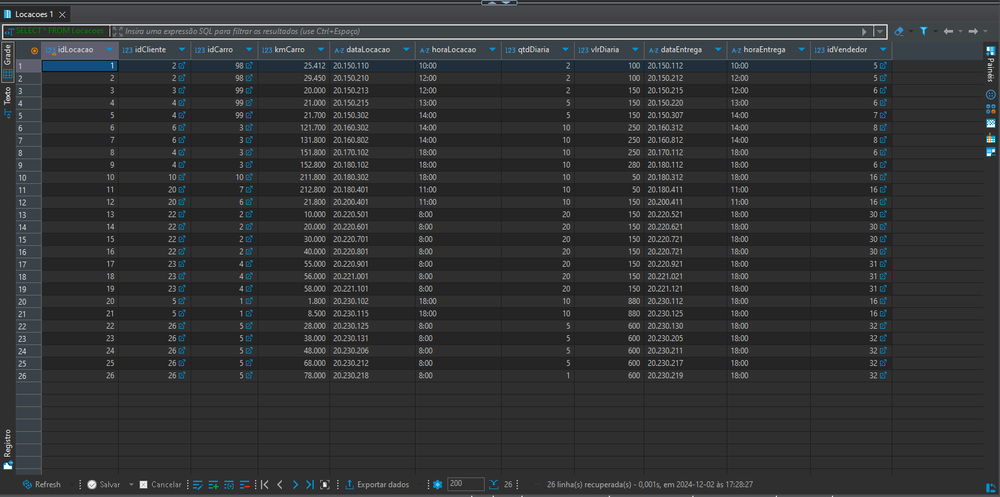


### Modelagem dimensional 

Foi realizada para organizar as informações no banco de dados de forma eficiente para consultas analíticas e relatórios. O processo de modelagem envolveu a criação de tabelas de *fatos* e *dimensões* para capturar as informações essenciais sobre as locações de carros, seus clientes, carros, vendedores e o tempo.


## Tabela de Dimensão para Clientes
A view dim_clientes extrai informações detalhadas sobre os clientes, como nome, cidade, estado e país.

```sql

CREATE VIEW dim_clientes AS 
SELECT DISTINCT 
    idCliente AS id_cliente,          
    nomeCliente AS cliente,           
    cidadeCliente AS cidade,         
    estadoCliente AS estado,        
    paisCliente AS pais               
FROM 
    Clientes c;

```


## Tabela de Dimensão para Carros
A view dim_carros contém informações detalhadas sobre os carros, como marca, modelo, ano e quilometragem atual.


```sql
CREATE VIEW dim_carros AS
SELECT DISTINCT 
    ca.idCarro AS id_carro,                 
    ca.classiCarro AS classificacao,        
    ca.marcaCarro AS marca,                 
    ca.modeloCarro AS modelo,               
    ca.anoCarro AS ano,                    
    ca.kmCarroatual AS quilometragem_atual,
    ca.idCombustivel AS id_combustivel,    
    co.tipoCombustivel AS tipo_combustivel
FROM 
    Carros ca
JOIN 
    Combustiveis co ON ca.idCombustivel = co.idCombustivel;
```   


## Tabela de Dimensão para Vendedores
A view dim_vendedores contém informações sobre os vendedores, como nome, sexo e estado.

```sql

CREATE VIEW dim_vendedores AS
SELECT DISTINCT 
    idVendedor AS id_vendedor,           
    nomeVendedor AS vendedor,            
    sexoVendedor AS sexo,                
    estadoVendedor AS estado              
FROM 
    Vendedores v;
```


## Tabela de Dimensão para Tempo
A view dim_tempo contém a data e hora das locações e entregas. Ela formata as informações para permitir a análise temporal.


```sql
CREATE VIEW dim_tempo AS
SELECT DISTINCT
    dataLocacao AS data,
    strftime('%Y', substr(dataLocacao, 1, 4) || '-' || substr(dataLocacao, 5, 2) || '-' || substr(dataLocacao, 7, 2)) AS ano,
    strftime('%m', substr(dataLocacao, 1, 4) || '-' || substr(dataLocacao, 5, 2) || '-' || substr(dataLocacao, 7, 2)) AS mes,
    strftime('%d', substr(dataLocacao, 1, 4) || '-' || substr(dataLocacao, 5, 2) || '-' || substr(dataLocacao, 7, 2)) AS dia,
    horaLocacao AS hora,
    'locacao' AS tipo
FROM 
    Locacoes
WHERE 
    dataLocacao IS NOT NULL

UNION ALL

SELECT DISTINCT
    dataEntrega AS data,
    strftime('%Y', substr(dataEntrega, 1, 4) || '-' || substr(dataEntrega, 5, 2) || '-' || substr(dataEntrega, 7, 2)) AS ano,
    strftime('%m', substr(dataEntrega, 1, 4) || '-' || substr(dataEntrega, 5, 2) || '-' || substr(dataEntrega, 7, 2)) AS mes,
    strftime('%d', substr(dataEntrega, 1, 4) || '-' || substr(dataEntrega, 5, 2) || '-' || substr(dataEntrega, 7, 2)) AS dia,
    horaEntrega AS hora,
    'entrega' AS tipo
FROM 
    Locacoes
WHERE 
    dataEntrega IS NOT NULL;

```
## Tabela de Fatos para as Locações
A view fato_locacao contém os dados principais sobre cada locação, como o ID do cliente, carro, valores, etc. Ela extrai informações da tabela Locacoes.

```sql
CREATE VIEW fato_locacao AS
SELECT 
    -- Informações da Locação
    l.idLocacao       AS id_locacao,         
    l.idCliente       AS id_cliente,         
    l.dataLocacao     AS data_locacao,       
    l.horaLocacao     AS hora_locacao,       
    l.idCarro         AS id_carro,           
    l.kmCarro         AS quilometragem_inicial, 
    l.qtdDiaria       AS quantidade_diaria,  
    l.vlrDiaria       AS valor_diaria,      
    l.dataEntrega     AS data_entrega,       
    l.horaEntrega     AS hora_entrega,       
    l.idVendedor      AS id_vendedor         
FROM 
    Locacoes l;
```  

## Modelo Dimensional Relacionamentos


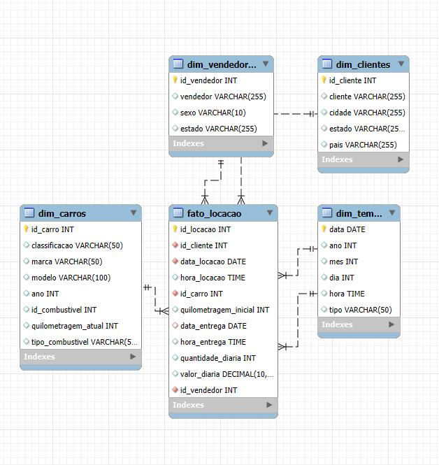


# Resultado das consultas Dimensional

## Tabela de Dimensão Clientes
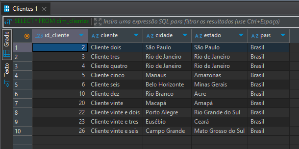
## Tabela de Dimensão Carros
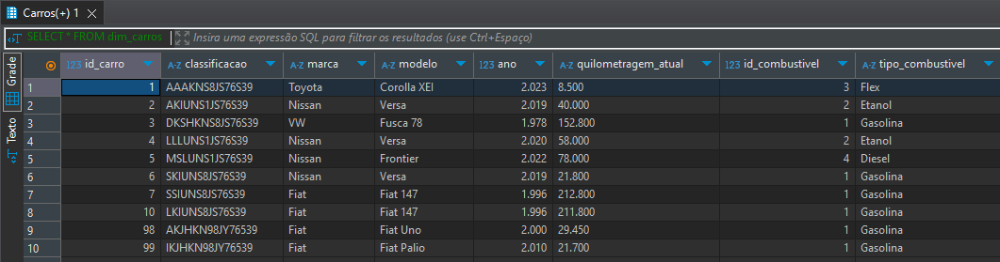

## Tabela de Dimensão Vendedores
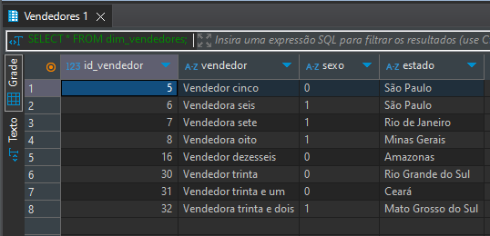

## Tabela de Dimensão Tempo
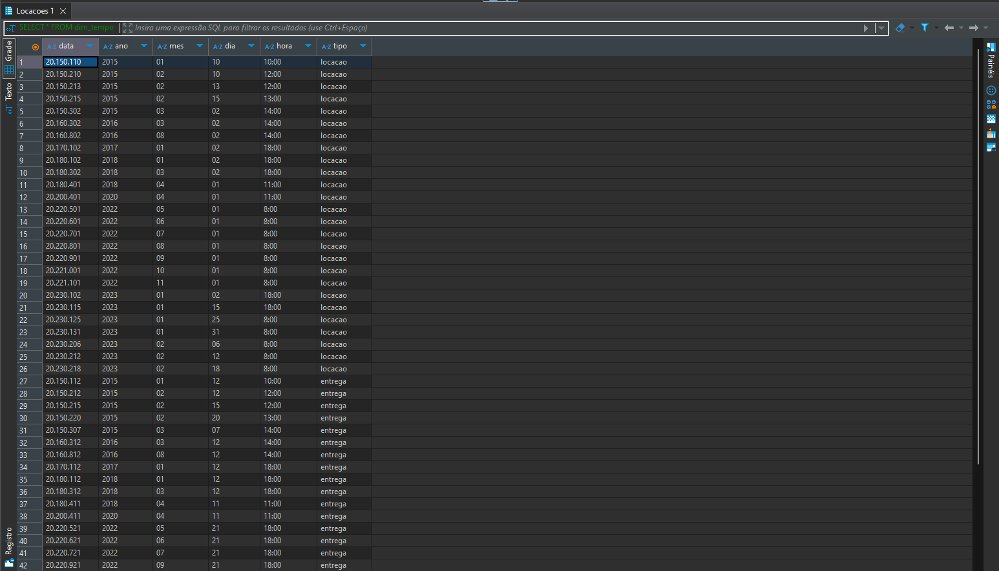
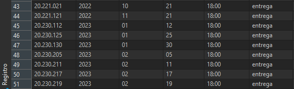

## Tabela de Fatos Locações
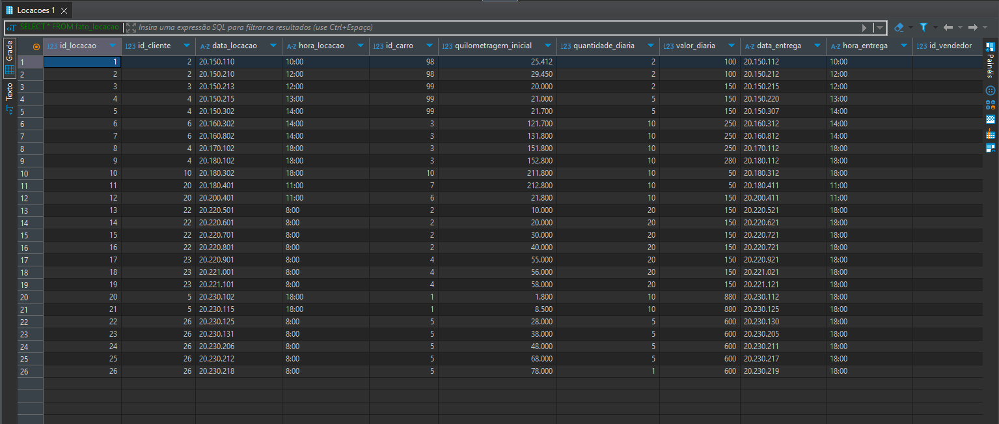