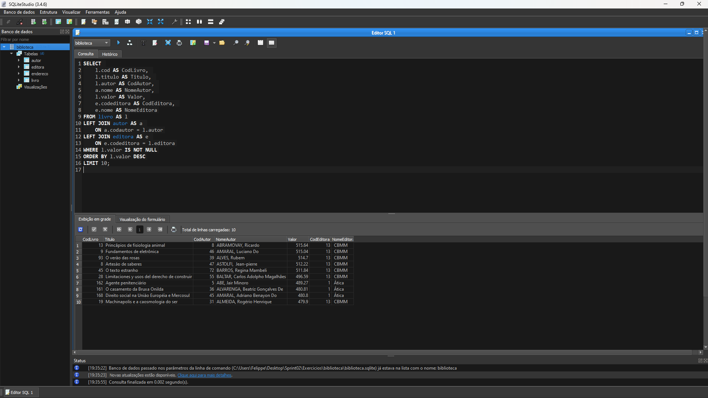

# Resumo da Sprint 2

**SQL:**: Aprendi a realizar pesquisas de dados. O curso abrangeu técnicas avançadas para trabalhar com dados, como combinar e filtrar informações de diferentes tabelas, realizar agregações e subconsultas correlacionadas, otimizando a extração de dados complexos. Isso ajuda a obter resultados mais precisos e eficientes em suas consultas de banco de dados.

**AWS Partners:**: O curso introdutório de vendas para AWS Partners ensina como entender e comunicar a proposta de valor da Amazon Web Services. Ele cobre conceitos básicos de serviços de nuvem, como articular o valor comercial da AWS, lidar com objeções comuns dos clientes e vender em conjunto com a AWS. O objetivo é fornecer ferramentas e modelos mentais para facilitar conversas eficazes sobre vendas de soluções em nuvem com os clientes.

# Exercícios

## Biblioteca
- [Resposta Ex1.](./Exercicios/biblioteca/ex1.txt)
- [Resposta Ex2.](./Exercicios/biblioteca/ex2.txt)
- [Resposta Ex3.](./Exercicios/biblioteca/ex3.txt)
- [Resposta Ex4.](./Exercicios/biblioteca/ex4.txt)
- [Resposta Ex5.](./Exercicios/biblioteca/ex5.txt)
- [Resposta Ex6.](./Exercicios/biblioteca/ex6.txt)
- [Resposta Ex7.](./Exercicios/biblioteca/ex7.txt)

## Loja
- [Resposta Ex8.](./Exercicios/loja/ex8.txt)
- [Resposta Ex9.](./Exercicios/loja/ex9.txt)
- [Resposta Ex10.](./Exercicios/loja/ex10.txt)
- [Resposta Ex11.](./Exercicios/loja/ex11.txt)
- [Resposta Ex12.](./Exercicios/loja/ex12.txt)
- [Resposta Ex13.](./Exercicios/loja/ex13.txt)
- [Resposta Ex14.](./Exercicios/loja/ex14.txt)
- [Resposta Ex15.](./Exercicios/loja/ex15.txt)
- [Resposta Ex16.](./Exercicios/loja/ex16.txt)

## Exportação de dados
- [Resposta Etapa 1.](./Exercicios/SQL/livros_top10_valor.csv)
- [Resposta Etapa 2.](./Exercicios/SQL/editora_top5_livro.csv)

  

# Evidências

## Etapa 1
 O código SQL exibe os 10 livros mais caros cadastrados. Ele combina as tabelas livro, autor e editora usando junções à esquerda (LEFT JOIN), trazendo informações como título, autor, valor e editora. Apenas livros com valores não nulos são considerados, e os resultados são ordenados em ordem decrescente pelo valor antes de serem limitados aos 10 primeiros registros.

## Etapa 2 
O código SQL é usado para listar as cinco editoras com mais livros registrados. Ele realiza uma junção entre as tabelas livro e editora, agrupando os dados pelo código e nome da editora. Em seguida, ordena os resultados pela quantidade de livros em ordem decrescente e exibe apenas os cinco primeiros registros.

# Certificados
Certificado AWS Partner: Sales Accreditation (Business)

- .png)