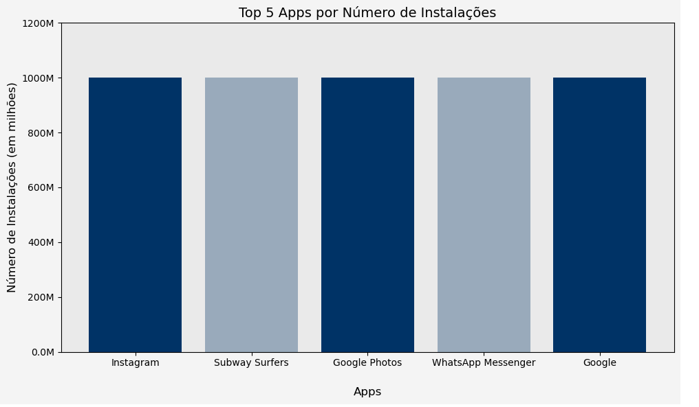
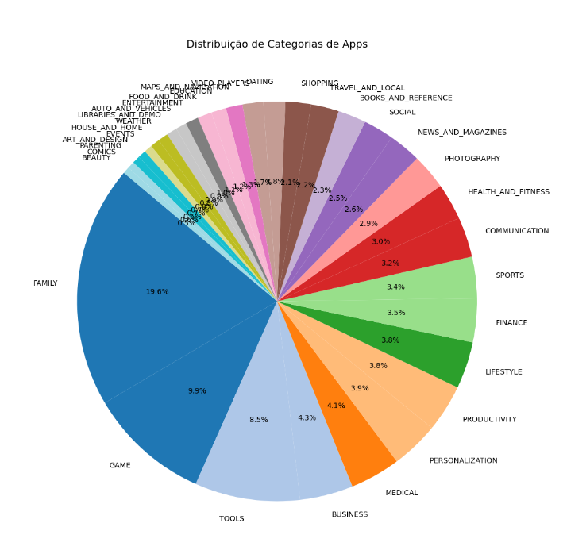
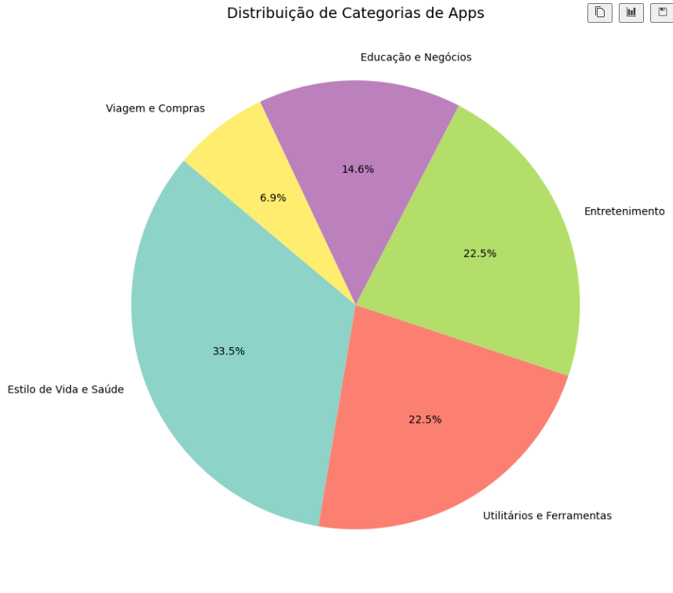
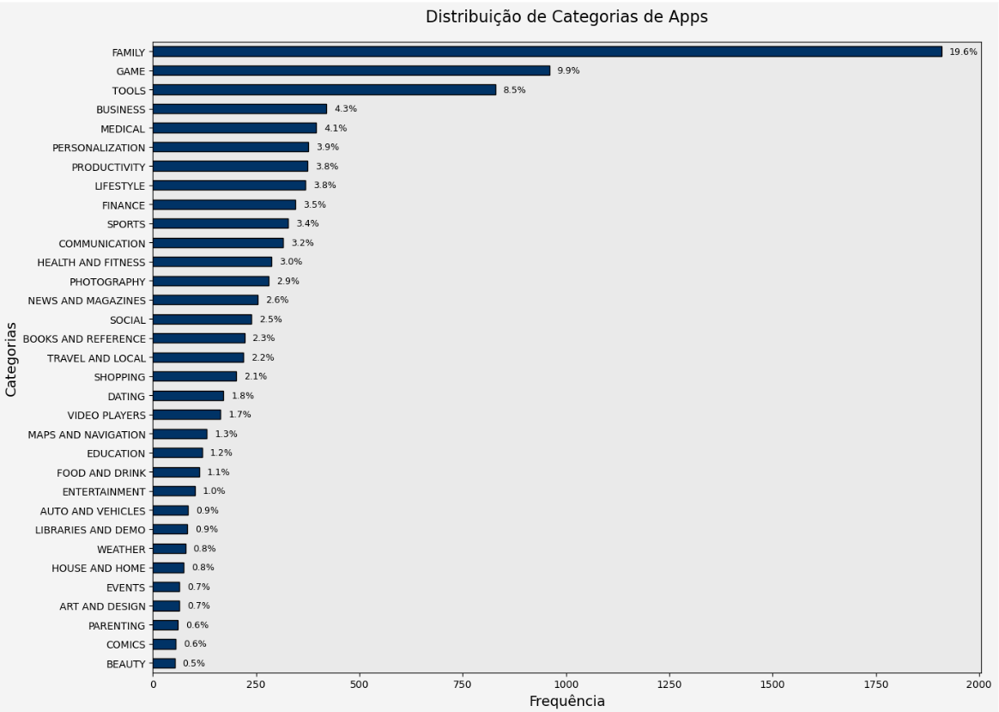
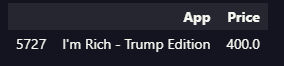
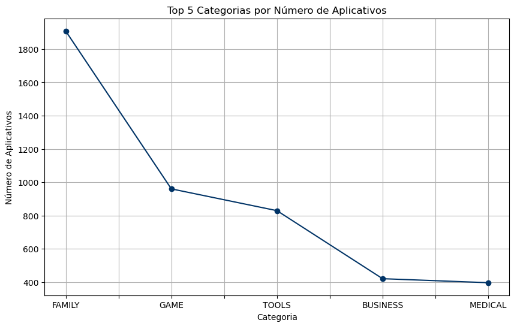
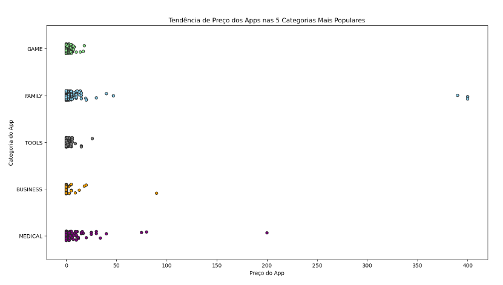

# Desafio

Neste desafio, o objetivo foi aplicar os conhecimentos adquiridos em Python para analisar e visualizar dados de um dataset de apps da Google Play Store (`googleplaystore.csv`). Utilizando as bibliotecas **Pandas** e **Matplotlib**, o desafio envolveu a realização de diversas etapas, como a leitura e limpeza dos dados, remoção de linhas duplicadas, e análise de informações como o número de instalações, as categorias de apps, os apps mais caros e a quantidade de apps classificados como "Mature 17+".

Além disso, foi necessário criar gráficos para visualizar os resultados, incluindo um gráfico de barras com os top 5 apps por número de instalações e um gráfico de pizza para mostrar a distribuição das categorias de apps. Também foi solicitado o cálculo do app mais caro e a listagem dos top 10 apps por número de reviews.

Para complementar, o desafio exigiu a criação de gráficos adicionais e a aplicação de cálculos adicionais sobre o dataset, proporcionando uma análise mais aprofundada e a visualização de diferentes aspectos do conjunto de dados.


# Índice

- [Desafio](#desafio)
- [Índice](#índice)
- [Carregar o arquivo CSV original](#carregar-o-arquivo-csv-original)
- [Análise e Limpeza de Dados do Google Play Store](#análise-e-limpeza-de-dados-do-google-play-store)
      - [Saída:](#saída)
- [Processamento da Coluna 'Installs' e Visualização dos Top 5 Aplicativos](#processamento-da-coluna-installs-e-visualização-dos-top-5-aplicativos)
  - [Gráfico de Pizza das Categorias](#gráfico-de-pizza-das-categorias)
  - [Primeira solução](#primeira-solução)
  - [Explicação sobre a Divisão de Categorias](#explicação-sobre-a-divisão-de-categorias)
    - [1. Estilo de Vida e Saúde](#1-estilo-de-vida-e-saúde)
    - [2. Entretenimento](#2-entretenimento)
    - [3. Utilitários e Ferramentas](#3-utilitários-e-ferramentas)
    - [4. Educação e Negócios](#4-educação-e-negócios)
    - [5. Viagem e Compras](#5-viagem-e-compras)
  - [Segunda solução:](#segunda-solução)
    - [Vantagens do gráfico de barras:](#vantagens-do-gráfico-de-barras)
  - [App Mais Caro](#app-mais-caro)
  - [Apps classificados como 'Mature 17+'](#apps-classificados-como-mature-17)
      - [Saída:](#saída-1)
  - [Top 10 Apps por Número de Reviews](#top-10-apps-por-número-de-reviews)
  - [Cálculos Adicionais e Gráficos Adicionais](#cálculos-adicionais-e-gráficos-adicionais)
    - [Cálculo 1: Top 5 Categorias com Mais Aplicativos](#cálculo-1-top-5-categorias-com-mais-aplicativos)
    - [Cálculo 2: Quantidades de Apps por Tipos pago e gratuitos  (Contagem de Aplicativos)](#cálculo-2-quantidades-de-apps-por-tipos-pago-e-gratuitos--contagem-de-aplicativos)
      - [Filtrando os aplicativos do tipo "Paid" ou "Free"](#filtrando-os-aplicativos-do-tipo-paid-ou-free)
      - [Saída:](#saída-2)
      - [Top 5 Categorias com Mais Aplicativos:](#top-5-categorias-com-mais-aplicativos)
  - [Gráficos Adicionais](#gráficos-adicionais)

# Carregar o arquivo CSV original
 
O primeiro passo é carregar o arquivo CSV original que contém informações sobre os aplicativos. O arquivo é lido usando a função pd.read_csv(), e o caractere de aspas duplas (") é tratado como delimitador para as strings no arquivo

# Análise e Limpeza de Dados do Google Play Store

```python
import pandas as pd
import matplotlib.pyplot as plt
from matplotlib.ticker import FuncFormatter
import re
import seaborn as sns

# 1. Carregar o arquivo CSV original
file_path = "googleplaystore.csv"
data = pd.read_csv(file_path, quotechar='"')

# Exibir o número inicial de linhas
total_rows_initial = len(data)
print(f"Número inicial de linhas: {total_rows_initial}")

# 2. Limpeza inicial - Manter o registro com o maior número de 'Reviews' para cada 'App'
data['Reviews'] = pd.to_numeric(data['Reviews'], errors='coerce')  # Converter 'Reviews' para numérico
data = data.sort_values(by='Reviews', ascending=False)  # Ordenar pela maior quantidade de 'Reviews'
data = data.drop_duplicates(subset=['App', 'Category'], keep='first')  # Remover duplicatas com base apenas em 'App'

def clean_app_name(name):
    # Remover emojis utilizando expressão regular
    # Mantém apóstrofo, ponto, vírgula e hífen
    name = re.sub(r"[^\w\s,.'-]", '', name)  # Mantém apóstrofo, ponto, vírgula e hífen
    # Remover aspas duplas
    name = name.replace('"', '')  # Remover todas as aspas duplas
    # Garantir que não haja espaços extras
    name = name.strip()
    return name

# Garantir que a coluna 'App' não tenha espaços extras e fazer a limpeza
data['App'] = data['App'].str.strip().apply(clean_app_name)

# Exibir o número de linhas após a limpeza inicial
total_rows_cleaned = len(data)
print(f"Número de linhas após remover duplicatas: {total_rows_cleaned}")

# Salvar o DataFrame limpo
output_path = "googleplaystore_cleaned.csv"
data.to_csv(output_path, index=False)
print(f"Arquivo limpo salvo em: {output_path}")

# 4. Recarregar os dados limpos para análise
cleaned_file_path = "googleplaystore_cleaned.csv"
data = pd.read_csv(cleaned_file_path)

# Exibir o número de linhas após a limpeza
print(f"Número de linhas nos dados limpos: {len(data)}")
```
#### Saída:

Número Inicial de Linhas:
- 10841

Número de Linhas Após Remover Duplicatas:
- 9745

Arquivo Limpo Salvo Em:
- `googleplaystore_cleaned.csv`
  
Número de Linhas nos Dados Limpos:
- 9745


# Processamento da Coluna 'Installs' e Visualização dos Top 5 Aplicativos

```python
# Garantir que a coluna 'Installs' seja processada corretamente
data['Installs'] = data['Installs'].astype(str).str.replace(",", "").str.replace("+", "")
data['Installs'] = pd.to_numeric(data['Installs'], errors='coerce')  # Converter para numérico
# data['Installs'] = data['Installs'] / 1e6  # Dividir para obter valores em milhões

# Classificar por Installs, Rating e Reviews
top_5_apps = data.sort_values(by=['Installs', 'Rating', 'Reviews'], ascending=[False, False, False]).head(5)

# Exibir os 5 aplicativos mais bem ranqueados (opcional)
# print("\nTop 5 Apps por Número de Instalações e Rating:")
# print(top_5_apps[['App', 'Installs', 'Rating', 'Reviews']].to_string(index=False))

# Gerar o gráfico
def millions_formatter(x, pos):
    """Formata valores em milhões para o eixo Y."""
    return f'{int(x)}M' if x >= 1 else f'{x:.1f}M'

plt.figure(figsize=(10, 6))

# Cores alternadas: azul marinho e cinza claro
colors = ['#003366', '#99AABB', '#003366', '#99AABB', '#003366']  # Alternando entre azul marinho e cinza claro

# Plotando as barras
bars = plt.bar(top_5_apps['App'], top_5_apps['Installs'], color=colors)

# Ajustar título, rótulos e eixos
plt.title('Top 5 Apps por Número de Instalações', fontsize=14)
plt.xlabel('Apps', fontsize=12, labelpad=20)
plt.ylabel('Número de Instalações (em milhões)', fontsize=12)
plt.xticks(rotation=0, fontsize=10)
plt.yticks(fontsize=10)

# Aplicar formatação ao eixo Y
plt.gca().yaxis.set_major_formatter(FuncFormatter(millions_formatter))

# Ajustar limites no eixo Y
plt.ylim(0, max(top_5_apps['Installs']) * 1.2)

# Personalizar fundos
plt.gcf().patch.set_facecolor('#f4f4f4')  # Fundo da figura
plt.gca().set_facecolor('#eaeaea')  # Fundo do gráfico

# Adicionar espaçamento entre as barras no eixo X
plt.tight_layout()

# Exibir o gráfico
plt.show()

```



## Gráfico de Pizza das Categorias

Ao criar o gráfico de pizza, percebe-se que, devido ao grande número de categorias, a visualização se torna difícil de entender. Para resolver esse problema, proponho duas soluções:

```python
# Contando a frequência de categorias
category_counts = data['Category'].value_counts()

# Criando o gráfico de pizza
plt.figure(figsize=(12, 10))  # Aumentando o tamanho do gráfico
category_counts.plot(kind='pie', autopct='%1.1f%%', startangle=140, colormap='tab20')

# Adicionando título e ajustando a visualização
plt.title('Distribuição de Categorias de Apps', fontsize=14)
plt.ylabel('')  # Remover o label do eixo Y
plt.tight_layout()  # Ajuste automático do layout
plt.show()

```




## Primeira solução
A divisão das categorias foi realizada com o objetivo de simplificar a visualização e a análise. As categorias foram agrupadas de acordo com propósitos semelhantes, facilitando a compreensão e tornando a comparação entre os grupos mais clara. Essa abordagem também permite uma análise mais eficaz do comportamento dos aplicativos.




```Python

# Agrupando as categorias com uma nova definição
grouped_categories = {
    'Estilo de Vida e Saúde': ['FAMILY', 'LIFESTYLE', 'HEALTH_AND_FITNESS', 'FOOD_AND_DRINK', 'BEAUTY', 'MEDICAL', 'PARENTING', 'HOUSE_AND_HOME'],
    'Entretenimento': ['GAME', 'ENTERTAINMENT', 'PHOTOGRAPHY', 'VIDEO_PLAYERS', 'SOCIAL', 'SPORTS', 'COMICS', 'EVENTS'],
    'Utilitários e Ferramentas': ['TOOLS', 'PRODUCTIVITY', 'PERSONALIZATION', 'COMMUNICATION', 'MAPS_AND_NAVIGATION', 'AUTO_AND_VEHICLES', 'LIBRARIES_AND_DEMO'],
    'Educação e Negócios': ['EDUCATION', 'BUSINESS', 'NEWS_AND_MAGAZINES', 'BOOKS_AND_REFERENCE', 'ART_AND_DESIGN','FINANCE'],
    'Viagem e Compras': ['TRAVEL_AND_LOCAL', 'SHOPPING', 'DATING', 'WEATHER']
}

# Lista de todas as categorias únicas no dataset
all_categories = set(data['Category'].unique())

# Categorias mapeadas no dicionário grouped_categories
mapped_categories = set(category for categories in grouped_categories.values() for category in categories)

# Categorias não mapeadas
unmapped_categories = all_categories - mapped_categories

# # Exibindo categorias não mapeadas
# print("Categorias não mapeadas:", unmapped_categories)

# Caso existam categorias não mapeadas, podemos decidir como agrupá-las
if unmapped_categories:
    # Adicionar as categorias não mapeadas a um grupo apropriado (Exemplo: Utilitários e Ferramentas)
    grouped_categories['Utilitários e Ferramentas'].extend(unmapped_categories)

# Reaplicar a função de categorização com todos os grupos atualizados
def categorize(category):
    for group, categories in grouped_categories.items():
        if category in categories:
            return group
    return 'Não Categorizado'

# Aplicando a categorização
data['Group'] = data['Category'].apply(categorize)

# Contando a frequência das categorias agrupadas
grouped_counts = data['Group'].value_counts()

# # Exibindo o conteúdo atualizado de grouped_counts
# print(grouped_counts)

# Criando o gráfico de pizza com cores vibrantes
plt.figure(figsize=(10, 8))
grouped_counts.plot(
    kind='pie', 
    autopct='%1.1f%%', 
    startangle=140, 
    colormap='Set3'  # Paleta de cores mais vibrante e profissional
)

# Ajustando o título e removendo o rótulo do eixo Y
plt.title('Distribuição de Categorias de Apps', fontsize=14)
plt.ylabel('')  # Remover o label do eixo Y
plt.tight_layout()  # Ajustar layout para evitar cortes

# Mostrar o gráfico
plt.show()
```


## Explicação sobre a Divisão de Categorias

A divisão das categorias foi feita para simplificar a visualização e análise, agrupando categorias com propósitos semelhantes. Essa abordagem facilita a compreensão, torna a comparação entre os grupos mais clara e permite uma análise mais eficaz do comportamento dos aplicativos.

### 1. Estilo de Vida e Saúde
Este grupo inclui categorias relacionadas ao bem-estar e saúde dos usuários, como **FAMILY**, **LIFESTYLE**, **HEALTH_AND_FITNESS**, **FOOD_AND_DRINK**, **BEAUTY**, **MEDICAL**, **PARENTING** e **HOUSE_AND_HOME**. Esses aplicativos visam melhorar a qualidade de vida dos usuários, seja por meio de hábitos saudáveis, cuidados pessoais ou serviços médicos.

### 2. Entretenimento
As categorias agrupadas aqui são voltadas para o lazer e socialização, incluindo **GAME**, **ENTERTAINMENT**, **PHOTOGRAPHY**, **VIDEO_PLAYERS**, **SOCIAL**, **SPORTS**, **COMICS** e **EVENTS**. Esses aplicativos proporcionam entretenimento e interação social, como jogos, redes sociais e plataformas de vídeos.

### 3. Utilitários e Ferramentas
Este grupo reúne categorias relacionadas à produtividade e utilidade do dia a dia, como **TOOLS**, **PRODUCTIVITY**, **PERSONALIZATION**, **COMMUNICATION**, **MAPS_AND_NAVIGATION**, **AUTO_AND_VEHICLES** e **LIBRARIES_AND_DEMO**. Aplicativos dessa categoria são voltados para facilitar tarefas cotidianas, como comunicação, personalização de dispositivos e navegação.

### 4. Educação e Negócios
As categorias **EDUCATION**, **BUSINESS**, **NEWS_AND_MAGAZINES**, **BOOKS_AND_REFERENCE**, **ART_AND_DESIGN** e **FINANCE** estão agrupadas aqui, com foco no aprendizado, aprimoramento profissional e consumo de conteúdo informativo. Esses aplicativos auxiliam na formação acadêmica, desenvolvimento de negócios e busca por conhecimentos especializados.

### 5. Viagem e Compras
Este grupo agrupa categorias voltadas para o turismo e o consumo, como **TRAVEL_AND_LOCAL**, **SHOPPING**, **DATING** e **WEATHER**. Esses aplicativos atendem às necessidades de viagens, compras online, serviços de namoro e informações climáticas.


## Segunda solução:
Para uma visualização mais clara e detalhada, onde não é necessário agrupar as categorias, o gráfico ideal seria um **gráfico de barras** (em vez de um gráfico de pizza), especialmente quando há um número elevado de categorias. O gráfico de barras oferece uma forma mais eficiente de comparar categorias com frequências variadas.

### Vantagens do gráfico de barras:
- **Facilidade de leitura**: Ele lida bem com um número grande de categorias, enquanto o gráfico de pizza pode se tornar difícil de interpretar quando há muitas fatias.
- **Comparação precisa**: A altura das barras facilita a comparação das frequências entre as categorias, tornando a análise mais intuitiva.





```Python 
# Contando a frequência de categorias
category_counts = data['Category'].value_counts()

# print("\nFrequência das Categorias Agrupadas:")
# print(category_counts)

# Removendo os underlines das categorias
category_counts.index = category_counts.index.str.replace('_', ' ')

# Ordenando os valores de forma decrescente
category_counts = category_counts.sort_values(ascending=False)

# Calculando as porcentagens
percentage = (category_counts / category_counts.sum()) * 100

# Criando o gráfico de barras horizontal
plt.figure(figsize=(14, 10))  # Figura com dimensões apropriadas

ax = category_counts.plot(kind='barh', color='#003366', edgecolor='black')  # Adicionando borda às barras para destaque

# Adicionando as porcentagens à direita de cada barra
for i, v in enumerate(category_counts):
    ax.text(v + category_counts.max() * 0.01, i, f'{percentage.iloc[i]:.1f}%', va='center', fontsize=9)  # Ajuste dinâmico do deslocamento

# Inverter explicitamente a ordem do eixo Y
ax.invert_yaxis()


# Ajustando título e rótulos
plt.title('Distribuição de Categorias de Apps', fontsize=16, pad=20)  # Pad ajusta o espaçamento do título
plt.xlabel('Frequência', fontsize=14)
plt.ylabel('Categorias', fontsize=14)
# Melhorando o layout
plt.tight_layout()  # Ajusta automaticamente os elementos para evitar sobreposição

# Configurando os fundos
plt.gcf().patch.set_facecolor('#f4f4f4')  # Fundo da figura
ax.set_facecolor('#eaeaea')  # Fundo do gráfico

# # Adicionando grid para melhor leitura (opcional)
# ax.grid(axis='x', linestyle='--', alpha=0.7)

# Exibindo o gráfico
plt.show()
```


## App Mais Caro
```Python
# Remover o '$' e tentar converter para float, substituindo erros por NaN
data['Price'] = data['Price'].replace({r'[$,]': ''}, regex=True)  # Remove '$' e ',' se houver
data['Price'] = pd.to_numeric(data['Price'], errors='coerce')  # Converte para float, com erro como NaN
# Encontrando o aplicativo mais caro
most_expensive_app = data.nlargest(1, 'Price')[['App', 'Price']]

most_expensive_app
```



## Apps classificados como 'Mature 17+'

```Python
# mature_17_plus_count = data[data['Content Rating'] == 'Mature 17+'].shape[0]
# print(f"Número de apps classificados como 'Mature 17+': {mature_17_plus_count}")


mature_17_plus_count = data['Content Rating'].str.contains('Mature 17+', na=False).sum()

print(f"Número de apps classificados como 'Mature 17+': {mature_17_plus_count}")
```
#### Saída:
Número de apps classificados como 'Mature 17+': 393


##  Top 10 Apps por Número de Reviews

```Python

# Ordenando os dados pela coluna 'Reviews' de forma decrescente
data_sorted = data.sort_values('Reviews', ascending=False)

# Removendo duplicatas, mantendo apenas a linha com o maior número de reviews para cada 'App'
data_unique = data_sorted.drop_duplicates(subset='App', keep='first')

# Selecionando as 10 primeiras aplicações com mais reviews
top10_reviews = data_unique[['App', 'Reviews']].head(10)

# Exibindo as 10 aplicações com mais reviews
top10_reviews
```


## Cálculos Adicionais e Gráficos Adicionais


### Cálculo 1: Top 5 Categorias com Mais Aplicativos

```Python
top_categories = data['Category'].value_counts().head(5)
```

### Cálculo 2: Quantidades de Apps por Tipos pago e gratuitos  (Contagem de Aplicativos)
#### Filtrando os aplicativos do tipo "Paid" ou "Free"


```Python
paid_apps_count = data[(data['Type'] == 'Paid') | (data['Type'] == 'Free')].shape[0]

# Exibindo os resultados no terminal
print("Top 5 Categorias com Mais Aplicativos:")
print(top_categories)
print("\nNúmero de Apps por Tipo:")
print(f"Número de aplicativos pagos ou gratuitos: {paid_apps_count}")

```

#### Saída:

#### Top 5 Categorias com Mais Aplicativos:

| Categoria  | Número de Aplicativos |
|------------|-----------------------|
| FAMILY     | 1909                  |
| GAME       | 960                   |
| TOOLS      | 829                   |
| BUSINESS   | 420                   |
| MEDICAL    | 396                   |

**Número de Apps por Tipo:**

- Número de aplicativos pagos ou gratuitos: 9744


## Gráficos Adicionais

```Python
## Gráfico 1: Gráfico de Linha para o Top 5 Categorias por Número de Apps
plt.figure(figsize=(10, 6))
top_categories.plot(kind='line', marker='o', title='Top 5 Categorias por Número de Aplicativos', color='#003366')
plt.xlabel('Categoria')
plt.ylabel('Número de Aplicativos')
plt.xticks()
plt.grid(True)
plt.show()

## Gráfico 2: Gráfico de pontos (stripplot) para Preço de Apps nas 5 Categorias mais Populares

top_5_categorias = ['FAMILY', 'GAME', 'TOOLS', 'BUSINESS', 'MEDICAL']

# Filtrando o dataset para as 5 categorias mais populares
top_5_apps = data[data['Category'].isin(top_5_categorias)]

# Definindo um palete de cores personalizado para cada categoria
custom_palette = {
    'FAMILY': 'skyblue',
    'GAME': 'lightgreen',
    'TOOLS': 'gray',
    'BUSINESS': 'orange',
    'MEDICAL': 'purple'
}

# Criando o gráfico de pontos (stripplot) para preço de apps nas 5 categorias mais populares
fig, ax = plt.subplots(figsize=(15, 8))
ax = sns.stripplot(x='Price', y='Category', hue='Category', data=top_5_apps, 
                   jitter=True, linewidth=1, palette=custom_palette, legend=False)

# Ajustando o título e as labels para refletir a natureza do gráfico
ax.set_title('Tendência de Preço dos Apps nas 5 Categorias Mais Populares')
ax.set_xlabel('Preço do App')
ax.set_ylabel('Categoria do App')

# Exibindo o gráfico
plt.show()

```





