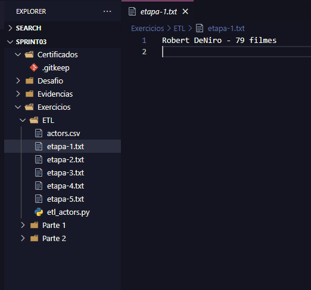
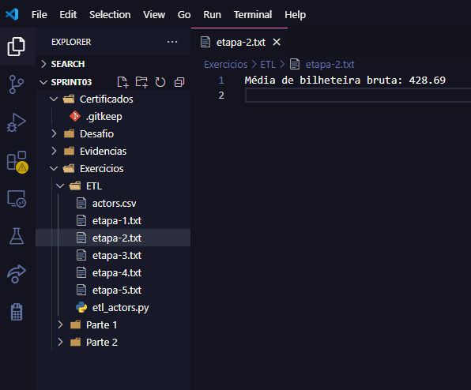
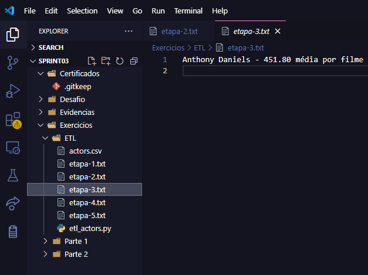
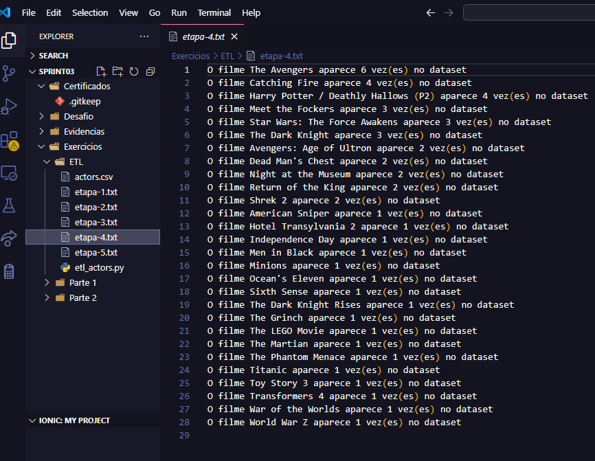
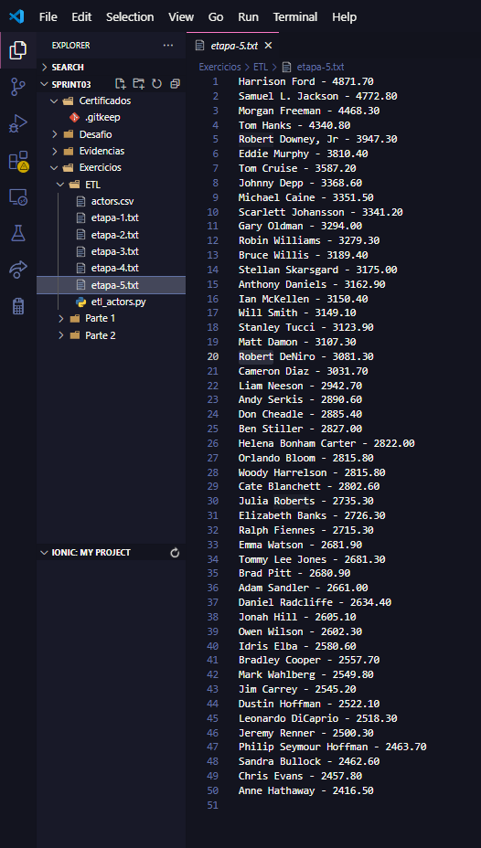

# Resumo da Sprint 2

**Python:** Neste curso de Python, aprendi o básico da linguagem, incluindo como usar classes e manipular arquivos. Também me aprofundei em programação orientada a objetos (POO), o que me permitiu criar programas mais estruturados e reutilizáveis. O curso abordou ainda o gerenciamento de pacotes, o que me ajudou a instalar e organizar bibliotecas necessárias para meus projetos.

Além disso, estudei o uso de bibliotecas poderosas como o Pandas, para manipulação e análise de dados, e o Matplotlib, para criar gráficos e visualizações. Essas ferramentas têm sido essenciais para trabalhar de forma eficiente com grandes volumes de dados e apresentar resultados de maneira clara e acessível.


**AWS Partners:** Neste curso, aprendi sobre a importância do valor comercial e do gerenciamento financeiro na nuvem, com foco na AWS. O objetivo é ajudar os clientes a perceberem os benefícios econômicos ao adotar a nuvem AWS. Eu estudei os pilares do AWS Cloud Value Framework, os conceitos principais do gerenciamento financeiro na nuvem e as práticas recomendadas para os clientes. Isso me ajudou a entender como otimizar os custos e maximizar o valor ao utilizar serviços na nuvem.

Além disso, o curso oferece transcrições e legendas traduzidas, com a narração em inglês, o que torna as lições mais acessíveis.


# Exercícios

## Parte 1
- [Resposta Ex1.](./Exercicios/Parte1/ex1.py)
- [Resposta Ex2.](./Exercicios/Parte1/ex2.py)
- [Resposta Ex3.](./Exercicios/Parte1/ex3.py)
- [Resposta Ex4.](./Exercicios/Parte1/ex4.py)
- [Resposta Ex5.](./Exercicios/Parte1/ex5.py)

## Parte 2
- [Resposta Ex6.](./Exercicios/Parte2/ex6.py)
- [Resposta Ex7.](./Exercicios/Parte2/ex7.py)
- [Resposta Ex8.](./Exercicios/Parte2/ex8.py)
- [Resposta Ex9.](./Exercicios/Parte2/ex9.py)
- [Resposta Ex10.](./Exercicios/Parte2/ex10.py)
- [Resposta Ex11.](./Exercicios/Parte2/ex11.py)
- [Resposta Ex12.](./Exercicios/Parte2/ex12.py)
- [Resposta Ex13.](./Exercicios/Parte2/ex13.py)
- [Resposta Ex14.](./Exercicios/Parte2/ex14.py)
- [Resposta Ex15.](./Exercicios/Parte2/ex15.py)
- [Resposta Ex16.](./Exercicios/Parte2/ex16.py)
- [Resposta Ex17.](./Exercicios/Parte2/ex17.py)
- [Resposta Ex18.](./Exercicios/Parte2/ex18.py)
- [Resposta Ex19.](./Exercicios/Parte2/ex19.py)
- [Resposta Ex20.](./Exercicios/Parte2/ex20.py)
- [Resposta Ex21.](./Exercicios/Parte2/ex21.py)
- [Resposta Ex22.](./Exercicios/Parte2/ex22.py)
- [Resposta Ex23.](./Exercicios/Parte2/ex23.py)
- [Resposta Ex24.](./Exercicios/Parte2/ex24.py)
- [Resposta Ex25.](./Exercicios/Parte2/ex25.py)

## Exportação de dados
- [Resposta Etapa 1.](./Exercicios/SQL/livros_top10_valor.csv)
- [Resposta Etapa 2.](./Exercicios/SQL/editora_top5_livro.csv)

  

# Evidências


Nessa parte, eu criei uma função para gerar os arquivos .txt e também retirei as partes erradas de Robert Downey, Jr.
```Python
# Função para criar os arquivos de saída
def criar_arquivos_saida(qtd):
    for i in range(1, qtd + 1):
        with open(f"etapa-{i}.txt", "w", encoding="utf-8") as f:
            pass


# Criar os arquivos de saída
criar_arquivos_saida(5)

# Ler o arquivo usando o módulo CSV
with open("actors.csv", "r", encoding="utf-8") as file:
    reader = csv.reader(file)
    lines = list(reader)

# Ignorar cabeçalho e processar os dados
header = lines[0]  # Cabeçalho (se necessário)
data = lines[1:]  # Dados sem cabeçalho

# Limpar espaços, remover "Jr." com ponto e tratar colunas numéricas
for row in data:
    row[0] = row[0].replace("Jr.", "Jr").strip()  # Remover ponto em "Jr."
    row[1] = row[1].replace(",", "").strip()  # Receita total
    row[2] = row[2].strip()  # Número de filmes
    row[3] = row[3].strip()  # Média de receita
    row[5] = row[5].strip()  # Bilheteira bruta

```
**Etapa 1: Ator com o Maior Número de Filmes**
- O ator com o maior número de filmes é: [Nome do Ator] - [Número de Filmes] filmes
```Python
    # Etapa 1: Ator com o Maior Número de Filmes
    max_movies = max(data, key=lambda x: int(x[2]) if x[2].isdigit() else 0)
    with open("etapa-1.txt", "w", encoding="utf-8") as f:
        f.write(f"{max_movies[0]} - {max_movies[2]} filmes\n")
```


**Etapa 2: Média de Bilheteira Bruta dos Principais Filmes**
- Média de bilheteira bruta: [Valor da Média de Bilheteira] (exemplo: 150.25)
``` Python
# Etapa 2: Média de Bilheteira Bruta dos Principais Filmes
gross_values = []
for row in data:
    try:
        gross_values.append(float(row[5]))  # Convertendo bilheteira bruta
    except ValueError:
        continue  # Ignorar valores não numéricos

gross_avg = sum(gross_values) / len(gross_values) if gross_values else 0  # Evitar divisão por zero
with open("etapa-2.txt", "w", encoding="utf-8") as f:
    f.write(f"Média de bilheteira bruta: {gross_avg:.2f}\n")

```


**Etapa 3: Ator com Maior Média de Receita por Filme**
- O ator com a maior média de receita por filme é: [Nome do Ator] - [Média de Receita por Filme]
  
``` Python
# Etapa 3: Ator com Maior Média de Receita por Filme
max_avg = max(
    data, key=lambda x: float(x[3]) if x[3].replace(".", "", 1).isdigit() else 0
)
with open("etapa-3.txt", "w", encoding="utf-8") as f:
    f.write(f"{max_avg[0]} - {max_avg[3]} média por filme\n")


```

**Etapa 4: Contagem de Aparições de Filmes na Coluna "#1 Movie"**
- O filme [Nome do Filme] aparece [Número de Aparições] vez(es) no dataset
  - (Exemplo de várias linhas com filmes ordenados por frequência de aparições)

``` Python
# Etapa 4: Contagem de Aparições de Filmes na Coluna "#1 Movie"
from collections import Counter

movies_count = Counter(row[4] for row in data)
sorted_movies = sorted(movies_count.items(), key=lambda x: (-x[1], x[0]))
with open("etapa-4.txt", "w", encoding="utf-8") as f:
    for movie, count in sorted_movies:
        f.write(f"O filme {movie} aparece {count} vez(es) no dataset\n")


```



**Etapa 5: Ordenação de Atores por Receita Total Bruta**
- [Nome do Ator] - [Receita Total Bruta]
  - (Lista de atores ordenada da maior para a menor receita total bruta)


``` Python
# Etapa 5: Ordenar Atores por Receita Total Bruta
data_sorted = sorted(
    data,
    key=lambda x: float(x[1]) if x[1].replace(".", "", 1).isdigit() else 0,
    reverse=True,
)
with open("etapa-5.txt", "w", encoding="utf-8") as f:
    for row in data_sorted:
        f.write(f"{row[0]} - {row[1]}\n")


```


# Certificados
Parceiros da AWS: Aspectos econômicos da nuvem (Portugues) | AWS Partner: Cloud Economics (Portuguese)
%20%20AWS%20Partner%20Cloud%20Economics%20(Portuguese).png)