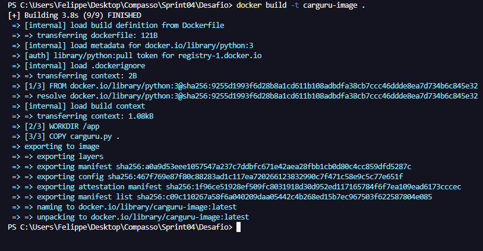
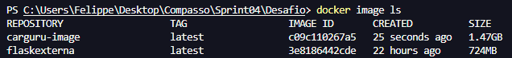
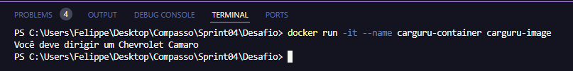
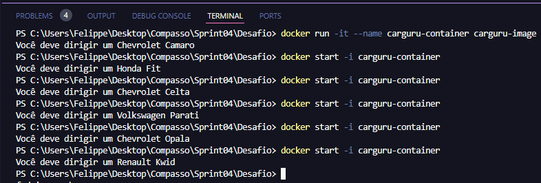
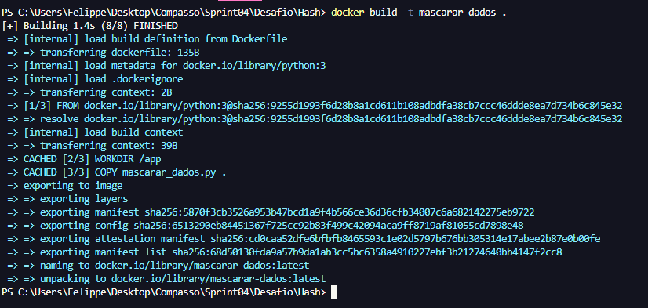
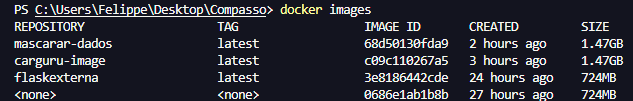
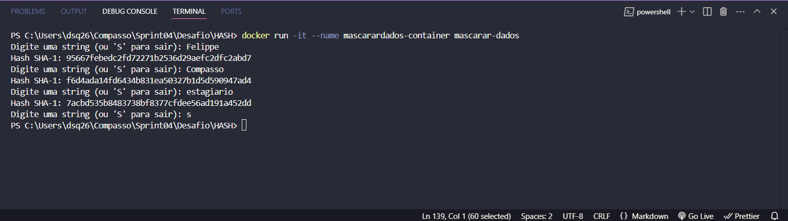

# Desafio

Neste desafio, o objetivo foi construir uma imagem a partir de um arquivo de instruções **Dockerfile** que execute o código **carguru.py**. Após isso, deveria ser executado um contêiner a partir da imagem criada, e em seguida responder à pergunta: "É possível reutilizar contêineres?" Depois, criar um contêiner que permita receber entradas durante sua execução. Também seria necessário criar um arquivo Python que implemente o seguinte algoritmo: receber uma string via input, gerar o hash da string por meio de SHA-1, imprimir o hash na tela utilizando o método **hexdigest**. Em seguida, criar uma imagem Docker chamada **mascarar-dados** que execute o script Python criado anteriormente. Finalmente, iniciar um contêiner a partir da imagem, enviando algumas palavras para o mascaramento.

# Índice

- [Desafio](#desafio)
- [Índice](#índice)
- [Arquivo Dockerfile](#arquivo-dockerfile)
- [Construindo uma imagem](#construindo-uma-imagem)
- [Executando o container a partir da imagem criada](#executando-o-container-a-partir-da-imagem-criada)
- [É possível reutilizar contêineres?](#é-possível-reutilizar-contêineres)
- [Hash](#hash)
  - [Arquivo Dockerfile](#arquivo-dockerfile-1)
  - [Script Python](#script-python)
  - [Criando a imagem mascar-dados](#criando-a-imagem-mascar-dados)
  - [Iniciando o container](#iniciando-o-container)

# Arquivo Dockerfile

```Dockerfile
FROM python:3.10-slim

WORKDIR /app

COPY carguru.py .

CMD [ "python", "carguru.py" ]
```


# Construindo uma imagem 


```Dockerfile
docker build -t nome_da_imagem .
```
O comando acima cria uma imagem Docker a partir do Dokcerfile que está presente no diretório atual(.), e p parâmerto -t define o nome que será atribuído para a imagem 




```Dockerfile
docker image ls 
```
Exibe uma lista de todas as imagens Docker presentes no sistema local



# Executando o container a partir da imagem criada 

Para iniciar um contâiner ultilizamos o comando

```Dockerfile
docker run -it --name container_id imagem_id
```

A opção -it combina -i (modo interativo) e -t (aloca um terminal) para permitir interações com o contêiner por meio de um terminal.



```Dockerfile
docker start -i carguru-container
```
Para reutilizar o container.



# É possível reutilizar contêineres?

Sim, é possível reutilizar containers, desde que eles não sejam removidos.

```Docker
docker start <container_id ou container_name>
```

Ou se  o container tenha terminado com erro ou precise ser ajustado, para iniciar um terminal interativo:

```Docker
docker start -i <container_id ou container_name>

```

# Hash

## Arquivo Dockerfile

```Docker
FROM python:3.10-slim

WORKDIR /app

COPY mascarar_dados.py .

CMD ["python", "mascarar_dados.py"]


```


## Script Python 

  ```Python
  # Importa o módulo hashlib que contém funções para gerar hashes
import hashlib

# Inicia um loop infinito para receber entradas do usuário
while True:
    # Solicita ao usuário que digite uma string ou 'S' para sair
    entrada = input("Digite uma string (ou 'S' para sair): ")
    
    # Se o usuário digitar 'S', converte para minúsculo e sai do loop
    if entrada.lower() == "s":
        break  # Interrompe o loop

    # Converte a entrada do usuário para bytes e calcula o hash SHA-1
    hash_resultado = hashlib.sha1(entrada.encode()).hexdigest()
    
    # Exibe o hash gerado na tela, no formato hexadecimal
    print(f"Hash SHA-1: {hash_resultado}")

  ```

## Criando a imagem mascar-dados

```Docker
docker build -t mascarar-dados .

```



## Iniciando o container 
```Docker
docker run -it --name mascarardados-container mascarar-dados
```


