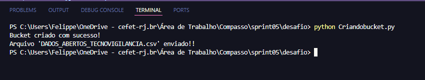
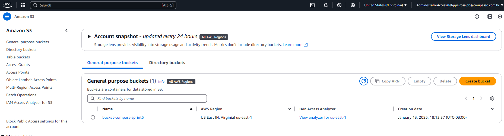
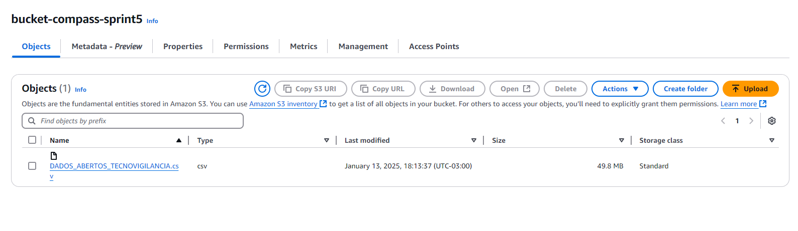
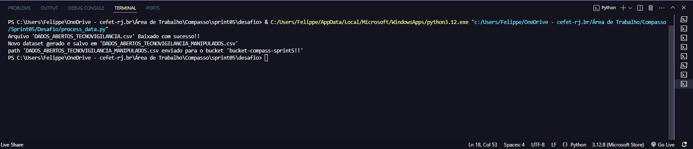
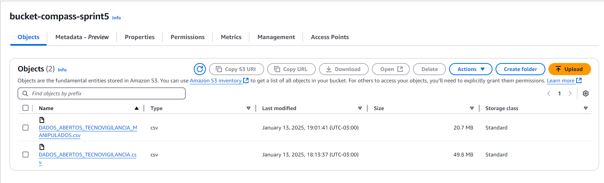

# Desafio
Neste desafio era proposto para escolher um arquivo único do portal de dados públicos do Governo Brasileiro análisa-lo e carregá-lo para um bucket S3 Utilizando um script Python com boto3 para carregar o arquivo selecionado para o bucket criado, em seguida realizar manipulções no arquivo com pandas ou polars com manipulções sendo elas filtros, agregações, condições, conversões e operações com datas e strings. Por fim, o arquivo processado deve ser salvo em formato CSV no S3.

# Índice

- [Desafio](#desafio)
- [Índice](#índice)
  - [Criando o bucket e fazendo o upload do arquivo para o S3](#criando-o-bucket-e-fazendo-o-upload-do-arquivo-para-o-s3)
  - [Executando](#executando)
  - [Bucket criado com o CSV original](#bucket-criado-com-o-csv-original)
  - [Criando um script Python para carregar o arquivo do S3 e transformá-lo em um DataFrame usando pandas](#criando-um-script-python-para-carregar-o-arquivo-do-s3-e-transformá-lo-em-um-dataframe-usando-pandas)
  - [Executando](#executando-1)
  - [Bucket AWS S3 após uma execução](#bucket-aws-s3-após-uma-execução)


Dataset escolhido foi **Tecnovigilância em Pós-Mercado**

## Criando o bucket e fazendo o upload do arquivo para o S3

``` python
import boto3

# Criando Sessão
session = boto3.Session(profile_name="AdministratorAccess-442426891183")

s3 = session.client("s3")


bucket_name = "meu-bucket-compasso-sprint5"
path = "DADOS_ABERTOS_TECNOVIGILANCIA.csv"
object_name = "DADOS_ABERTOS_TECNOVIGILANCIA.csv"

try:
    # Criando um bucket
    s3.create_bucket(Bucket="meu-bucket-compasso-sprint5")
    print("Bucket criado com sucesso!")
except Exception as e:
    print(f"Erro ao criar o bucket: {e}")

try:
    # Enviando o arquivo para o bucket
    s3.upload_file(path, bucket_name, object_name)
    print(f"Arquivo '{path}' enviado!!")
except FileNotFoundError:
    print("Arquivo não encontrado")
except Exception as e:
    print(f"Erro:{e}")
```

## Executando 



## Bucket criado com o CSV original 








## Criando um script Python para carregar o arquivo do S3 e transformá-lo em um DataFrame usando pandas


``` python

import boto3
import pandas as pd

# Criando Sessão
session = boto3.Session(profile_name="AdministratorAccess-442426891183")

s3 = session.client("s3", region_name="us-east-1")


bucket_name = "bucket-compass-sprint5"
object_name = "DADOS_ABERTOS_TECNOVIGILANCIA.csv"
path = "DADOS_ABERTOS_TECNOVIGILANCIA.csv"


# Baixando o arquivo do bucket
try:
    s3.download_file(bucket_name, object_name, path)
    print(f"Arquivo '{path}' Baixado com sucesso!!")
except Exception as e:
    print(f"Erro:{e}")


df = pd.read_csv(path, sep=";", encoding="utf-8")

# total_rows_initial = len(df )
# print(f"Número de linhas: {total_rows_initial}")


# 1. Filtrar dados usando dois operadores lógicos
filtro_df = df[
    (df["UF_EMPRESA_NOTIFICANTE"].isin(["RJ", "SP"])) & (df["ANO_NOTIFICACAO"] <= 2022)
].copy()


# 2. Duas funções de Agregação
#  2.1 Contar ocorrencia de cada 'TIPO_NOTIFICAÇÃO'
tipo_counts = filtro_df.groupby("TIPO_NOTIFICACAO").size()
filtro_df["CONTAGEM_TIPO_NOTIFICACAO"] = filtro_df["TIPO_NOTIFICACAO"].map(tipo_counts)

# 2.2 Contar notificações por 'CLASSE_RISCO' de ocorrência
uf_counts = filtro_df.groupby("CLASSE_RISCO").size()
filtro_df["CONTAGEM_UF_OCORRENCIA"] = filtro_df["CLASSE_RISCO"].map(uf_counts)


# print("\nContagem de ocorrências por TIPO_NOTIFICACAO:")
# print(tipo)

# print("\nMédia de notificações por UF_OCORRENCIA :")
# print(notificações)

# 3. Função Condicional
filtro_df["ALTO_RISCO"] = filtro_df["CLASSE_RISCO"].apply(
    lambda x: "Sim" if x in ["III", "IV"] else "Nao"
)

# print("\nNova coluna 'ALTO_RISCO' adicionada:")
# print(filtro_df [["CLASSE_RISCO", "ALTO_RISCO"]].head(50))


#  4. Função Conversão
filtro_df["DATA_NOTIFICACAO"] = pd.to_datetime(
    filtro_df["DATA_NOTIFICACAO"], errors="coerce", dayfirst=True
)


# print("\nData modificada:")
# print(filtro_df["DATA_NOTIFICACAO"].head())


# 5. Função data - Calcular a diferença entre duas datas
filtro_df["DIFERENCA_DIAS"] = (
    filtro_df["DATA_NOTIFICACAO"]
    - pd.to_datetime(filtro_df["ANO_NOTIFICACAO"].astype(str) + "-01-01")
).dt.days


# print("\nData modificada:")
# print(filtro_df ['MES_NOTIFICACAO'].head())


# 6. Função string
filtro_df = filtro_df.replace("--", "NAO INFORMADO")
filtro_df = filtro_df.fillna("NAO INFORMADO")


filtro_df = filtro_df.sort_values(
    by=["DATA_NOTIFICACAO", "ANO_NOTIFICACAO"], ascending=True
)

final_path = "DADOS_ABERTOS_TECNOVIGILANCIA_MANIPULADOS.csv"
filtro_df.to_csv(final_path, index=False, sep=";")
print(
    f"Novo dataset gerado e salvo em '{
final_path}'"
)


bucket = "bucket-compass-sprint5"

# Configurando para enviar para o s3

session = boto3.Session(profile_name="AdministratorAccess-442426891183")
s3 = session.client("s3")

try:
    with open(final_path, "rb") as data:
        s3.upload_fileobj(data, bucket, final_path)
        print(
            f"path '{
final_path} enviado para o bucket '{bucket}!!'"
        )
except Exception as e:
    print(f"Erro!{e}")


```


## Executando 



## Bucket AWS S3 após uma execução

