# Índice

- [Índice](#índice)
- [Resumo da Sprint 5](#resumo-da-sprint-5)
- [Exercícios](#exercícios)
- [Evidências](#evidências)
  - [Etapa 1: Criar um bucket](#etapa-1-criar-um-bucket)
  - [Etapa 2: Habilitar hospedagem de site estático](#etapa-2-habilitar-hospedagem-de-site-estático)
  - [Etapa 3: Habilitar hospedagem de site estático](#etapa-3-habilitar-hospedagem-de-site-estático)
  - [Etapa 4: Adicionar política de bucket que torna o conteúdo do bucket publicamente disponível](#etapa-4-adicionar-política-de-bucket-que-torna-o-conteúdo-do-bucket-publicamente-disponível)
  - [Etapa 5: Configurar um documento de índice](#etapa-5-configurar-um-documento-de-índice)
  - [Etapa 6: Configurar documento de erros](#etapa-6-configurar-documento-de-erros)
  - [Etapa 7: Testar o endpoint do site](#etapa-7-testar-o-endpoint-do-site)
- [Certificados](#certificados)
    - [Curso-padrão de preparação para o exame AWS Certified Cloud Practitioner (CLF-C02 - Português)](#curso-padrão-de-preparação-para-o-exame-aws-certified-cloud-practitioner-clf-c02---português)
    - [AWS Cloud Quest: Cloud Practitioner](#aws-cloud-quest-cloud-practitioner)
  
   
   
# Resumo da Sprint 5


**AWS Cloud Quest: Partners:** Aprendi na pratica a ultilizar os serviços da AWS para criar e otmizar soluções na nuvem,com o foco em atender as necessidades de nogócios de parceiros. Entendi como funciona o modelo de responsabilidade compartilhada e aprofundei meus conhecimentos em serviços importantes, como EC2, S3 e RDS.

Aprendi a criar arquiteturas escaláveis, resilientes e seguras, usando boas práticas da AWS, além de configurar redes seguras com Amazon VPC. Também explorei como implementar soluções de alta disponibilidade e gerenciar recursos de forma eficiente para atender diferentes demandas.

**Curso-padrão de preparação para o exame AWS Certified Cloud Practitioner (CLF-C02 - Português): Partners:** Aprendi como funciona a prova da AWS, como me inscrever e como fazer simulados e analisar as palavras-chave das perguntas e como elas funcionam. Me aprofundei no conteúdo abordado no curso AWS Cloud Quest e pratiquei questões relacionadas a cada tópico, como conceito de nuvem, segurança e conformidade, tecnologia e serviços em nuvem, cobrança, preços e suporte.


# Exercícios
Explorar as capacidades do serviço AWS S3.  Nos passos que seguem, você será guiado pelas configurações necessárias para que um bucket do Amazon S3 funcione como hospedagem de conteúdo estático.

# Evidências

## Etapa 1: Criar um bucket

1. No Console, busque pelo serviço S3.

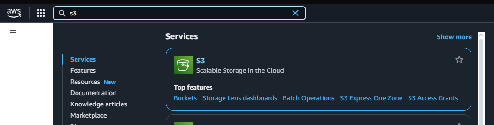

2. Selecione Create bucket (Criar bucket) e selecione a região onde você deseja criar o bucket. Escolha US East (N. Virginia) us-east-1.
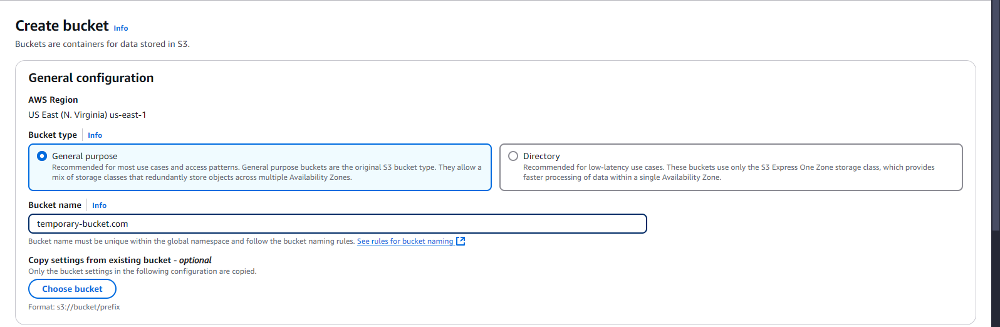

3. Para aceitar as configurações padrão e criar o bucket, escolha Create (Criar).
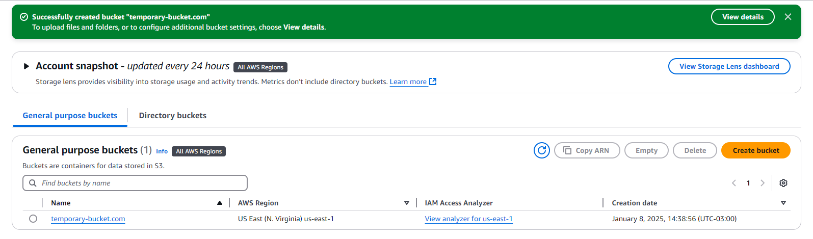


## Etapa 2: Habilitar hospedagem de site estático

1. Escolha Properties (Propriedades).
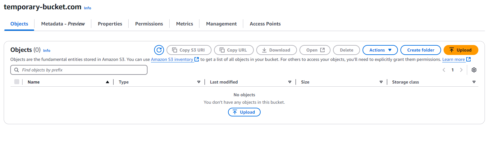

2. Em Static website hosting (Hospedagem estática de sites), escolha Edit (Editar).
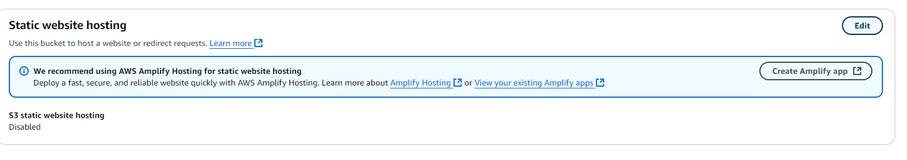

3. Em Static website hosting (Hospedagem estática de sites), escolha Enable (Ativar).
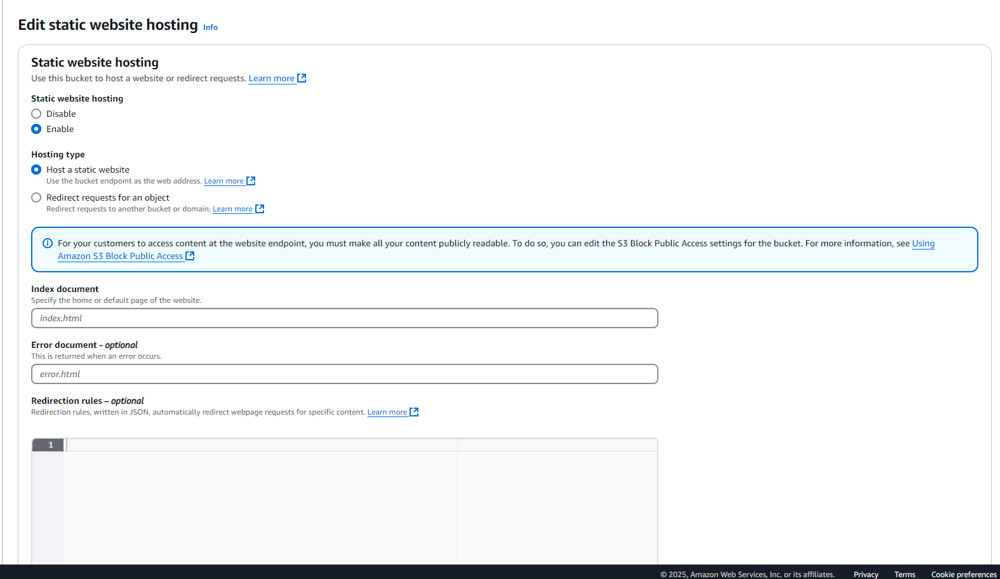

4. Em Index Document (Documento de índice), insira o nome do arquivo do documento de índice, que geralmente é index.html. Para fornecer seu próprio documento de erros personalizado para erros da classe 4XX, em Error document (Documento de erros), insira o nome de arquivo do documento de erros personalizado.
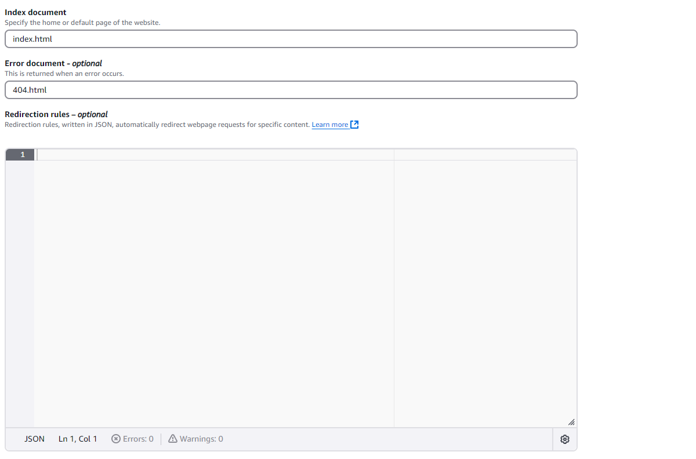

1. Static criado com sucesso.
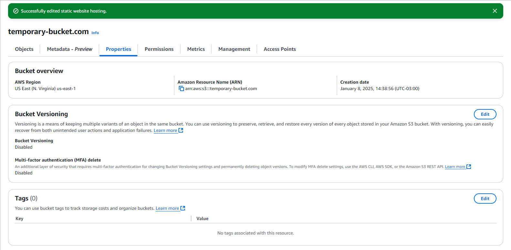

1. Em Static website hosting (Hospedagem de sites estáticos), copie o endpoint informado.
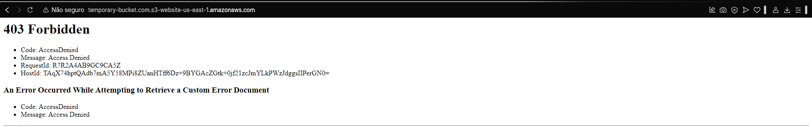


## Etapa 3: Habilitar hospedagem de site estático

1. Escolha Permissions (Permissões). Em Block public access (bucket settings) (Bloqueio de acesso público (configurações de bucket), escolha Edit (Editar).
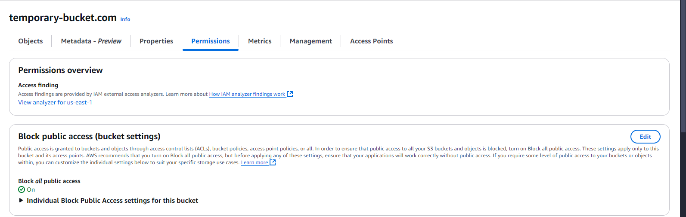

2. Desmarque Block all public access (Bloquear todo acesso público) e escolha Save changes (Salvar alterações).
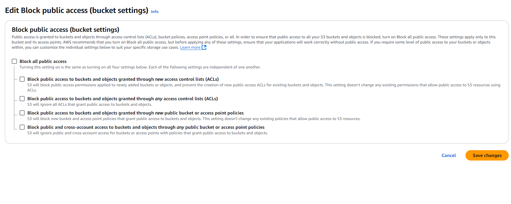

3. Editado Block public 
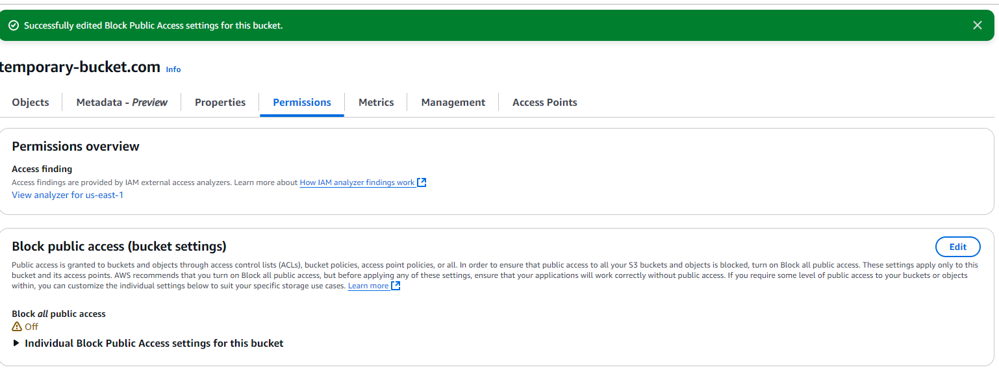

## Etapa 4: Adicionar política de bucket que torna o conteúdo do bucket publicamente disponível


1. Em Bucket Policy (Política de bucket), escolha Edit (Editar).
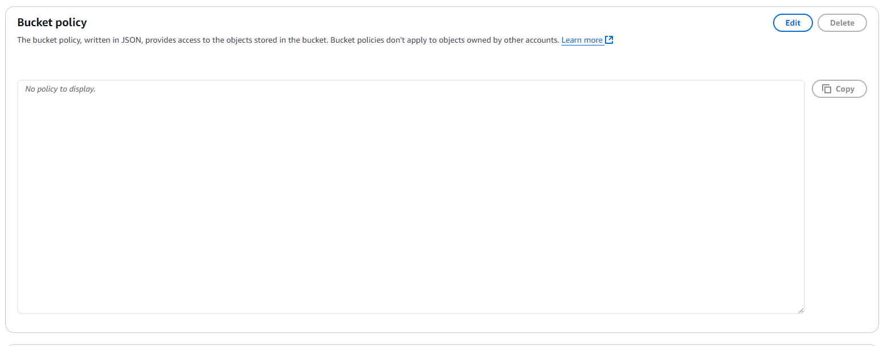

1. Para conceder acesso público de leitura ao site, copie a política de bucket a seguir e cole-a no Bucket policy editor (Editor de política de bucket).
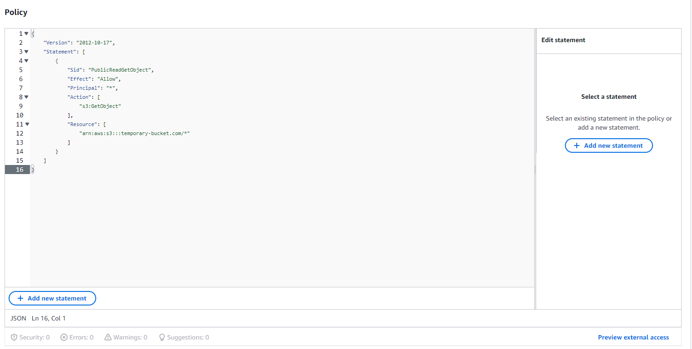

1. A política de bucket foi adicionada com sucesso.

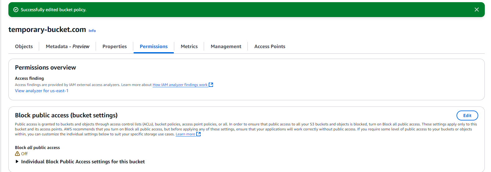

## Etapa 5: Configurar um documento de índice

Criar um arquivo local (sua máquina) com o nome index.html . O conteúdo do arquivo deverá ser (atente-se para o atributo href do link, pois ele deverá apontar para o arquivo CSV):
````html
<html xmlns="http://www.w3.org/1999/xhtml" >
<head>
    <title>Home Page do meu WebSite - Tutorial de S3</title>
</head>
<body>
  <h1>Bem-vindo ao meu website</h1>
  <p>Agora hospedado em Amazon S3!</p>
  <a href="nome do arquivo CSV a ser baixado">Download CSV File</a> 
</body>
</html>
````
1. Fazer upload do documento e uma pasta chamada dados e, após, faça upload do conteúdo do site (arquivo CSV) para ela.
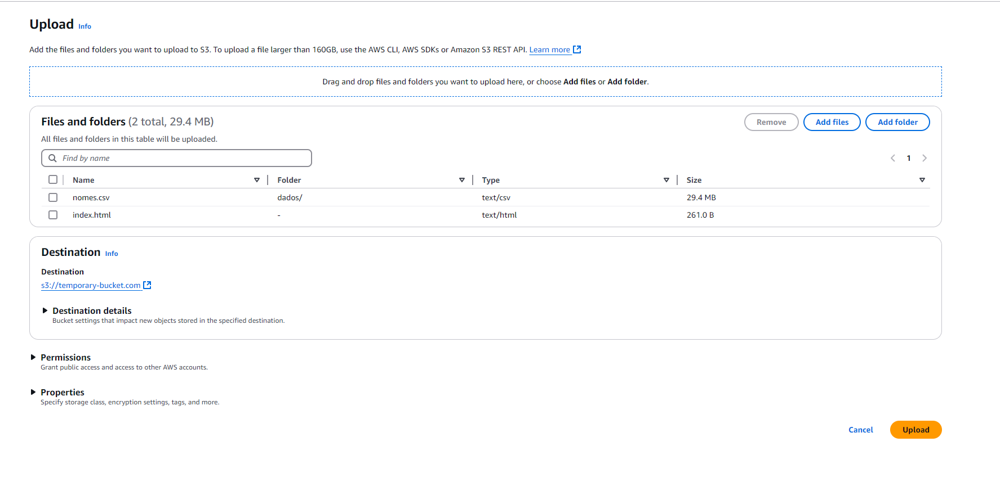

1. Upload com sucesso
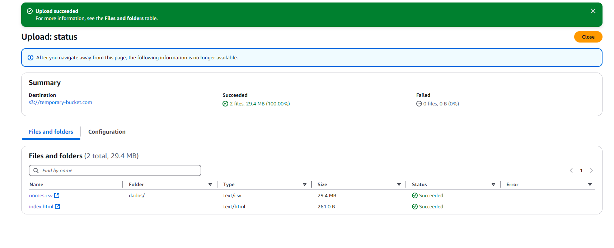


## Etapa 6: Configurar documento de erros

1. Crie um documento de erro com o nome 404.html depois fazer upload.
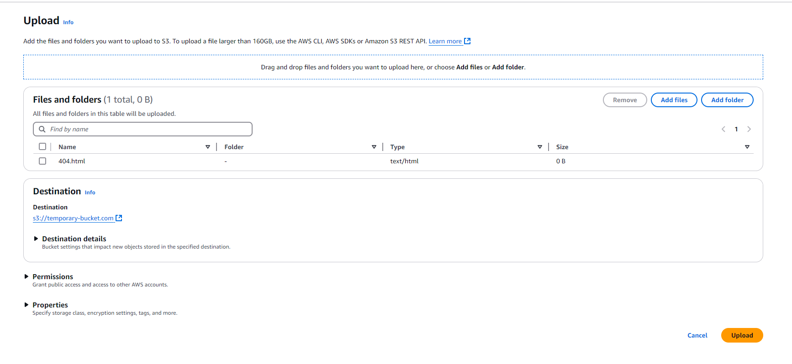

1. Upload com sucesso.
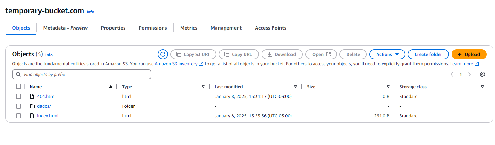


## Etapa 7: Testar o endpoint do site

1. Bucket website endpoint (Endpoint de site do Bucket). Seu documento de índice é aberto em uma janela separada do navegador.
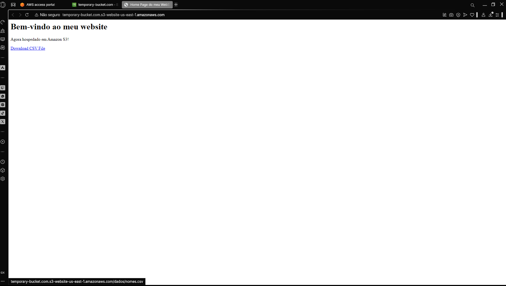

2. Baixando arquivo csv
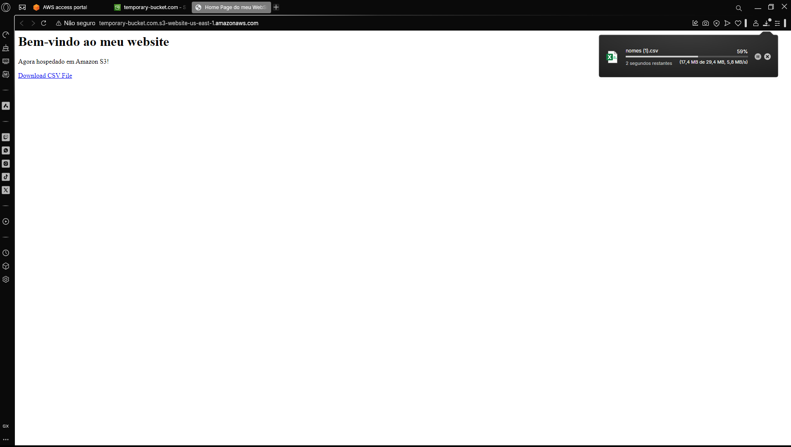


# Certificados

### Curso-padrão de preparação para o exame AWS Certified Cloud Practitioner (CLF-C02 - Português) 

.png)

### [AWS Cloud Quest: Cloud Practitioner](https://www.credly.com/badges/c10f5472-c5e9-4fb5-b3a7-0eb4780016e2/public_url)

[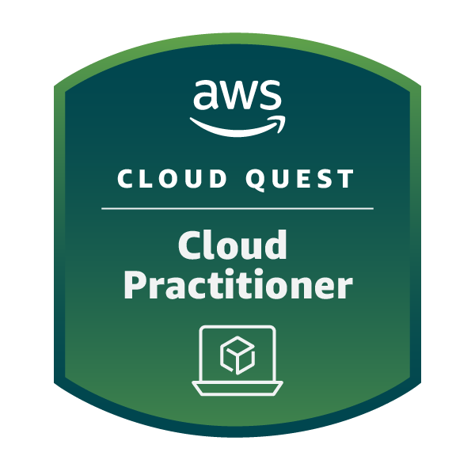](https://www.credly.com/badges/c10f5472-c5e9-4fb5-b3a7-0eb4780016e2/public_url)


 [Voltar para o topo](#índice)

