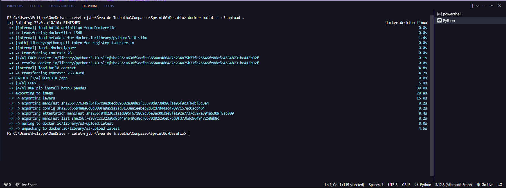
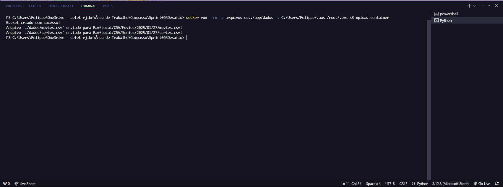
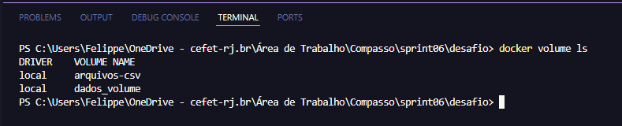
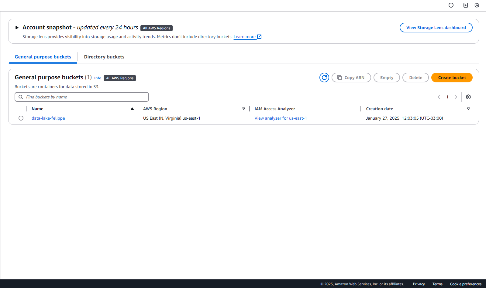
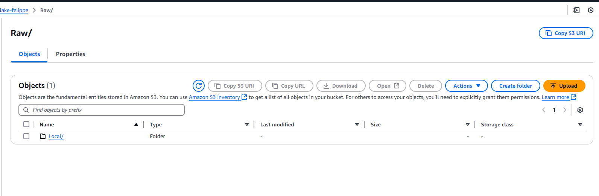
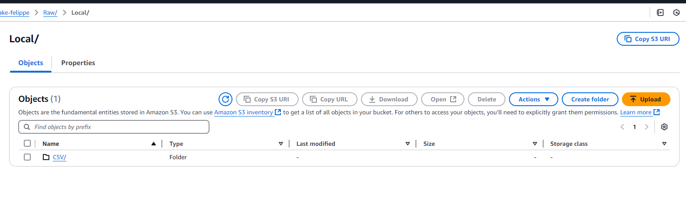
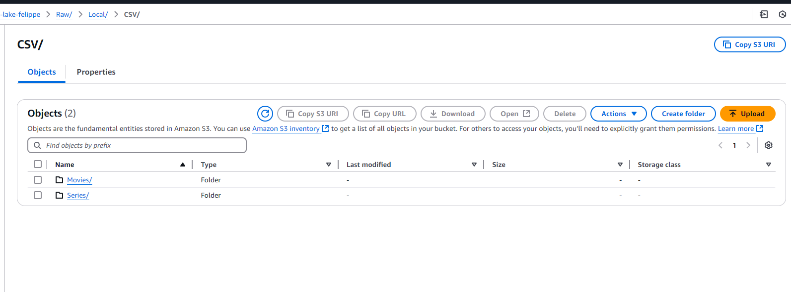
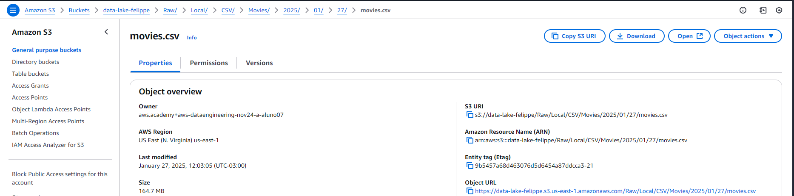
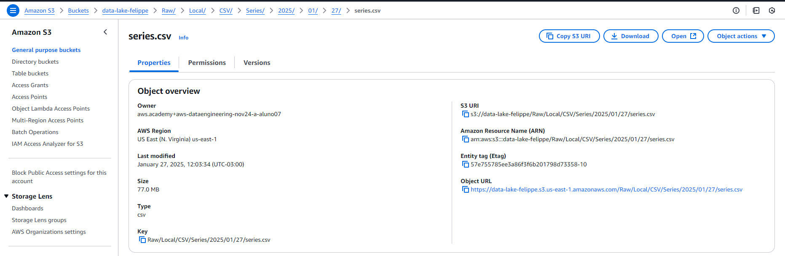

# Desafio
Neste desafio foi proposto criar duas perguntas para análises e fazer a ingestão em lote (batch) dos dados. O processo envolve ler dois arquivos CSV (de filmes e séries) e carregar esses dados para o S3 da AWS usando a biblioteca boto3, sem filtrar as informações. As perguntas devem ser definidas para orientar a análise dos dados. Para o carregamento, o caminho no S3 deve seguir um padrão específico, incluindo a origem, formato, data e nome do arquivo. Também é necessário configurar um container Docker com um volume para armazenar os arquivos CSV e rodar o processo Python localmente para realizar a carga ao S3.

# Índice

- [Desafio](#desafio)
- [Índice](#índice)
- [Peguntas](#peguntas)
  - [1. Implementando código Python](#1-implementando-código-python)
  - [2. Criando um container com volume para armazenar e executar processo python.](#2-criando-um-container-com-volume-para-armazenar-e-executar-processo-python)
  - [3. Criando imagem](#3-criando-imagem)
  - [4. Executando container](#4-executando-container)
  - [5. Volume](#5-volume)
- [Resultados](#resultados)
  - [Meu bucket criado com sucesso](#meu-bucket-criado-com-sucesso)
  - [Caminho Raw](#caminho-raw)
  - [Caminho Local](#caminho-local)
  - [Caminho CSV](#caminho-csv)
  - [Movies com os caminhos das datas](#movies-com-os-caminhos-das-datas)
  - [Series com os caminhos das datas](#series-com-os-caminhos-das-datas)


# Peguntas 

1. Como a popularidade dos filmes de guerra mundou ao longo dos anos?

    Esta análise visa observar a evolução da popularidade dos filmes de guerra, considerando métricas como bilheteira, audiência e lançamento ao longo das décadas. A ideia é identificar tendências e mudanças significativas no comportamento do público.

2. Quais filmes apresentam um retorno financeiro abaixo do esperado, com base no orçamento investido?
    
    A análise de retorno financeiro terá como base a comparação entre o orçamento de produção e a arrecadação nas bilheteiras. Será calculada a relação entre essas duas variáveis para identificar filmes que não atingiram o retorno financeiro esperado.


## 1. Implementando código Python

```Python
import boto3
import pandas as pd
import os
from datetime import datetime

# Criando Sessão
session = boto3.Session(profile_name="nome_do_perfil_sso")
s3 = session.client("s3")

# Definindo nome do bucket e caminho dos arquivos locais
bucket_name = "data-lake-felippe"
datas_path = "./dados"

# Definindo caminho para os arquivos
movies_path = os.path.join(datas_path, "movies.csv")
series_path = os.path.join(datas_path, "series.csv")

# Lendo os arquivos
df_movies = pd.read_csv(movies_path)
df_series = pd.read_csv(series_path)

# Obtendo a data atual para formar o caminho.
current_date = datetime.now().strftime("%Y/%m/%d")

# Criação do bucket S3
try:
    s3.create_bucket(Bucket="data-lake-felippe")
    print("Bucket criado com sucesso!")
except Exception as e:
    print(f"Erro ao criar o bucket: {e}")


# Função Upload do arquivo S3
def upload_s3(file_path, bucket, s3_path):
    try:
        s3.upload_file(file_path, bucket, s3_path)
        print(f"Arquivo '{file_path}' enviado para {s3_path}!")
    except FileNotFoundError:
        print(f"Arquivo {file_path} não encontrado.")
    except Exception as e:
        print(f"Erro ao enviar o arquivo: {e}")


# Caminho o caminho no S3 para o arquivo de filmes e fazendo o upload
path_movies_s3 = f"Raw/Local/CSV/Movies/{current_date}/movies.csv"
upload_s3(movies_path, bucket_name, path_movies_s3)

# Caminho no S3 para o arquivo de séries e fazendo o upload
path_series_s3 = f"Raw/Local/CSV/Series/{current_date}/series.csv"
upload_s3(series_path, bucket_name, path_series_s3)

```

## 2. Criando um container com volume para armazenar e executar processo python.

Arquivo Dockerfile

```Dockerfile
FROM python:3.10-slim

WORKDIR /app

COPY . .

RUN pip install boto3 pandas

CMD ["python", "upload_s3.py"]
```

## 3. Criando imagem



## 4. Executando container 




## 5. Volume



# Resultados

## Meu bucket criado com sucesso


## Caminho Raw



## Caminho Local


## Caminho CSV 


## Movies com os caminhos das datas 

Obs: O caminho da DATA pode ser visualizado acima de movies.csv 


## Series com os caminhos das datas 

Obs: O caminho da DATA pode ser visualizado acima de serie.csv 



