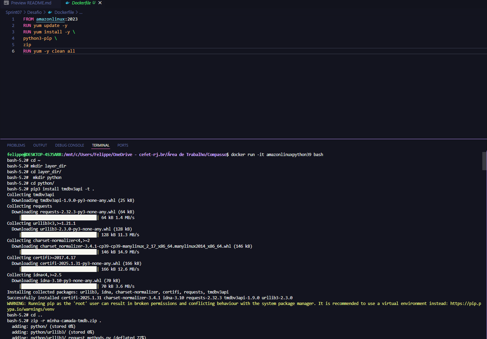
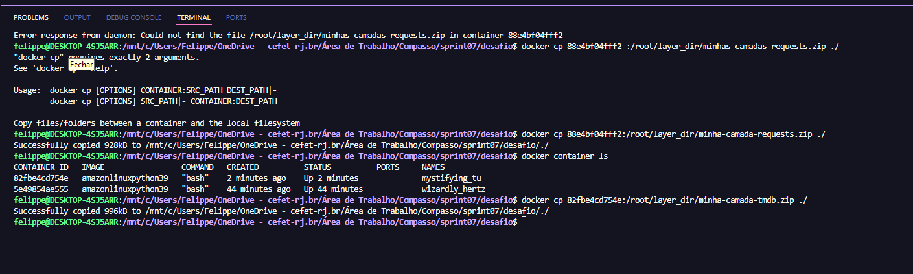
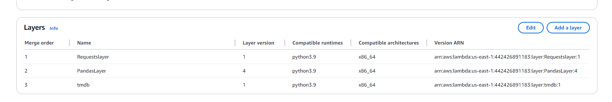
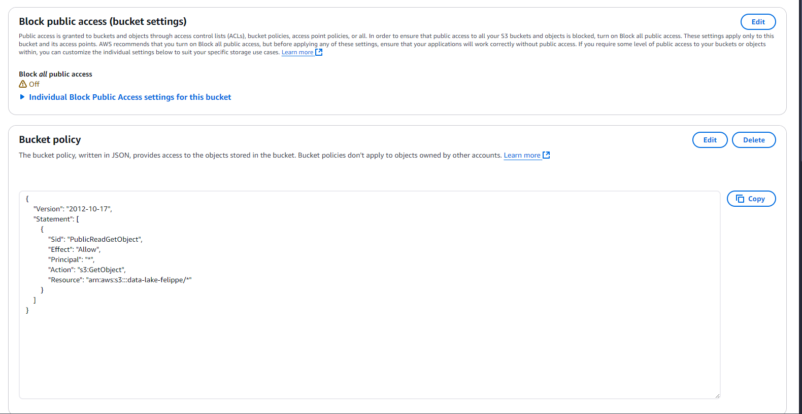
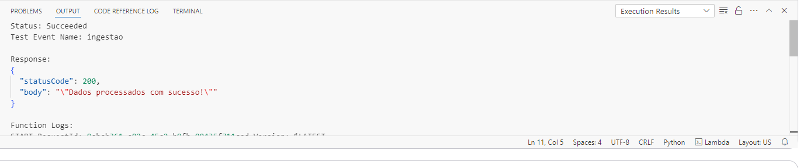
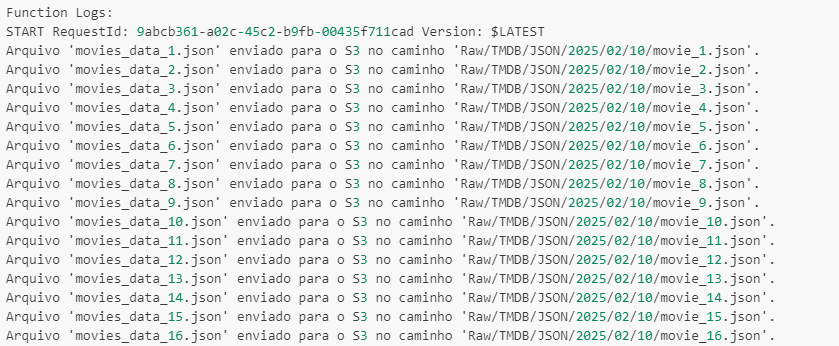
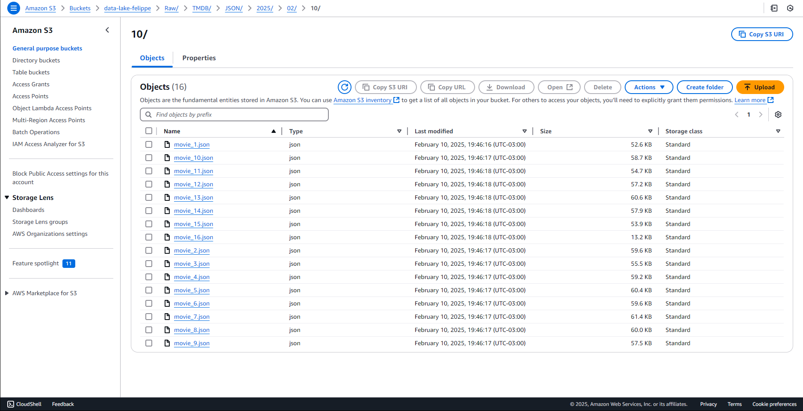

# Desafio
O objetivo desse desafio era fazer uma ingestão de dados com uma api usando uma função lambda

# Índice

- [Desafio](#desafio)
- [Índice](#índice)
- [Novas Peguntas](#novas-peguntas)
  - [Criando minhas camadas](#criando-minhas-camadas)
  - [Função Lambda](#função-lambda)
  - [Permissões necessárias](#permissões-necessárias)
  - [Resultados](#resultados)


# Novas Peguntas 

Com as novas perguntas 

Como a popularidade dos filmes de guerra mudou ao longo dos anos?

Quais filmes apresentam retorno financeiro abaixo do esperado?

Qual é o orçamento médio dos filmes de guerra em comparação com os de
crime?

Quais são as 10 filmes de crimes mais bem avaliadas?

Quais diretores têm os filmes mais bem avaliados nas categorias de crime e
guerra?

Quais os temas que mais aparecem na sinopse dos filmes de guerra?

Quais as principais empresas produzem filmes de crime?

Como os temas de filmes de guerra mudaram ao longo das décadas?

Quais países produzem mais filmes de guerra?

Popularidade de filmes indicados a prêmios de filmes de guerra e crime.

Como as filmes de crime e guerra se comparam em popularidade e avaliação?


## Criando minhas camadas

Criando as camadas do tmdb e requests foi reutilizada a pandas criada no exercicio da sprint05




Adicionando as camadas 



## Função Lambda 

```python

import boto3
import pandas as pd
import json
import math
import os
import time
import requests
from tmdbv3api import TMDb, Movie
from datetime import datetime
def lambda_handler(event, context):
    
    s3_client = boto3.client('s3')
    bucket_name = 'data-lake-felippe'
    csv_key = "Raw/Local/CSV/Movies/2025/01/27/movies.csv"
    
    csv_file = '/tmp/movies.csv'
    s3_client.download_file(bucket_name, csv_key, csv_file)
    
    try:
        df = pd.read_csv(csv_file, sep="|", low_memory=False)
    except Exception as e:
        print(f"Erro ao ler o arquivo CSV: {e}")
        return

    # Filtrar filmes do gênero 'war' e 'crime'
    movies_df = df[(df['genero'] == 'War') | (df['genero'] == 'Crime')]
    ordened = movies_df.sort_values('notaMedia', ascending=False)
    movies_df = ordened.drop_duplicates('id', keep='first')
    
    TMDB_API_KEY =  os.environ.get("TMDB_API_KEY")  
    TMDB_BASE_URL = "https://api.themoviedb.org/3"
    
    def movie_details(movie_id):
        
        try:
            url = f"{TMDB_BASE_URL}/movie/{movie_id}?api_key={TMDB_API_KEY}&language=pt-BR"
            response = requests.get(url)
            response.raise_for_status()
            return response.json()
        except requests.exceptions.RequestException as e:
            return None


    # Dados retirados da api
    movies_data = []
    for _, row in movies_df.iterrows():
        movie_id = row['id']
        movie_data = movie_details(movie_id)
        if movie_data:
                    movie_info = {
                        "imdb_id": movie_data.get("imdb_id"),
                        "tipo": "movie",
                        "popularity": movie_data.get("popularity"),
                        "budget": movie_data.get("budget"),
                        "revenue": movie_data.get("revenue"),
                        "vote_average":movie_data.get("vote_average"),
                        "vote_count":movie_data.get("vote_count"),
                        "overview":movie_data.get("overview"),
                        "production_countries": movie_data.get("production_countries", []),
                        "production_companies": movie_data.get("production_companies", []),
                    }
                    movies_data.append(movie_info)
            
    if movies_data:
        size = 100
        total = math.ceil(len(movies_data) / size)
        
        # Obter a data atual para formar a estrutura do caminho
        current_date = datetime.now()
        year = current_date.year
        month = f"{current_date.month:02d}"
        day = f"{current_date.day:02d}"
        
        for i in range(total):
            data = movies_data[i * size: (i + 1) * size]
            file_name = f"movies_data_{i + 1}.json"
            file_path = f"/tmp/{file_name}"
            
            with open(file_path, "w", encoding="utf-8") as json_file:
                json.dump(data, json_file, ensure_ascii=False, indent=4)
            
            # Definir o caminho no S3 de acordo com o formato solicitado
            s3_path = f"Raw/TMDB/JSON/{year}/{month}/{day}/movie_{i + 1}.json"
            
            # Enviar o arquivo para o S3
            s3_client.upload_file(file_path, bucket_name, s3_path)
            print(f"Arquivo '{file_name}' enviado para o S3 no caminho '{s3_path}'.")
    else:
        print("Nenhum dado foi encontrado.")
    
    return {
        'statusCode': 200,
        'body': json.dumps('Dados processados com sucesso!')
    }

```


## Permissões necessárias 
Bucket 


Iam


## Resultados 










