# Índice

- [Índice](#índice)
- [Resumo da Sprint 7](#resumo-da-sprint-7)
- [Certificados](#certificados)
    - [Não houve certificados nessa Sprint](#não-houve-certificados-nessa-sprint)
- [Exercícios](#exercícios)
  - [Apache Spark - Contador de Palavras](#apache-spark---contador-de-palavras)
    - [Realizando o pull da imagem:](#realizando-o-pull-da-imagem)
    - [Criando um container:](#criando-um-container)
    - [Jupyter Lab:](#jupyter-lab)
    - [Obtendo arquivos do git:](#obtendo-arquivos-do-git)
    - [Comandos para contar a quantidade de ocorrências de cada palavra contida](#comandos-para-contar-a-quantidade-de-ocorrências-de-cada-palavra-contida)
  - [TMDB](#tmdb)
  - [Conta e API criada com sucesso](#conta-e-api-criada-com-sucesso)
  - [Testando as Credencias e a biblioteca](#testando-as-credencias-e-a-biblioteca)
  - [Resultado](#resultado)
  - [Aws Glue](#aws-glue)
- [Parte 1](#parte-1)
- [Parte 2](#parte-2)
- [Parte 3](#parte-3)
- [Parte 4](#parte-4)
- [Parte 5](#parte-5)
- [Parte 5.2](#parte-52)
  - [Resultados](#resultados)
  - [Parte 6](#parte-6)

   
   
# Resumo da Sprint 7
**Spark:** Aprendi que o spark é uma ferramenta muito poderosa para o processamento distribuído de grandes volumes de dados, muito usada em Big Data. Aprendi sobre o Spark Core, que gerencia tarefas e distribui o processamento, e os RDDs (Resilient Distributed Datasets), que são a base para manipular dados de forma distribuída. Também vi que o Spark SQL permite trabalhar com consultas SQL em dados distribuídos e que os DataFrames e Datasets são estruturas otimizadas para análise e manipulação de dados no Spark.

# Certificados

### Não houve certificados nessa Sprint


# Exercícios

## Apache Spark - Contador de Palavras


### Realizando o pull da imagem: 

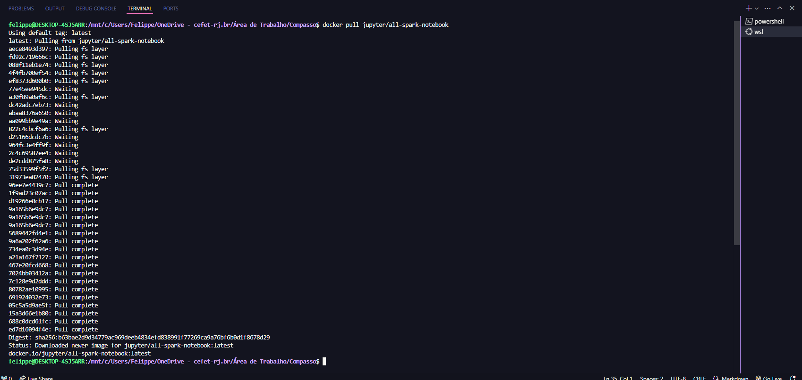


### Criando um container:

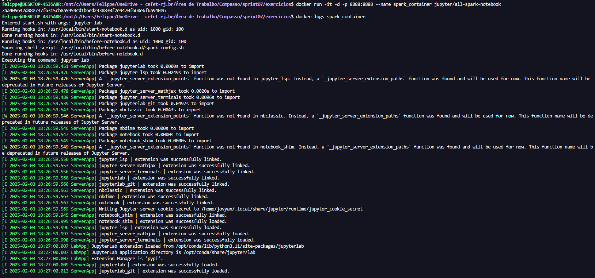


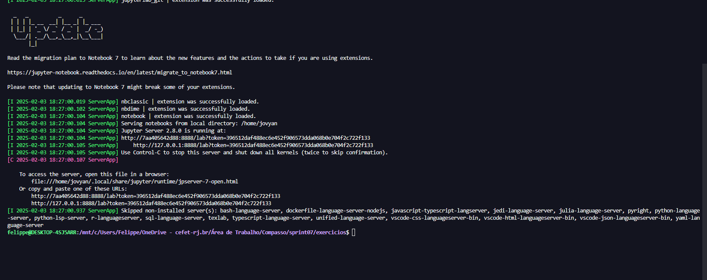

### Jupyter Lab:

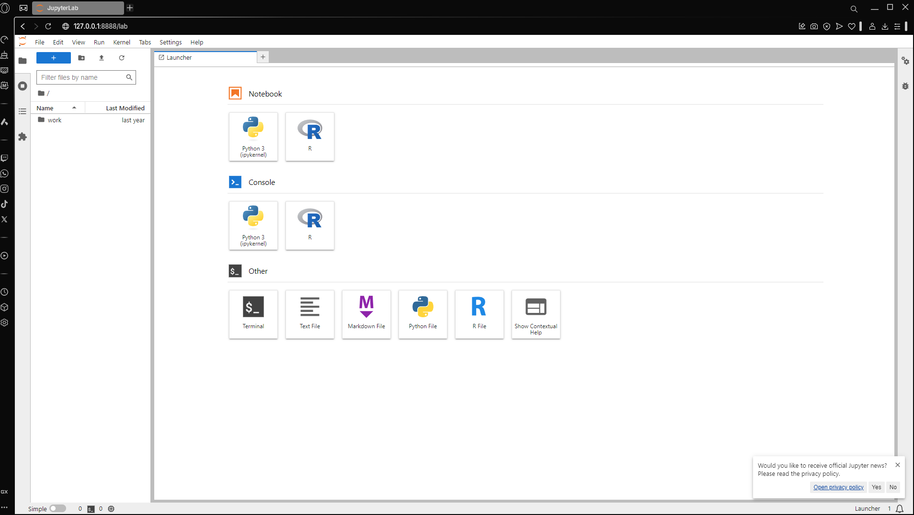


### Obtendo arquivos do git: 

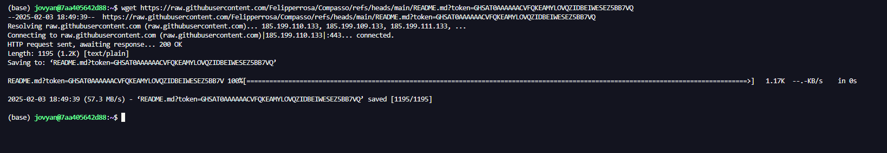


### Comandos para contar a quantidade de ocorrências de cada palavra contida 

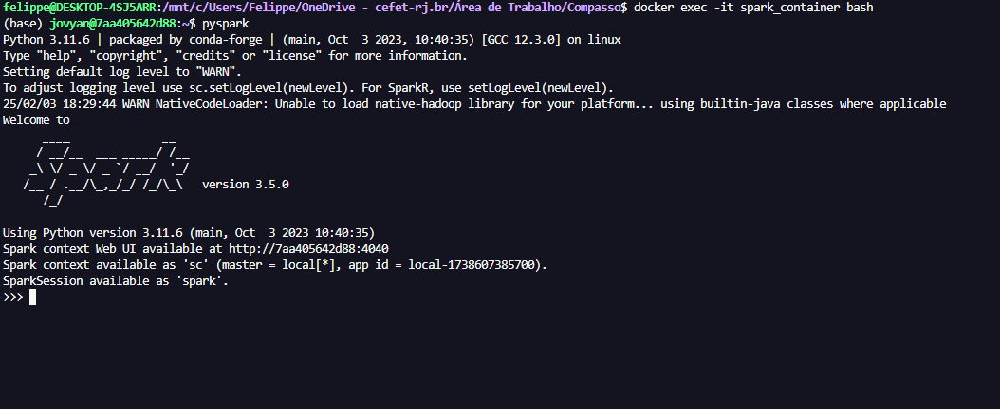


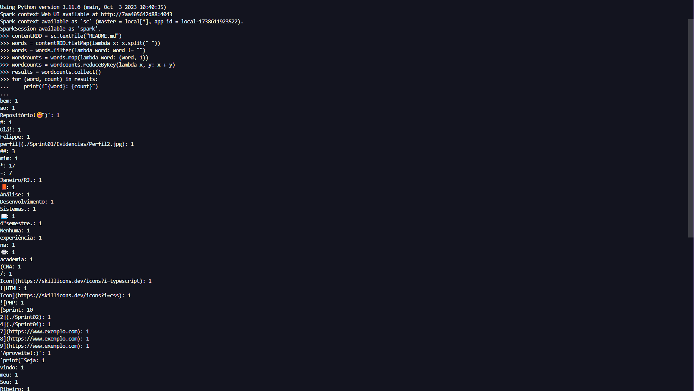


## TMDB

## Conta e API criada com sucesso 

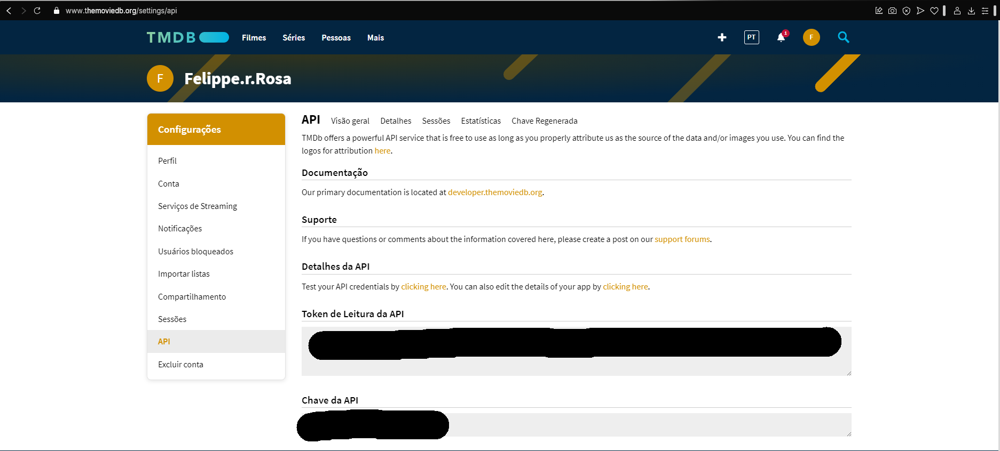


## Testando as Credencias e a biblioteca
```python
import requests
import pandas as pd
from IPython.display import display

api_key = "MINHA_CHAVE"
url = f"https://api.themoviedb.org/3/movie/top_rated?api_key={api_key}&language=pt-BR"


response = requests.get(url)
data = response.json()

filmes = []

for movie in data["results"]:
    df = {
        "Título": movie["title"],
        "Data de lançamento": movie["release_date"],
        "Visão geral": movie["overview"],
        "Votos": movie["vote_count"],
        "Média de votos": movie["vote_average"],
    }
    filmes.append(df)

df = pd.DataFrame(filmes)
display(df)
```
## Resultado

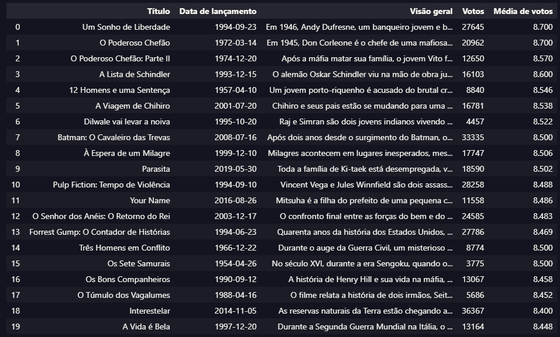


## Aws Glue

# Parte 1 

preparando origem 

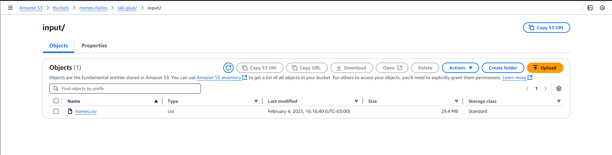

# Parte 2 

Permissoes

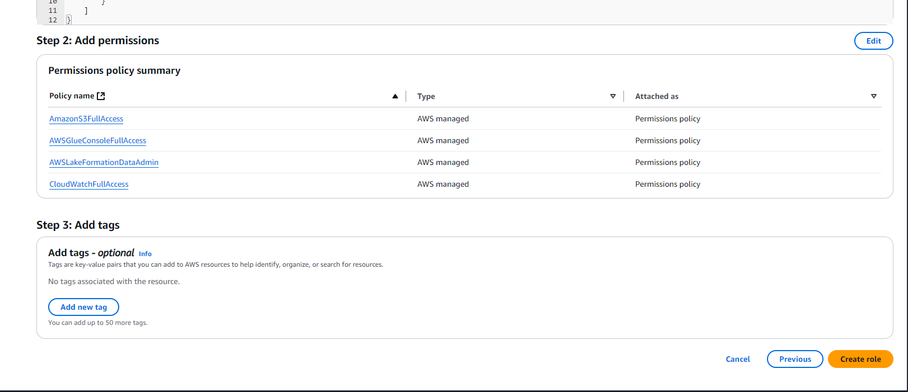

Nome

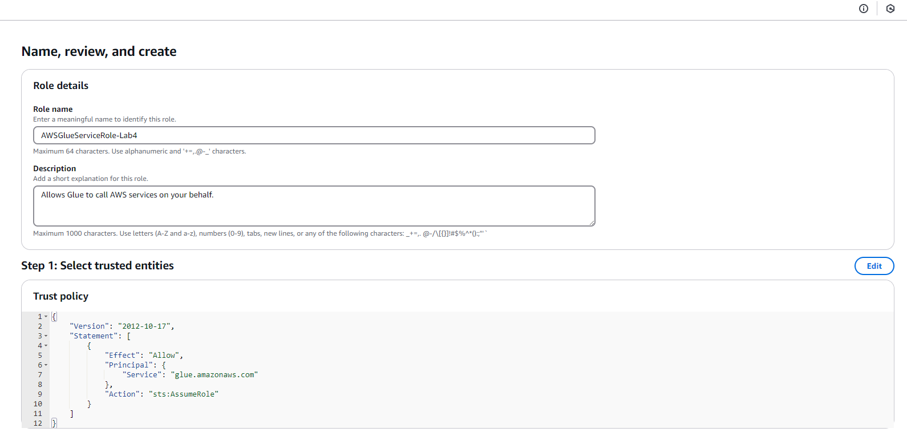

Criada com sucesso 

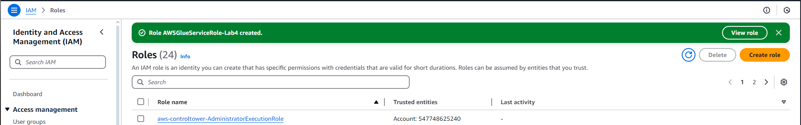

# Parte 3

Acesso ao glue

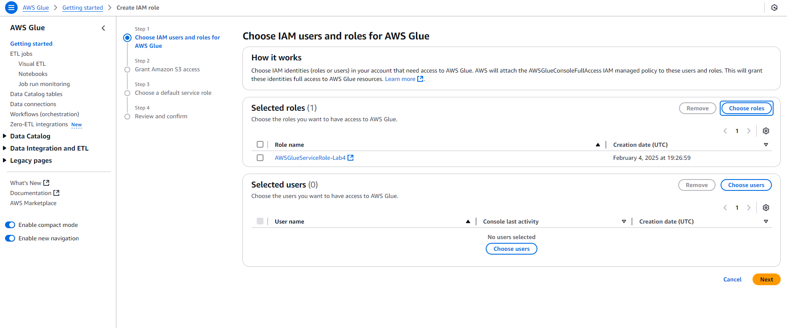

Roles atualizada com sucesso

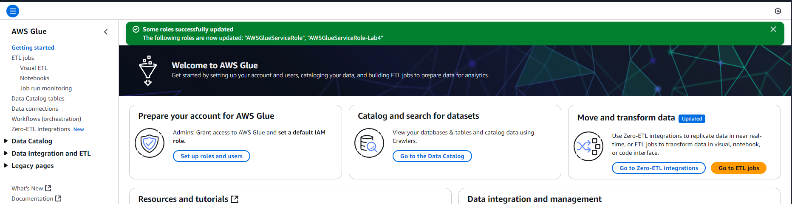


# Parte 4

Database

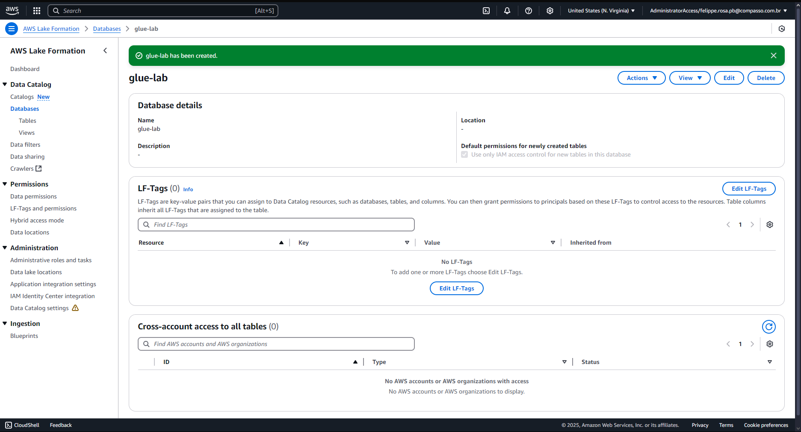


# Parte 5

Jobdetail

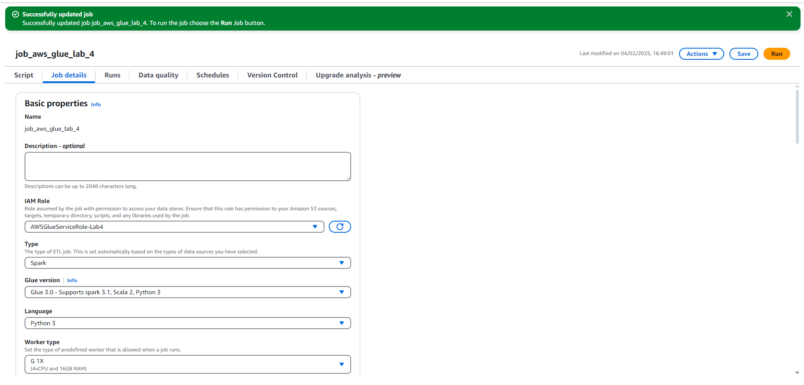

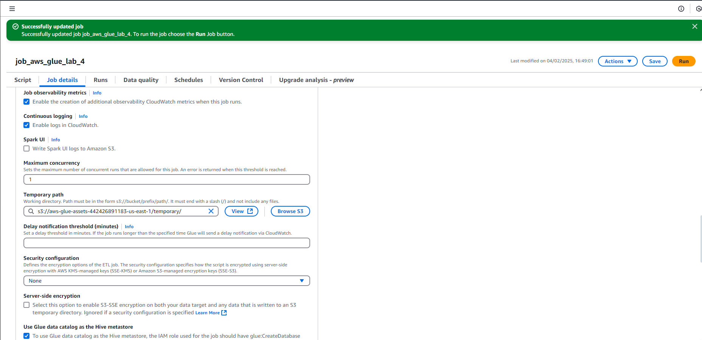


Job Parameters

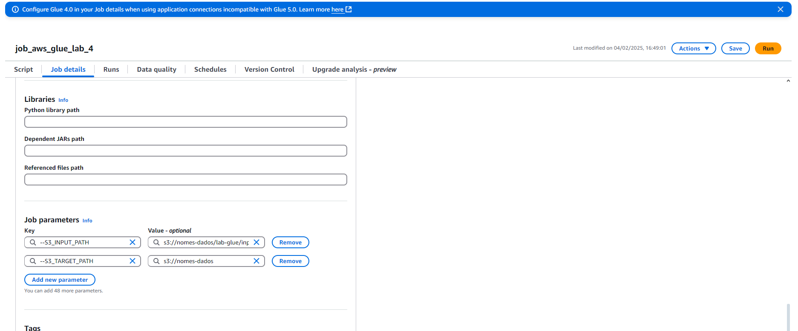

Script

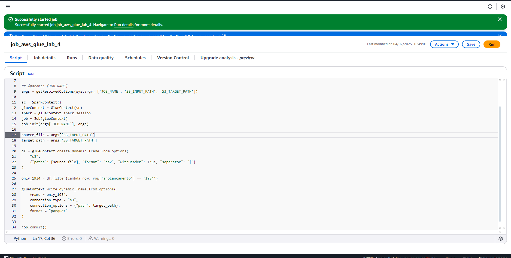


Resultado

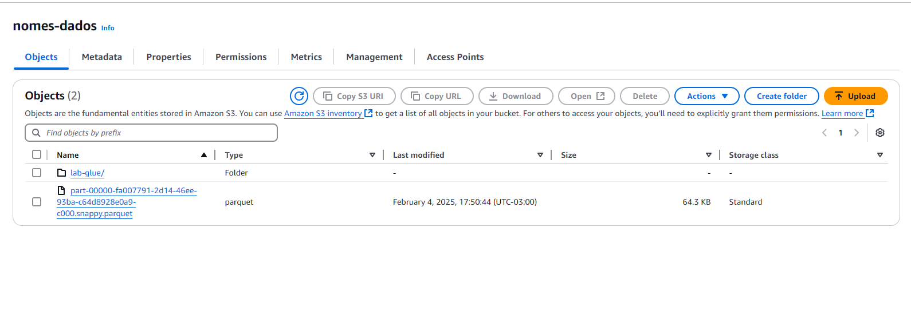

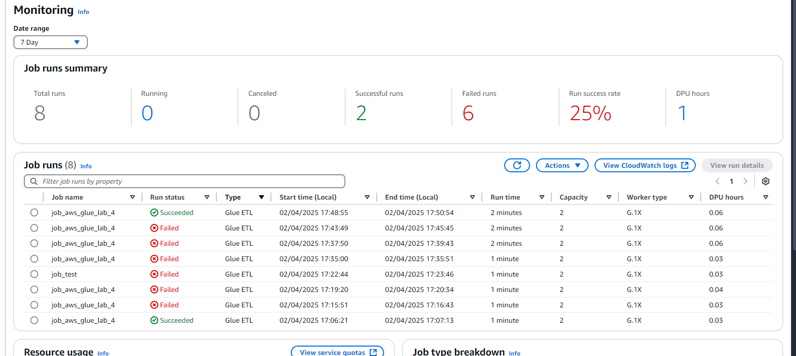

# Parte 5.2

Minha vez!

```python
import sys
from awsglue.transforms import *
from awsglue.utils import getResolvedOptions
from pyspark.context import SparkContext
from awsglue.context import GlueContext
from awsglue.job import Job
from awsglue.dynamicframe import DynamicFrame
from pyspark.sql.functions import upper, col, count, desc

## @params: [JOB_NAME, S3_INPUT_PATH, S3_TARGET_PATH]
args = getResolvedOptions(sys.argv, ['JOB_NAME', 'S3_INPUT_PATH', 'S3_TARGET_PATH'])

# Inicialização do contexto Spark e Glue
sc = SparkContext()
glueContext = GlueContext(sc)
spark = glueContext.spark_session
job = Job(glueContext)
job.init(args['JOB_NAME'], args)

# 1. Ler o arquivo CSV do S3
input_path = args['S3_INPUT_PATH']
dynamic_frame = glueContext.create_dynamic_frame.from_options(
    connection_type="s3",
    format="csv",
    connection_options={"paths": [input_path]},
    format_options={"withHeader": True, "separator": ","},
    transformation_ctx="dynamic_frame"
)

# Converter DynamicFrame para DataFrame Spark
spark_df = dynamic_frame.toDF()

# 2. Imprimir o schema do DataFrame
spark_df.printSchema()

# 3. Alterar a caixa dos valores da coluna "nome" para MAIÚSCULO
spark_df = spark_df.withColumn("nome", upper(col("nome")))

# 4. Imprimir a contagem de linhas presentes no DataFrame
print(f"Contagem de linhas: {spark_df.count()}")

# 5. Contagem de nomes, agrupando por "ano" e "sexo", ordenando pelo ano mais recente
df_grouped = spark_df.groupBy("ano", "sexo").agg(count("*").alias("total")).orderBy(desc("ano"))
df_grouped.show()

# 6. Nome feminino com mais registros e o ano em que ocorreu
df_feminino = spark_df.filter(col("sexo") == "F") \
    .groupBy("nome", "ano") \
    .agg(count("*").alias("total")) \
    .orderBy(desc("total"))
df_feminino.show(1)

# 7. Nome masculino com mais registros e o ano em que ocorreu
df_masculino = spark_df.filter(col("sexo") == "M") \
    .groupBy("nome", "ano") \
    .agg(count("*").alias("total")) \
    .orderBy(desc("total"))
df_masculino.show(1)

# 8. Total de registros (masculinos e femininos) para cada ano, ordenados pelo ano (crescente)
df_total_por_ano = spark_df.groupBy("ano") \
    .agg(count("*").alias("total")) \
    .orderBy("ano")
df_total_por_ano.show(10)

# 9. Escrever o DataFrame com os valores de "nome" em maiúsculo no S3, no formato JSON, particionado por "sexo" e "ano"
output_path = args['S3_TARGET_PATH']
spark_df.write.mode("overwrite") \
    .format("json") \
    .partitionBy("sexo", "ano") \
    .save(output_path)

# Finalizar o job
job.commit()

```

## Resultados
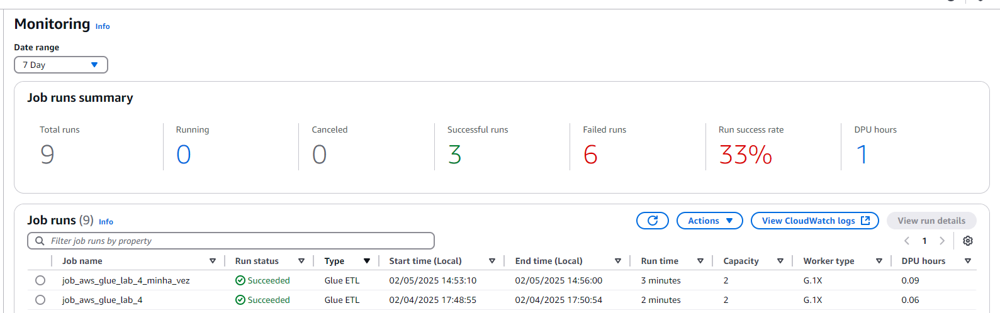

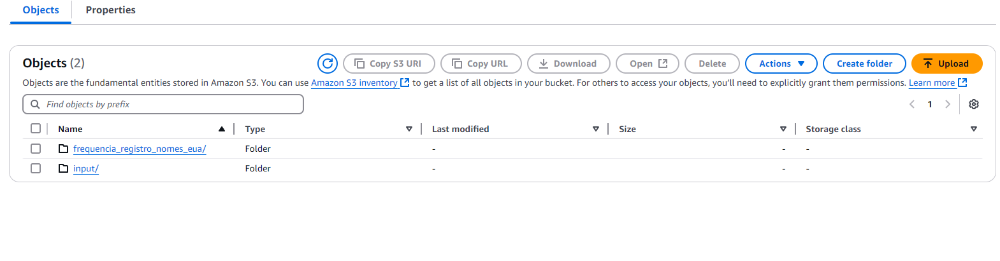

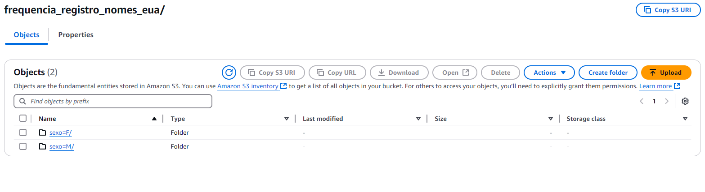

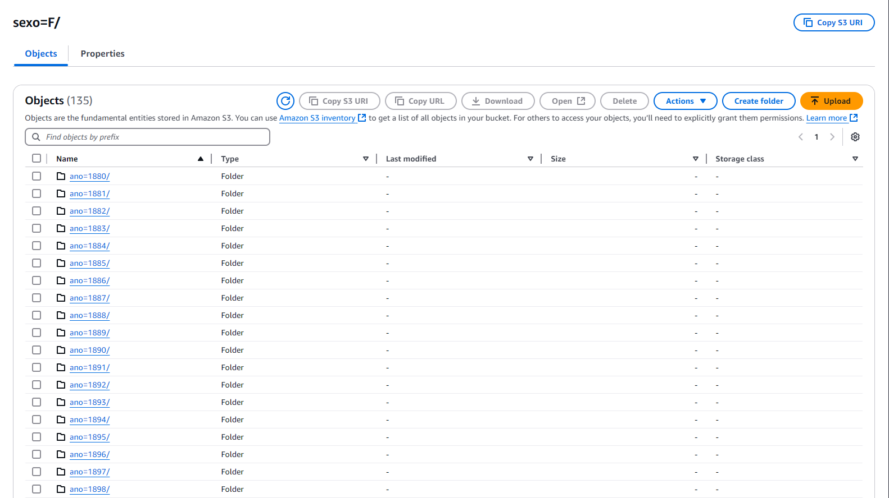

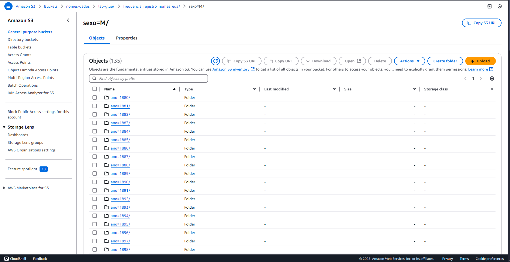


## Parte 6 

Criando Crawler

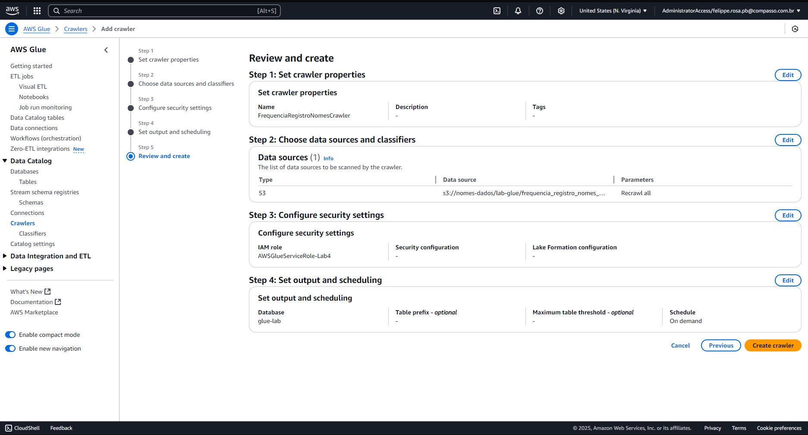

Criado com Sucesso 

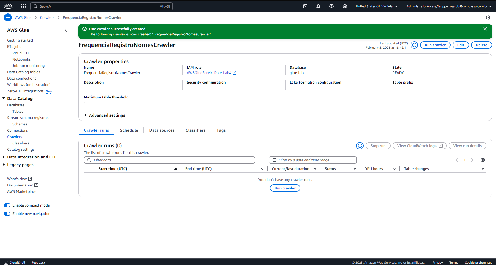
Criado com Sucesso 

Tabela e resultados 
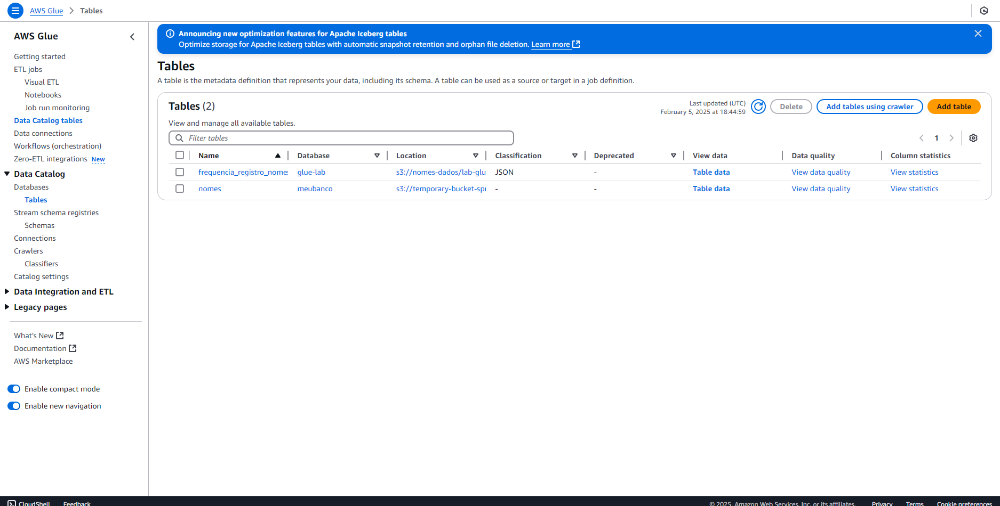

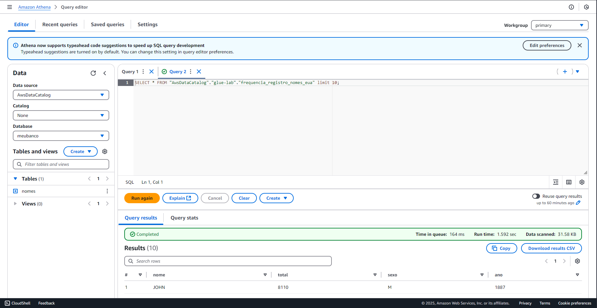

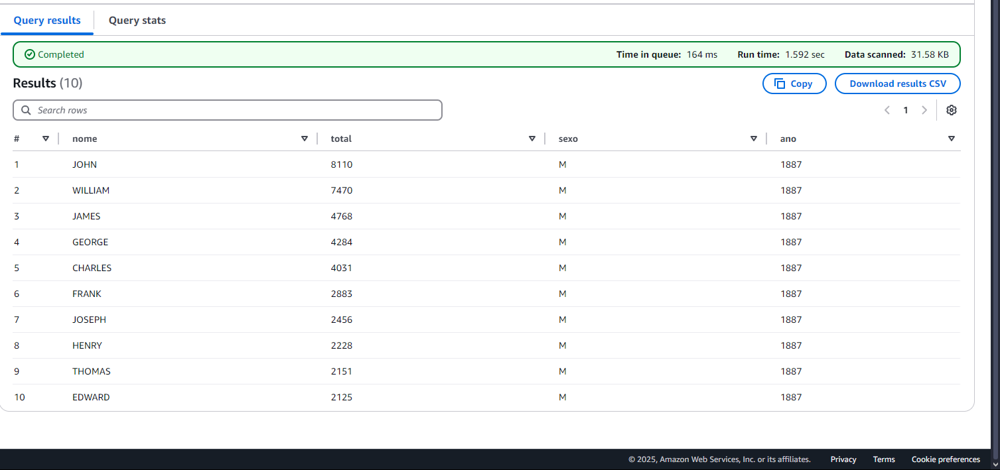