# Desafio
O Desafio  foca no processamento da camada Trusted de um data lake, onde os dados são limpos, confiáveis e padronizados, provenientes da integração de fontes da camada Raw. Utilizando o Apache Spark via AWS Glue, os dados da Raw Zone são transformados e persistidos na Trusted Zone no formato PARQUET
# Índice

- [Desafio](#desafio)
- [Índice](#índice)
  - [Tema do desafio](#tema-do-desafio)
  - [**1. Desempenho Comercial e Recepção Crítica**](#1-desempenho-comercial-e-recepção-crítica)
  - [**2. Análise de Personagens e Popularidade**](#2-análise-de-personagens-e-popularidade)
  - [**3. Evolução Narrativa e Temática**](#3-evolução-narrativa-e-temática)
  - [**4. Legado e Influência Cultural**](#4-legado-e-influência-cultural)
  - [**5. Premiações e Direção**](#5-premiações-e-direção)
- [API TMDB (The Movie Database)](#api-tmdb-the-movie-database)
- [API OMDB (Open Movie Database)](#api-omdb-open-movie-database)
- [O Desafio](#o-desafio)
  - [Job CSV](#job-csv)
  - [Resultados](#resultados)
  - [Job Json](#job-json)
  - [Resultados](#resultados-1)


## Tema do desafio 

O tema do desafio será a trilogia do Poderoso Chefão, um clássico do cinema que não apenas marcou a história do cinema, mas também influenciou inúmeras outras obras cinematográficas. A trilogia, dirigida por Francis Ford Coppola, é baseada no romance de Mario Puzo e retrata a saga da família Corleone, explorando temas como poder, lealdade, traição e a complexidade das relações familiares.

As perguntas que serão analisadas foram dividas em 5 Categorias 


## **1. Desempenho Comercial e Recepção Crítica**  
**(Foco em bilheteria, orçamento e avaliações)**  
- **1.1** - Qual é a avaliação média de cada filme da trilogia, levando em consideração o número de votos?  
- **1.2** - Qual foi o desempenho de bilheteria de cada filme em comparação ao seu orçamento?  
- **1.3** - Qual o retorno financeiro de cada filme (bilheteria menos orçamento), e qual teve o maior lucro?  
- **1.4** - Como as avaliações evoluíram ao longo da trilogia?  
- **1.5** - Qual foi o filme mais popular entre os três, considerando métricas como bilheteria e avaliação crítica?**  
- **1.6** - Quais países esses filmes foram lançados?** 


## **2. Análise de Personagens e Popularidade**  
**(Foco na relevância dos personagens e sua evolução ao longo da trilogia)**  
- **2.1** - Qual personagem é mais popular em cada filme da trilogia? Como a popularidade varia ao longo dos filmes?  
- **2.2** - Quais personagens tiveram mais destaque no filme 2 e 3 em comparação ao 1? 


## **3. Evolução Narrativa e Temática**  
**(Foco em mudanças na história, temas principais e estilo do filme)**  
- **3.1** - Como a narrativa e os temas principais da trilogia evoluíram ao longo dos três filmes? Quais elementos (personagens, eventos, cenários) mudaram?  
- **3.2** - Por que diferenciam tanto Sicília de Itália?  
- **3.3** - Quais foram as línguas faladas durante a trilogia, e como isso refletiu a diversidade cultural no enredo?**  


## **4. Legado e Influência Cultural**  
**(Foco na recepção do público ao longo dos anos e impacto da trilogia no cinema e na cultura pop)**  
- **4.1** - Como a popularidade de *O Poderoso Chefão* se manteve ao longo das décadas, considerando relançamentos e a influência cultural?  
- **4.2** - Como o público respondeu ao final da trilogia, especialmente em relação à recepção mista de *The Godfather Part III* comparado ao sucesso dos filmes 1 e 2?  
- **4.3** - Como a popularidade da trilogia foi afetada ao longo dos anos, incluindo o impacto de novos públicos e reexibições?**  


## **5. Premiações e Direção**  
**(Foco nos prêmios, impacto das premiações e decisões criativas de Coppola)**  
- **5.1** - Quantos prêmios importantes cada filme ganhou?  
- **5.5** - Como as locações e ambientações geográficas impactaram a autenticidade e a narrativa, e como influenciaram as decisões do enredo?  


# API TMDB (The Movie Database)

A API do TMDB foi escolhida para este projeto devido a:

Ampla Base de Dados: Contém informações detalhadas sobre filmes, séries, diretores, elenco, empresas de produção e gêneros.

Disponibilidade de Informações Relevantes: Permite acesso a dados como orçamento, receita, popularidade, avaliação, gênero e sinopse.

Facilidade de Integração: Fornece endpoints bem documentados e de fácil uso para obtenção dos dados necessários.

Suporte a Consultas Avançadas: Permite filtrar filmes por gênero, ano de lançamento, diretores e outras informações essenciais para a análise.

# API OMDB (Open Movie Database)

A API do OMDB foi utilizada como complemento à API do TMDB, principalmente para obter informações que não estão disponíveis no TMDB, como:

Prêmios Recebidos: A API OMDB fornece detalhes sobre os prêmios que um filme ou série recebeu, o que é crucial para uma análise completa do impacto e reconhecimento da obra.

Contagem de Votos e Média de Avaliação: Embora o TMDB também forneça dados de avaliação, a API OMDB pode apresentar diferenças na contagem de votos e na média de avaliações, permitindo uma comparação mais abrangente.


# O Desafio 

## Job CSV

````python
import sys
import re
from awsglue.transforms import *
from awsglue.utils import getResolvedOptions
from pyspark.context import SparkContext
from awsglue.context import GlueContext
from awsglue.job import Job

sc = SparkContext()
glueContext = GlueContext(sc)
spark = glueContext.spark_session
job = Job(glueContext)

args = getResolvedOptions(sys.argv, ["JOB_NAME", "S3_INPUT_PATH", "S3_TARGET_PATH"])
job.init(args["JOB_NAME"], args)

match = re.search(r"(\d{4})/(\d{2})/(\d{2})", args["S3_INPUT_PATH"])
ano, mes, dia = match.groups()  

df_raw = spark.read.csv(args["S3_INPUT_PATH"], header=True, inferSchema=True, sep="|")

# Filtrar apenas os filmes da trilogia 'O Poderoso Chefão'
godfather_movies = ["The Godfather", "The Godfather Part II", "The Godfather Part III"]
filtered_df = df_raw.filter(df_raw["tituloPincipal"].isin(godfather_movies))

# Criar caminho no S3 usando a data extraída
path = f"{args['S3_TARGET_PATH']}/{ano}/{mes}/{dia}"

# Salvar o DataFrame no S3 em formato Parquet diretamente no caminho
filtered_df.write.mode("overwrite").parquet(path)

job.commit()


````


## Resultados

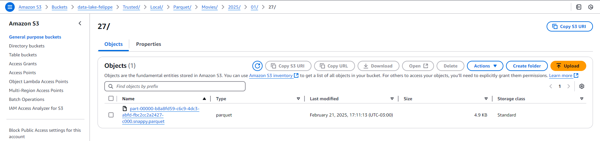

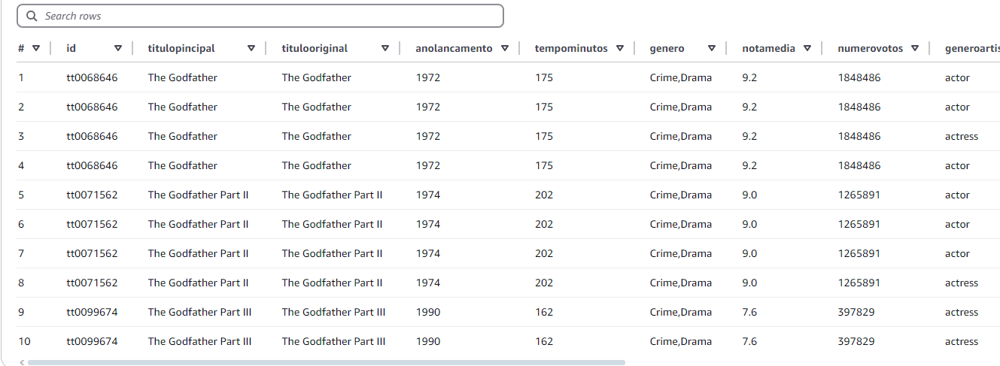

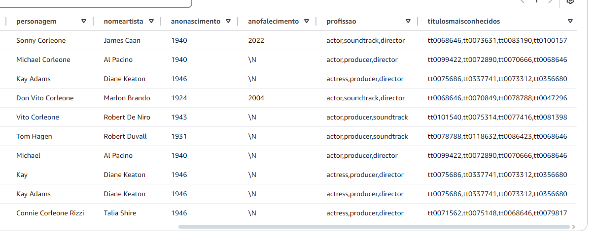


## Job Json


```python
import sys
import re
from awsglue.transforms import *
from awsglue.utils import getResolvedOptions
from pyspark.context import SparkContext
from awsglue.context import GlueContext
from awsglue.job import Job
from pyspark.sql.functions import current_date

# Inicialização do contexto
sc = SparkContext()
glueContext = GlueContext(sc)
spark = glueContext.spark_session
job = Job(glueContext)

# Parâmetros do Job
args = getResolvedOptions(sys.argv, ['JOB_NAME', "S3_INPUT_PATH", "S3_TARGET_PATH"])
job.init(args['JOB_NAME'], args)

match = re.search(r"(\d{4})/(\d{2})/(\d{2})", args["S3_INPUT_PATH"])
ano, mes, dia = match.groups()  

# Ler dados da Raw Zone (todos os arquivos JSON no caminho especificado)
df_raw = spark.read.json(args['S3_INPUT_PATH'], multiLine=True)

# Criar caminho no S3 usando a data extraída
path = f"{args['S3_TARGET_PATH']}/{ano}/{mes}/{dia}"

# Salvar dados na Trusted Zone (Parquet, particionado por data de ingestão)
df_raw.write.mode("overwrite").parquet(path)

# Finalizar o job
job.commit()


```


## Resultados

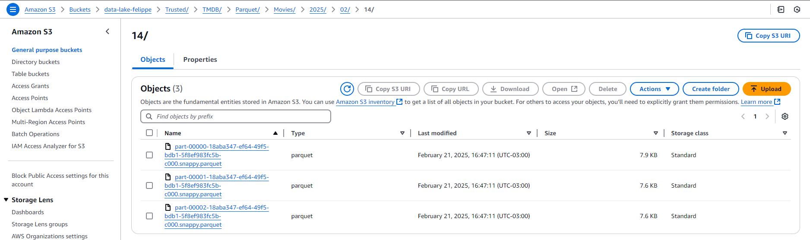

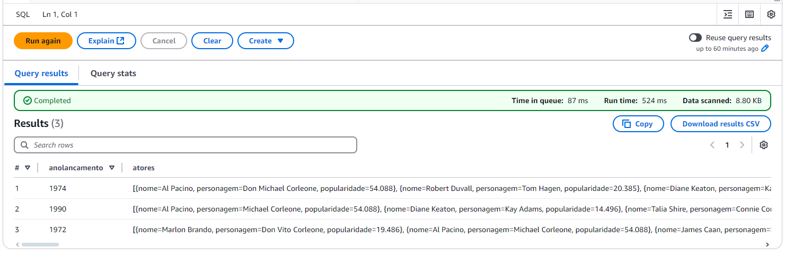

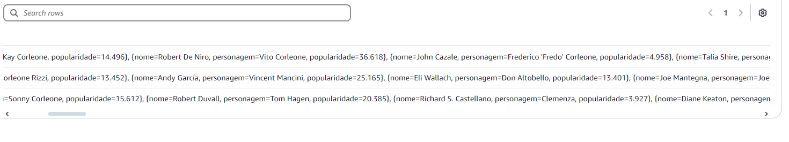

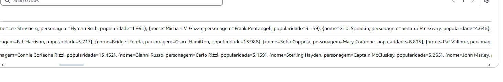

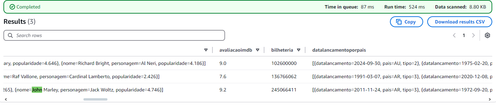

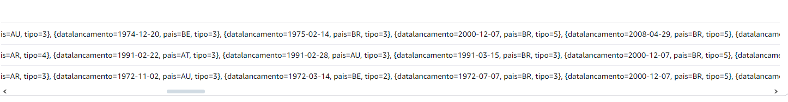

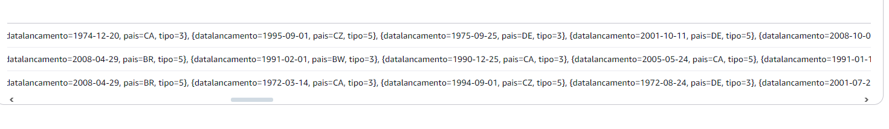

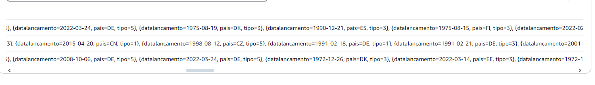

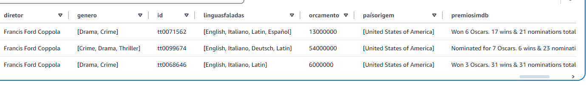

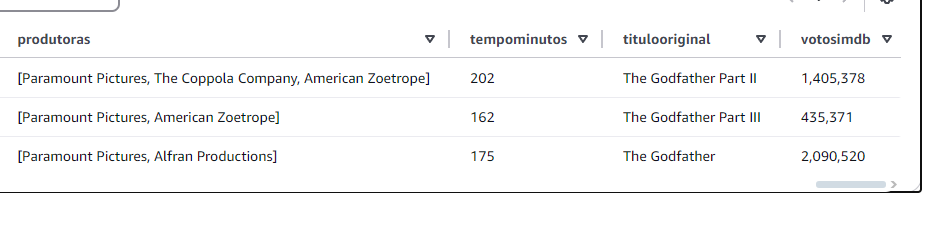


