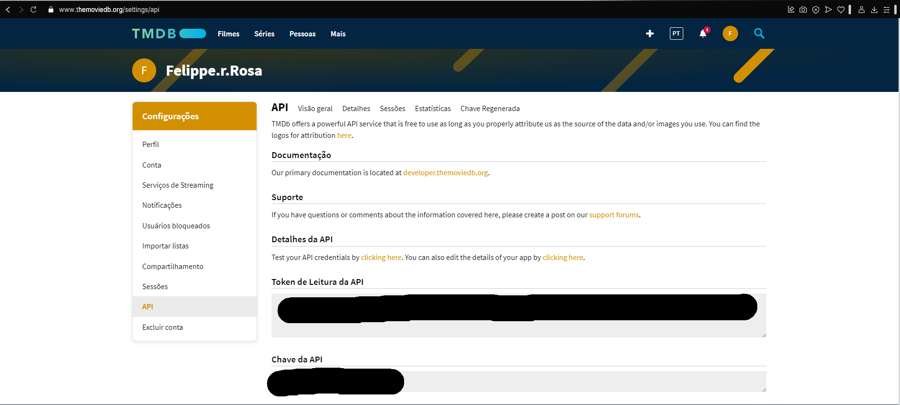
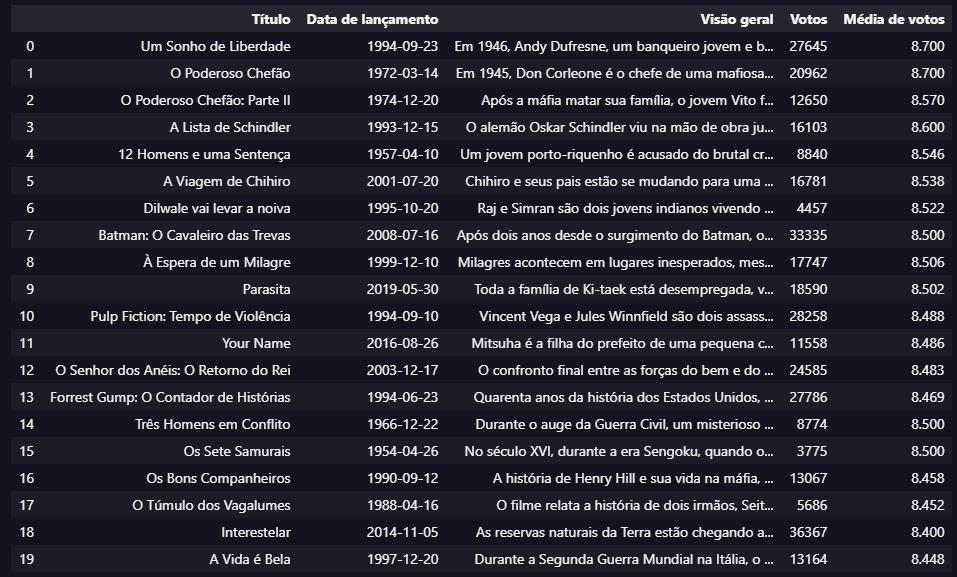

# Índice

- [Índice](#índice)
- [Resumo da Sprint 7](#resumo-da-sprint-7)
- [Certificados](#certificados)
    - [Não houve certificados nessa Sprint](#não-houve-certificados-nessa-sprint)
- [Exercícios](#exercícios)
  - [Apache Spark -](#apache-spark--)
  - [TMDB](#tmdb)
  - [Conta e API criada com sucesso](#conta-e-api-criada-com-sucesso)
  - [Testando as Credencias e a biblioteca](#testando-as-credencias-e-a-biblioteca)
  - [Resultado](#resultado)

   
   
# Resumo da Sprint 7
**Spark:** 

# Certificados

### Não houve certificados nessa Sprint


# Exercícios

## Apache Spark - 


## TMDB

## Conta e API criada com sucesso 




## Testando as Credencias e a biblioteca
```python
import requests
import pandas as pd
from IPython.display import display

api_key = "MINHA_CHAVE"
url = f"https://api.themoviedb.org/3/movie/top_rated?api_key={api_key}&language=pt-BR"


response = requests.get(url)
data = response.json()

filmes = []

for movie in data["results"]:
    df = {
        "Título": movie["title"],
        "Data de lançamento": movie["release_date"],
        "Visão geral": movie["overview"],
        "Votos": movie["vote_count"],
        "Média de votos": movie["vote_average"],
    }
    filmes.append(df)

df = pd.DataFrame(filmes)
display(df)
```
## Resultado



