# Desafio
O Desafio foca no processamento da camada Refined de um data lake onde fazemos a modelagem dimensional e as transformações dos arquivos da camada Trusted.
# Índice

- [Desafio](#desafio)
- [Índice](#índice)
  - [Tema do desafio](#tema-do-desafio)
  - [**1. Desempenho Comercial e Recepção Crítica**](#1-desempenho-comercial-e-recepção-crítica)
  - [**2. Análise de Personagens e Popularidade**](#2-análise-de-personagens-e-popularidade)
  - [**3. Evolução Narrativa e Temática**](#3-evolução-narrativa-e-temática)
  - [**4. Legado e Influência Cultural**](#4-legado-e-influência-cultural)
  - [**5. Premiações e Direção**](#5-premiações-e-direção)
- [API TMDB (The Movie Database)](#api-tmdb-the-movie-database)
- [API OMDB (Open Movie Database)](#api-omdb-open-movie-database)
- [O Desafio](#o-desafio)
  - [Job](#job)
  - [Resultados](#resultados)
    - [Athena](#athena)
      - [Tabelas](#tabelas)
      - [Tabela Fato](#tabela-fato)
      - [Tabela ator](#tabela-ator)
      - [Tabela diretor](#tabela-diretor)
      - [Tabela genero](#tabela-genero)
      - [Tabela linguas](#tabela-linguas)
      - [Tabela paises](#tabela-paises)
      - [Tabela produção](#tabela-produção)
      - [Tabela tempo](#tabela-tempo)


## Tema do desafio 

O tema do desafio será a trilogia do Poderoso Chefão, um clássico do cinema que não apenas marcou a história do cinema, mas também influenciou inúmeras outras obras cinematográficas. A trilogia, dirigida por Francis Ford Coppola, é baseada no romance de Mario Puzo e retrata a saga da família Corleone, explorando temas como poder, lealdade, traição e a complexidade das relações familiares.

As perguntas que serão analisadas foram dividas em 5 Categorias 


## **1. Desempenho Comercial e Recepção Crítica**  
**(Foco em bilheteria, orçamento e avaliações)**  
- **1.1** - Qual é a avaliação média de cada filme da trilogia, levando em consideração o número de votos?  
- **1.2** - Qual foi o desempenho de bilheteria de cada filme em comparação ao seu orçamento?  
- **1.3** - Qual o retorno financeiro de cada filme (bilheteria menos orçamento), e qual teve o maior lucro?  
- **1.4** - Como as avaliações evoluíram ao longo da trilogia?  
- **1.5** - Qual foi o filme mais popular entre os três, considerando métricas como bilheteria e avaliação crítica?**  
- **1.6** - Quais países esses filmes foram lançados?** 


## **2. Análise de Personagens e Popularidade**  
**(Foco na relevância dos personagens e sua evolução ao longo da trilogia)**  
- **2.1** - Qual personagem é mais popular em cada filme da trilogia? Como a popularidade varia ao longo dos filmes?  
- **2.2** - Quais personagens tiveram mais destaque no filme 2 e 3 em comparação ao 1? 


## **3. Evolução Narrativa e Temática**  
**(Foco em mudanças na história, temas principais e estilo do filme)**  
- **3.1** - Como a narrativa e os temas principais da trilogia evoluíram ao longo dos três filmes? Quais elementos (personagens, eventos, cenários) mudaram?  
- **3.2** - Por que diferenciam tanto Sicília de Itália?  
- **3.3** - Quais foram as línguas faladas durante a trilogia, e como isso refletiu a diversidade cultural no enredo?**  


## **4. Legado e Influência Cultural**  
**(Foco na recepção do público ao longo dos anos e impacto da trilogia no cinema e na cultura pop)**  
- **4.1** - Como a popularidade de *O Poderoso Chefão* se manteve ao longo das décadas, considerando relançamentos e a influência cultural?  
- **4.2** - Como o público respondeu ao final da trilogia, especialmente em relação à recepção mista de *The Godfather Part III* comparado ao sucesso dos filmes 1 e 2?  
- **4.3** - Como a popularidade da trilogia foi afetada ao longo dos anos, incluindo o impacto de novos públicos e reexibições?**  


## **5. Premiações e Direção**  
**(Foco nos prêmios, impacto das premiações e decisões criativas de Coppola)**  
- **5.1** - Quantos prêmios importantes cada filme ganhou?  
- **5.5** - Como as locações e ambientações geográficas impactaram a autenticidade e a narrativa, e como influenciaram as decisões do enredo?  


# API TMDB (The Movie Database)

A API do TMDB foi escolhida para este projeto devido a:

Ampla Base de Dados: Contém informações detalhadas sobre filmes, séries, diretores, elenco, empresas de produção e gêneros.

Disponibilidade de Informações Relevantes: Permite acesso a dados como orçamento, receita, popularidade, avaliação, gênero e sinopse.

Facilidade de Integração: Fornece endpoints bem documentados e de fácil uso para obtenção dos dados necessários.

Suporte a Consultas Avançadas: Permite filtrar filmes por gênero, ano de lançamento, diretores e outras informações essenciais para a análise.

# API OMDB (Open Movie Database)

A API do OMDB foi utilizada como complemento à API do TMDB, principalmente para obter informações que não estão disponíveis no TMDB, como:

Prêmios Recebidos: A API OMDB fornece detalhes sobre os prêmios que um filme ou série recebeu, o que é crucial para uma análise completa do impacto e reconhecimento da obra.

Contagem de Votos e Média de Avaliação: Embora o TMDB também forneça dados de avaliação, a API OMDB pode apresentar diferenças na contagem de votos e na média de avaliações, permitindo uma comparação mais abrangente.


# O Desafio 

## Job 

````python
import sys
from awsglue.transforms import *
from awsglue.utils import getResolvedOptions
from pyspark.context import SparkContext
from awsglue.context import GlueContext
from awsglue.job import Job
from pyspark.sql.functions import (
    current_date, lit, year, month, dayofmonth, split, explode, col, date_format, row_number, monotonically_increasing_id, trim, lower
)
from pyspark.sql.window import Window

# Obter argumentos do job
args = getResolvedOptions(sys.argv, ['JOB_NAME', 'S3_INPUT_PATH_1', 'S3_INPUT_PATH_2', 'S3_TARGET_PATH'])

# Criar contexto Spark e Glue
sc = SparkContext()
glueContext = GlueContext(sc)
spark = glueContext.spark_session
job = Job(glueContext)
job.init(args['JOB_NAME'], args)

# Ler os arquivos Parquet
df1 = spark.read.parquet(args['S3_INPUT_PATH_1'])
df2 = spark.read.parquet(args['S3_INPUT_PATH_2'])

# Renomear colunas para evitar problemas
df1 = df1.withColumnRenamed("paísOrigem", "pais_origem")
df2 = df2.withColumnRenamed("paísOrigem", "pais_origem")

# Padronizar tipos de colunas
df2 = df2.withColumn("tempoMinutos", df2["tempoMinutos"].cast("long"))

# Tratar a coluna 'genero'
df1 = df1.withColumn("genero", explode(col("genero")))
df2 = df2.withColumn("genero", explode(split(col("genero"), ",")))

# Adicionar colunas ausentes
for col_name in set(df1.columns) - set(df2.columns):
    df2 = df2.withColumn(col_name, lit(None))
for col_name in set(df2.columns) - set(df1.columns):
    df1 = df1.withColumn(col_name, lit(None))

# Unir os DataFrames
df = df1.unionByName(df2)

# Explodir a coluna 'pais_origem' para que cada país seja uma linha separada
df_explodido = df.withColumn("pais_origem", explode(col("pais_origem")))

# Explodir a coluna 'produtoras' para que cada produtora seja uma linha separada
df_explodido_produtoras = df_explodido.withColumn("produtora", explode(col("produtoras")))

# Explodir a coluna 'linguasFaladas' para que cada língua seja uma linha separada
df_explodido_linguas = df_explodido_produtoras.withColumn("lingua", explode(col("linguasFaladas")))

# Filtrar e garantir que valores nulos sejam removidos
df_explodido_linguas = df_explodido_linguas.filter(col("pais_origem").isNotNull())

# Explodir a coluna 'dataLancamentoPorPais' para acessar 'dataLancamento'
df_explodido_data = df.withColumn("dataLancamento", explode(col("dataLancamentoPorPais")))

# Acessar corretamente a coluna 'pais' dentro do struct 'dataLancamento'
dim_paises = df.selectExpr("explode(pais_origem) as pais") \
    .union(df_explodido_data.selectExpr("dataLancamento.pais as pais")) \
    .filter(col("pais").isNotNull()) \
    .filter(trim(col("pais")) != "") \
    .dropDuplicates() \
    .withColumn("pais", trim(col("pais"))) \
    .withColumn("id_paises", row_number().over(Window.orderBy(lit(1))))

dim_atores = df.selectExpr("explode(atores) as ator") \
               .selectExpr("ator.nome as nome_ator", "ator.personagem as personagem", "ator.popularidade as popularidade") \
               .dropDuplicates() \
               .withColumn("id_atores", row_number().over(Window.orderBy(lit(1))))

dim_diretores = df.selectExpr("diretor as nome_diretor") \
                  .filter(col("diretor").isNotNull()) \
                  .filter(col("diretor") != "") \
                  .dropDuplicates() \
                  .withColumn("id_diretores", row_number().over(Window.orderBy(lit(1))))

dim_produtoras = df.selectExpr("explode(produtoras) as nome_produtora").dropDuplicates() \
                   .withColumn("id_produtoras", row_number().over(Window.orderBy(lit(1))))

dim_generos = df.selectExpr("genero as nome_genero").dropDuplicates() \
                .withColumn("id_generos", row_number().over(Window.orderBy(lit(1))))

dim_linguas = df.selectExpr("explode(linguasFaladas) as nome_lingua").dropDuplicates() \
                .withColumn("id_linguas", row_number().over(Window.orderBy(lit(1))))

# Agora, podemos acessar o 'dataLancamento' diretamente
dim_tempo = df_explodido_data.select(
    col("dataLancamento.dataLancamento").alias("data"),  # Acessa o 'dataLancamento' dentro da estrutura
    year(col("dataLancamento.dataLancamento")).alias("ano"),
    month(col("dataLancamento.dataLancamento")).alias("mes"),
    dayofmonth(col("dataLancamento.dataLancamento")).alias("dia"),
    date_format(col("dataLancamento.dataLancamento"), "EEEE").alias("dia_da_semana"),
    date_format(col("dataLancamento.dataLancamento"), "MMMM").alias("nome_mes"),
).dropDuplicates()

# Criar df_filmes_pais para mapear filmes aos países
df_filmes_pais = df_explodido_linguas.select(
    col("id").alias("id_filme"),
    col("pais_origem").alias("pais")
).dropDuplicates()

# Agora, faz o join entre df_filmes_pais e dim_paises
df_filmes_pais = df_filmes_pais.join(
    dim_paises, df_filmes_pais["pais"] == dim_paises["pais"], "left"
).select(
    col("id_filme"), dim_paises["id_paises"]
)

# Explodir a coluna de atores para que cada ator seja uma linha separada
df_explodido_atores = df_explodido_linguas.withColumn("ator", explode(col("atores"))) \
    .withColumn("nome_ator", col("ator.nome"))

# Agora, fazemos o join entre a tabela de fato e a tabela dim_atores, utilizando o nome do ator
fato_filmes = df_explodido_atores \
    .join(dim_tempo, df_explodido_atores["anoLancamento"] == dim_tempo["ano"], "left") \
    .join(dim_diretores, df_explodido_atores["diretor"] == dim_diretores["nome_diretor"], "left") \
    .join(df_filmes_pais, df_explodido_atores["id"] == df_filmes_pais["id_filme"], "left") \
    .join(dim_produtoras, df_explodido_atores["produtora"] == dim_produtoras["nome_produtora"], "left") \
    .join(dim_generos, df_explodido_atores["genero"] == dim_generos["nome_genero"], "left") \
    .join(dim_linguas, df_explodido_atores["lingua"] == dim_linguas["nome_lingua"], "left") \
    .join(dim_atores, df_explodido_atores["nome_ator"] == dim_atores["nome_ator"], "left") \
    .select(
        df_explodido_atores["id"].alias("id_filmes"),
        df_explodido_atores["tituloOriginal"],
        df_explodido_atores["anoLancamento"],
        df_explodido_atores["avaliacaoIMDB"],
        df_explodido_atores["votosIMDB"],
        df_explodido_atores["premiosIMDB"],
        df_explodido_atores["bilheteria"],
        df_explodido_atores["orcamento"],
        df_explodido_atores["tempoMinutos"],
        dim_tempo["data"],
        dim_diretores["id_diretores"],
        df_filmes_pais["id_paises"],
        dim_produtoras["id_produtoras"],
        dim_generos["id_generos"],
        dim_linguas["id_linguas"],
        dim_atores["id_atores"] 
    ).dropDuplicates(["id_filmes"])

# Caminho de destino no S3
refined_path = args['S3_TARGET_PATH']

# Salvar tabelas no S3
dim_atores.write.mode("overwrite").parquet(f"{refined_path}dim_atores/")
dim_tempo.write.mode("overwrite").parquet(f"{refined_path}dim_tempo/")
dim_paises.write.mode("overwrite").parquet(f"{refined_path}dim_paises/")
dim_diretores.write.mode("overwrite").parquet(f"{refined_path}dim_diretores/")
dim_produtoras.write.mode("overwrite").parquet(f"{refined_path}dim_produtoras/")
dim_generos.write.mode("overwrite").parquet(f"{refined_path}dim_generos/")
dim_linguas.write.mode("overwrite").parquet(f"{refined_path}dim_linguas/")
fato_filmes.write.mode("overwrite").parquet(f"{refined_path}fato_filmes/")

# Finalizar job
job.commit()

````
 

## Resultados

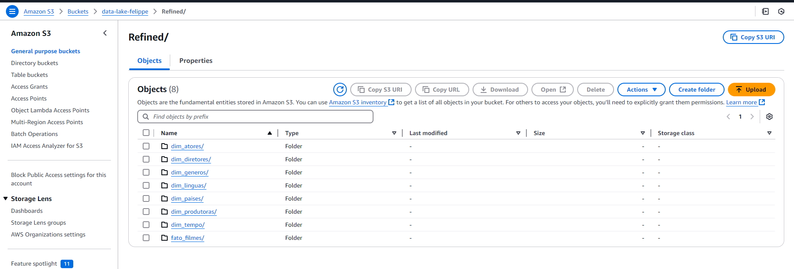


### Athena

#### Tabelas
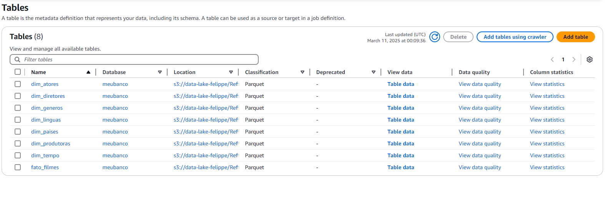

#### Tabela Fato
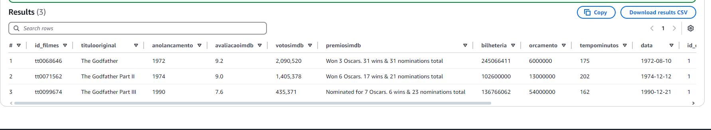
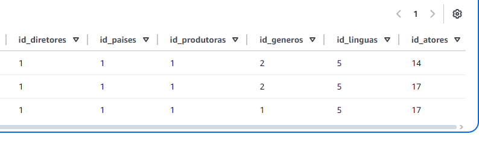

#### Tabela ator
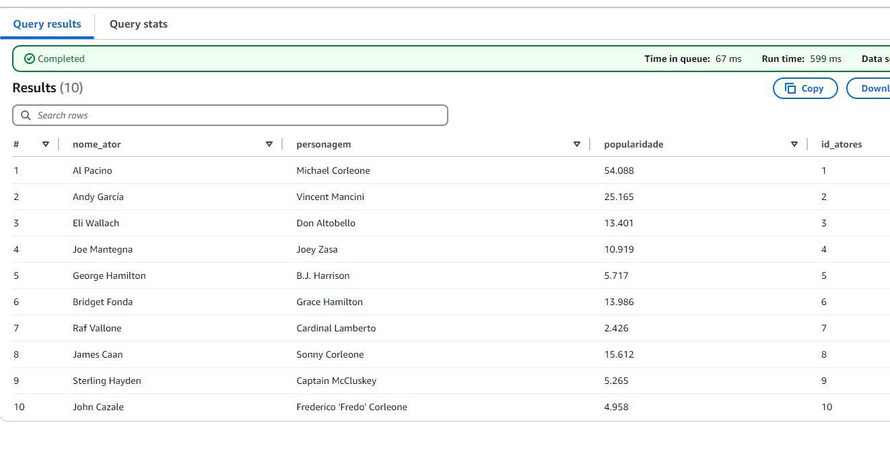

#### Tabela diretor
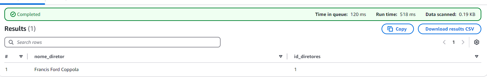

#### Tabela genero
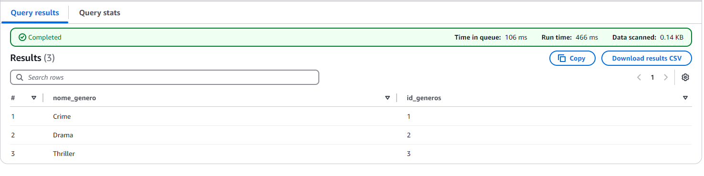

#### Tabela linguas
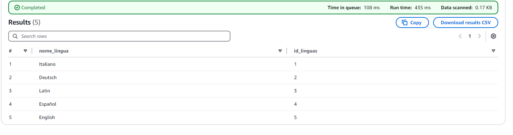

#### Tabela paises
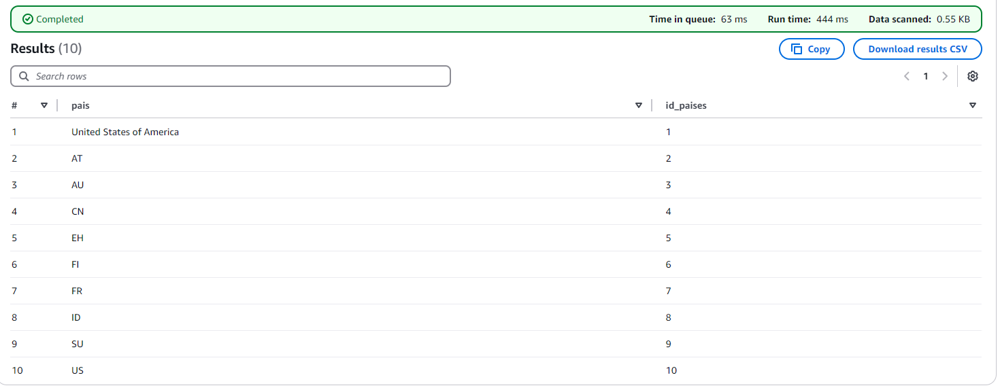

#### Tabela produção
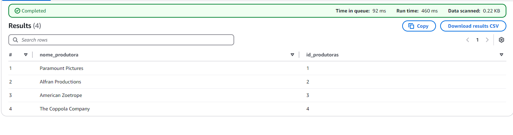

#### Tabela tempo
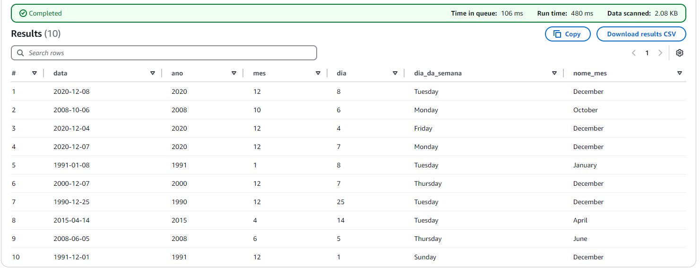

