# Desafio
O Desafio foca no processamento da camada Refined de um data lake onde fazemos a modelagem dimensional e as transformações dos arquivos da camada Trusted.
# Índice

- [Desafio](#desafio)
- [Índice](#índice)
  - [Tema do desafio](#tema-do-desafio)
  - [**1. Desempenho Comercial e Recepção Crítica**](#1-desempenho-comercial-e-recepção-crítica)
  - [**2. Análise de Personagens e Popularidade**](#2-análise-de-personagens-e-popularidade)
  - [**3. Evolução Narrativa e Temática**](#3-evolução-narrativa-e-temática)
  - [**4. Legado e Influência Cultural**](#4-legado-e-influência-cultural)
  - [**5. Premiações e Direção**](#5-premiações-e-direção)
- [O Desafio](#o-desafio)
  - [Parte 1](#parte-1)
  - [Parte 2](#parte-2)
  - [Parte 3](#parte-3)
  - [Retorno Financeiro por Filme](#retorno-financeiro-por-filme)
  - [Comparação entre Bilheteria e Orçamento](#comparação-entre-bilheteria-e-orçamento)
  - [Popularidade dos Filmes](#popularidade-dos-filmes)
  - [Evolução Das Avaliações ao Longo da Trilogia](#evolução-das-avaliações-ao-longo-da-trilogia)
  - [Países onde os Filmes Foram Lançados](#países-onde-os-filmes-foram-lançados)
  - [Produtoras](#produtoras)
  - [Diferenças entre Sicília e Itália na Trilogia](#diferenças-entre-sicília-e-itália-na-trilogia)

## Tema do desafio 

O tema do desafio será a trilogia do Poderoso Chefão, um clássico do cinema que não apenas marcou a história do cinema, mas também influenciou inúmeras outras obras cinematográficas. A trilogia, dirigida por Francis Ford Coppola, é baseada no romance de Mario Puzo e retrata a saga da família Corleone, explorando temas como poder, lealdade, traição e a complexidade das relações familiares.

As perguntas que serão analisadas foram dividas em 5 Categorias 

## **1. Desempenho Comercial e Recepção Crítica**  
**(Foco em bilheteria, orçamento e avaliações)**  
- **1.1** - Qual é a avaliação média de cada filme da trilogia, levando em consideração o número de votos?  
- **1.2** - Qual foi o desempenho de bilheteria de cada filme em comparação ao seu orçamento?  
- **1.3** - Qual o retorno financeiro de cada filme (bilheteria menos orçamento), e qual teve o maior lucro?  
- **1.4** - Como as avaliações evoluíram ao longo da trilogia?  
- **1.5** - Qual foi o filme mais popular entre os três, considerando métricas como bilheteria e avaliação crítica?**  
- **1.6** - Quais países esses filmes foram lançados?** 

## **2. Análise de Personagens e Popularidade**  
**(Foco na relevância dos personagens e sua evolução ao longo da trilogia)**  
- **2.1** - Qual personagem é mais popular em cada filme da trilogia? Como a popularidade varia ao longo dos filmes?  
- **2.2** - Quais personagens tiveram mais destaque no filme 2 e 3 em comparação ao 1? 

## **3. Evolução Narrativa e Temática**  
**(Foco em mudanças na história, temas principais e estilo do filme)**  
- **3.1** - Como a narrativa e os temas principais da trilogia evoluíram ao longo dos três filmes? Quais elementos (personagens, eventos, cenários) mudaram?  
- **3.2** - Por que diferenciam tanto Sicília de Itália?  
- **3.3** - Quais foram as línguas faladas durante a trilogia, e como isso refletiu a diversidade cultural no enredo?**  

## **4. Legado e Influência Cultural**  
**(Foco na recepção do público ao longo dos anos e impacto da trilogia no cinema e na cultura pop)**  
- **4.1** - Como a popularidade de *O Poderoso Chefão* se manteve ao longo das décadas, considerando relançamentos e a influência cultural?  
- **4.2** - Como o público respondeu ao final da trilogia, especialmente em relação à recepção mista de *The Godfather Part III* comparado ao sucesso dos filmes 1 e 2?  
- **4.3** - Como a popularidade da trilogia foi afetada ao longo dos anos, incluindo o impacto de novos públicos e reexibições?**  

## **5. Premiações e Direção**  
**(Foco nos prêmios, impacto das premiações e decisões criativas de Coppola)**  
- **5.1** - Quantos prêmios importantes cada filme ganhou?  
- **5.5** - Como as locações e ambientações geográficas impactaram a autenticidade e a narrativa, e como influenciaram as decisões do enredo?  

# O Desafio 
 
## Parte 1
Primeiramente, importamos os datasets gerados na Sprint 09:

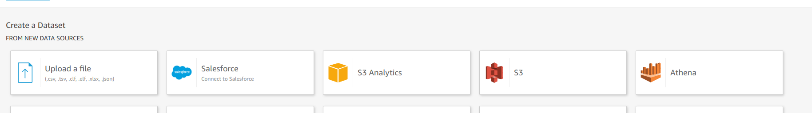

Após a importação, os dados ficam organizados conforme mostrado abaixo:
  
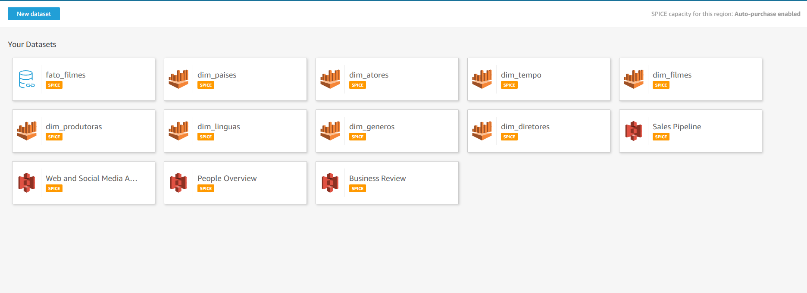

## Parte 2

Em seguida, realizamos o left **join** para integrar os dados à tabela fato:

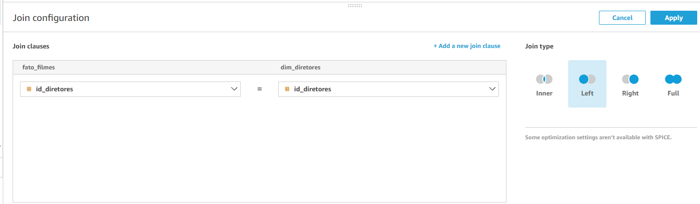

Este processo foi repetido para todos os datasets. O resultado final dos joins é o seguinte:

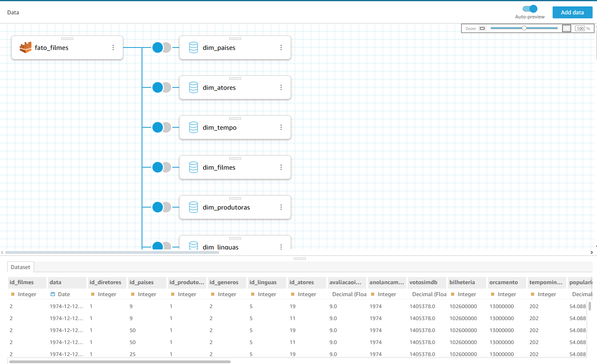

Após concluir esses passos, é possível iniciar a criação do dashboard.

## Parte 3
Esee é o resultado do meu dashbord.

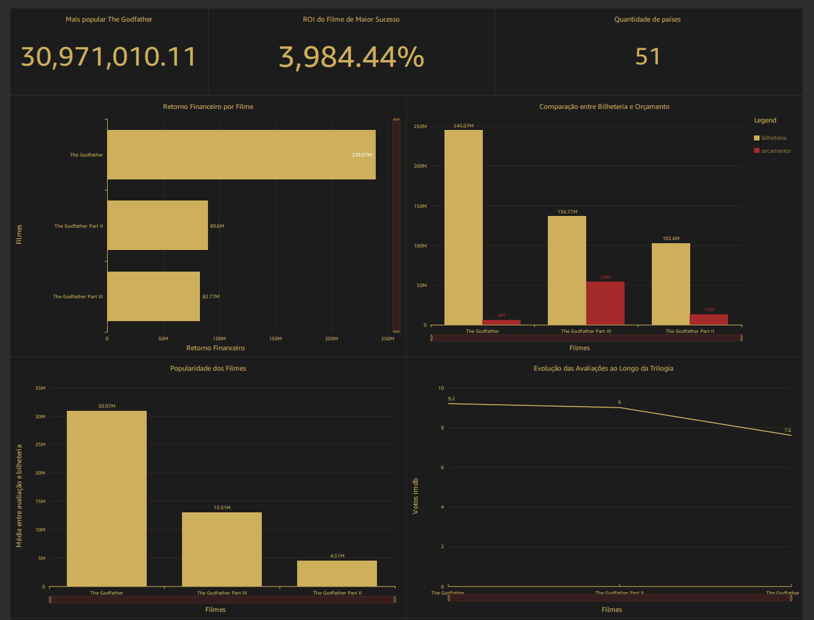

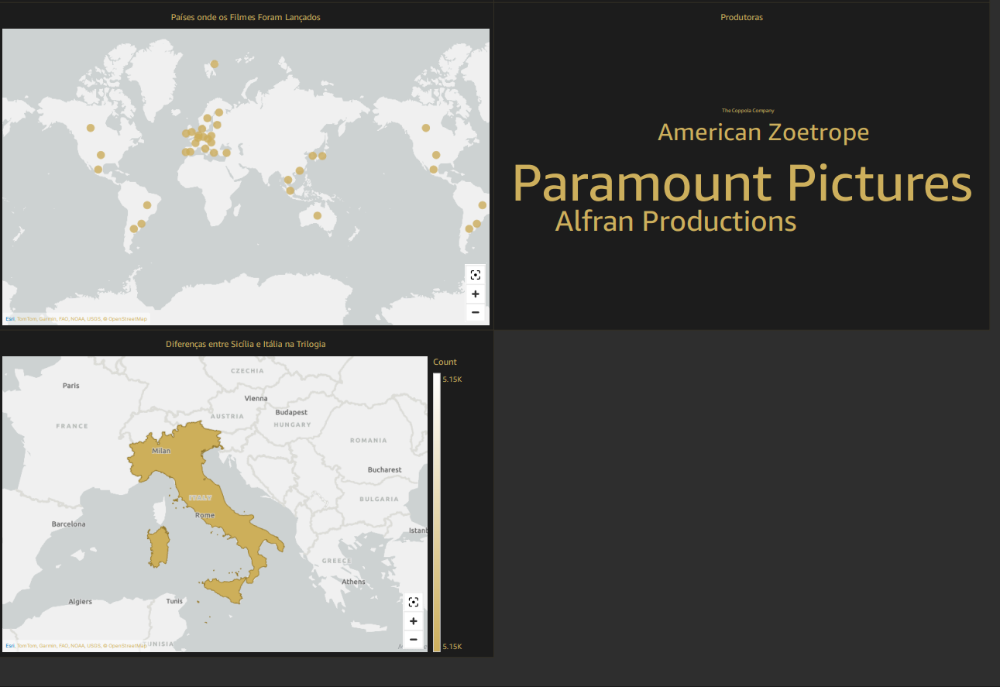

## Retorno Financeiro por Filme

O gráfico de barras abaixo mostra o retorno financeiro (Lucro Bruto) de cada filme, calculado subtraindo os custos de produção das receitas totais, também é apresentado uma KPI com o ROI do filme com mais retorno.

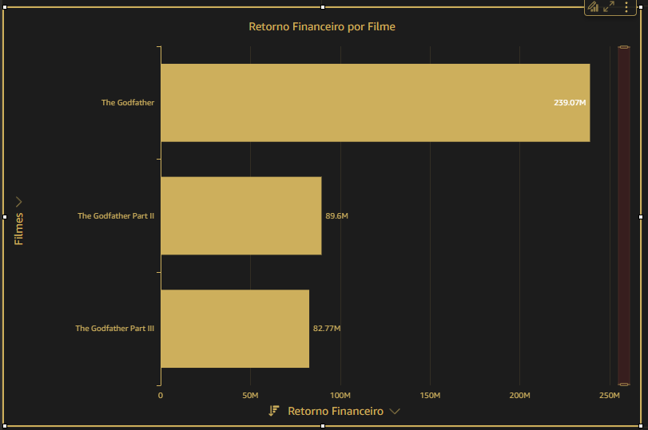

Foi usado o campo calculado de seguinde forma: 

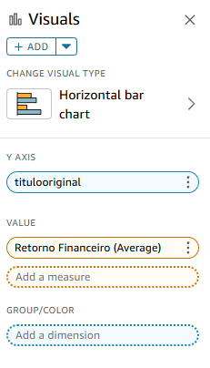

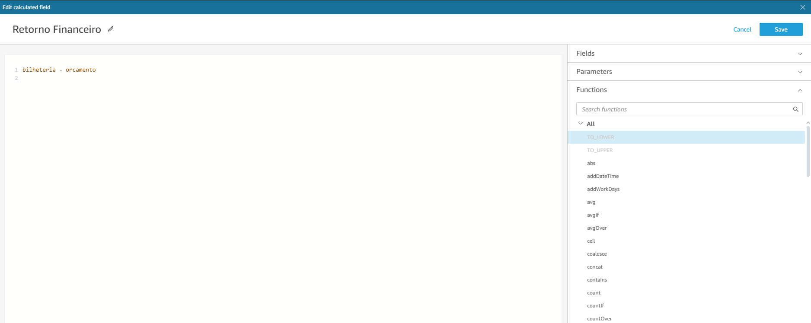

Foi usado o campo ROI calculado de seguinde forma: 

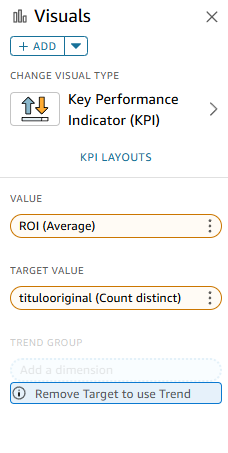

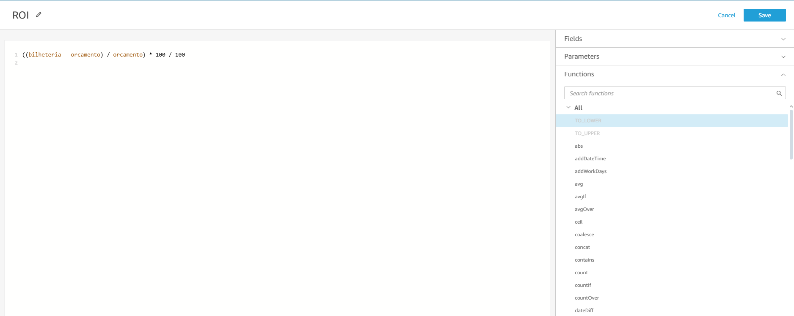

## Comparação entre Bilheteria e Orçamento 

O gráfico de barras abaixo mostra a comparação entre a bilheteria e orçamento de cadae filme.

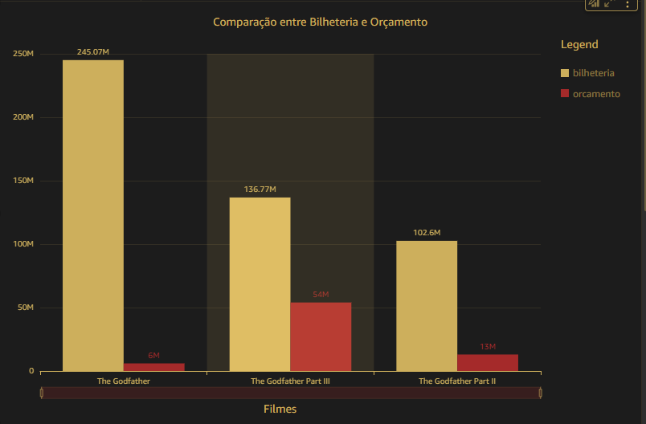

Foi usado somente campos do próprio dataset:

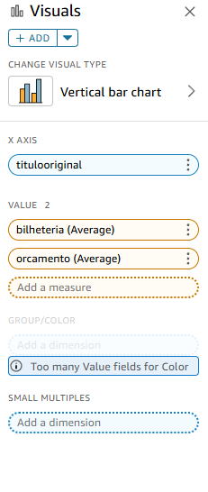

## Popularidade dos Filmes 

O gráfico de barras abaixo mostra a popularidade de cada filme, calculado a média entre avaliação e bilheteria, também o filme uma KPI com o filme mais popular.

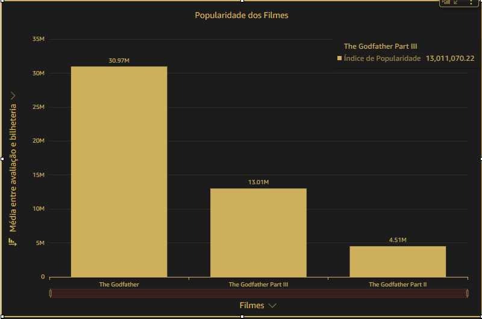

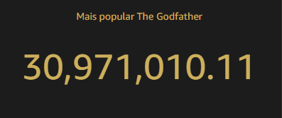

Foi usado o campo calculado de seguinde forma:

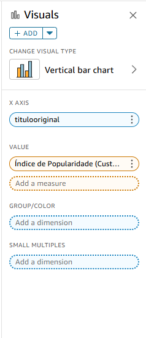

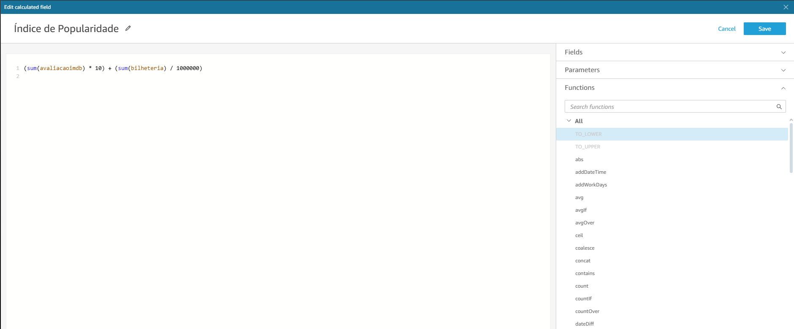

## Evolução Das Avaliações ao Longo da Trilogia

O gráfico de linhas abaixo mostra as avaliações de cada filme.

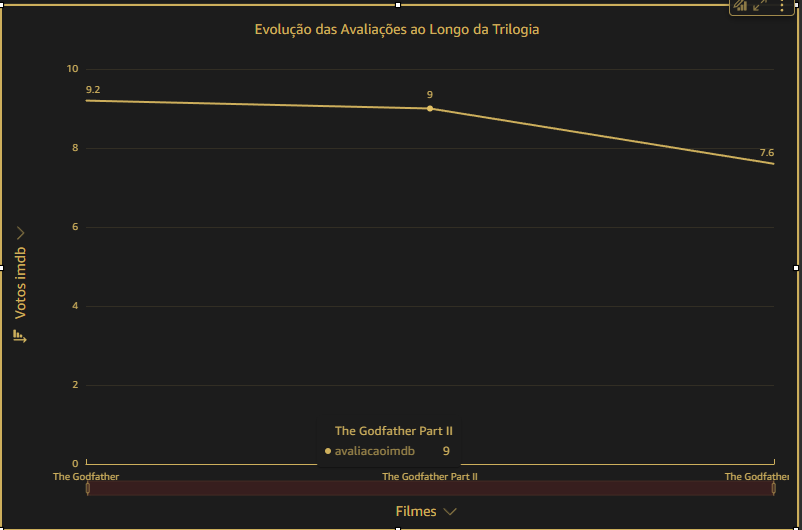

Foi usado somente campos do próprio dataset:

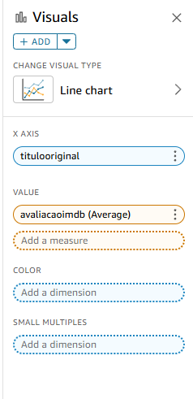

## Países onde os Filmes Foram Lançados

O gráfico abaixo mostra a geolocalização de cade país onde cada filme foi lançado.

Foi usado somente campos do próprio dataset:

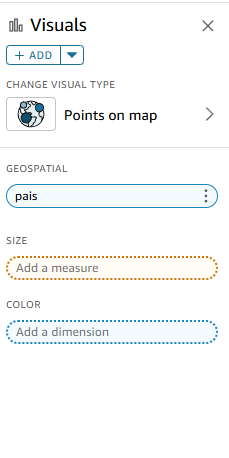

## Produtoras

Word Cloud abaixo mostra as produtoras de cada filme.

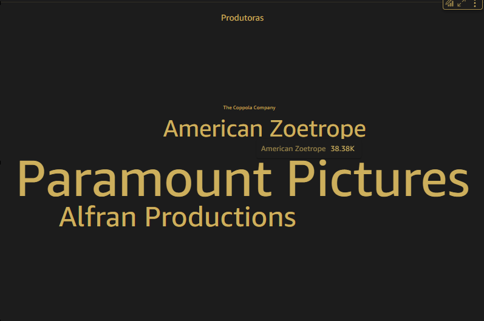

Foi usado somente campos do próprio dataset:

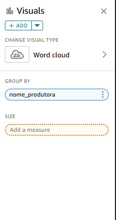

## Diferenças entre Sicília e Itália na Trilogia

O gráfico abaixo mostra a geolocalização da Italia e ao sul é destacado Siciília onde é retratada pela influência das tradições mafiosas sicilianas, que moldam as famílias mafiosas e suas relações de poder.

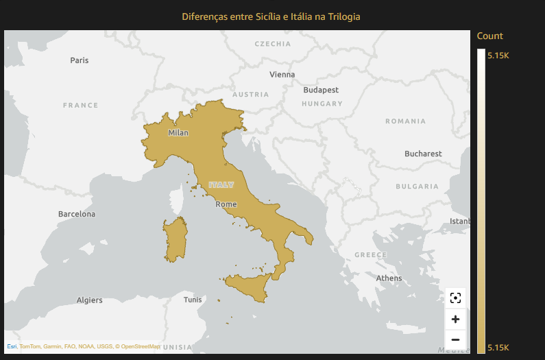

Foi usado somente campos do próprio dataset:

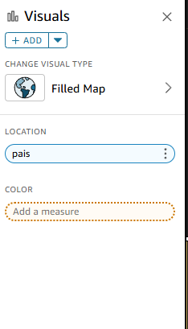